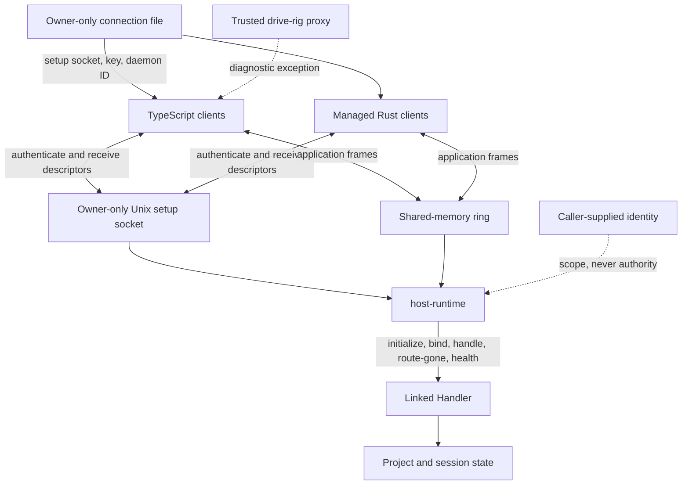
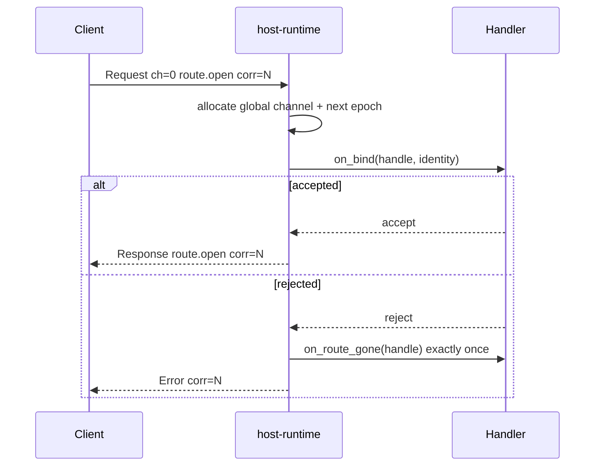
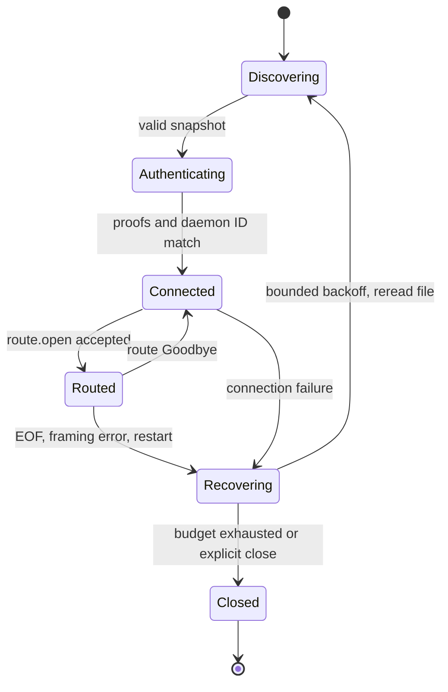

# `host-runtime` Wire Protocol and Handshake

Status: normative direct-linked static three-target profile

## 1. Conformance and authority

The key words **MUST**, **MUST NOT**, **SHOULD**, **SHOULD NOT**, and **MAY** are normative as defined by RFC 2119 and RFC 8174.

This document is the direct-only wire authority. `host-runtime` owns the Rust wire, authentication, discovery, control, routing, and managed-client contracts. Repository implementations and conformance tests provide executable evidence; historical published-package behavior is provenance only and cannot enable a compatibility path.

The host wire has exactly one contract. It carries no version field, numbered revision, negotiation, or skew path, and the daemon, both plugins, the CLI, and the fixtures ship it from one build. Canonical literals are part of this contract; in particular `host_ops`, `connection.json`, `EIDNARA_MODULE_ID`, `EIDNARA_LAUNCH_NONCE`, `eidnara-server`, and `eidnara-client`. A change to any wire name, literal, or shape lands in one change with this document and every Rust and TypeScript peer.

Connection identity, never a version number, fences a stale process. A client authenticates only against the incarnation whose publication it read: the proofs bind that publication's key, daemon ID, and daemon build string (Section 5.2), so a key or daemon ID from another incarnation or a replaced daemon process fails authentication before any envelope is exchanged, and a peer still computing the former proof domains fails the same way. Connection generations and route epochs then fence every later frame (Sections 8 and 12). Build identity across one release is fenced by the lifecycle payload-manifest digest the launcher checks at start (Section 4.3); the one-build rule above keeps every running peer on the same shape.

## 2. Profile, actors, and trust boundary

`host-runtime` directly links one static composite handler and serves exactly three immutable modules: `context` (role `tool_provider`), `local_embeddings` (role `management_surface`), and `model_execution` (role `management_surface`). The composition is fixed at startup: there is no dynamic registration, catalog mutation, plugin loading, or module supervision, and `host-runtime` is not a remote transport.

Actors:

- **Host:** `host-runtime`; owns credentials, connection generations, ring setup, channels, epochs, correlations, and component lifecycle.
- **Managed TypeScript client:** `HostClient` and `HostModuleTransport`; own secure discovery, authentication, mandatory ring attachment, route epochs, deadlines, cancellation, Ping/Pong, and cleanup for plugin, LocalEmbeddings, wake-plane, CLI, and fixture callers.
- **Managed Rust client:** `host_runtime::Client`; owns the same boundary for `HistorySummarizerProducer` and Rust fixtures, including typed send outcomes, streaming, checked correlation allocation, reserved control admission, and deterministic close.
- **Handler:** the directly linked static composite; receives initialization, target-aware bind, request, route-gone, internal health, and shutdown callbacks and dispatches each to `context`, `local_embeddings`, or `model_execution`.

The 32-byte connection key is a bearer capability. Possession grants every direct-profile operation, including host-global `host.shutdown` (Section 7.6), and permits any `BindIdentity`. Client `role`, `consumer_identity`, `project_root`, `harness`, and `session` are claims or scoping metadata; none grants authority. A key reader MUST therefore be trusted as the same local security principal as the host, and every key reader is stop-capable: a diagnostic or proxy principal that holds the bearer is not read-only, whatever its role label or mount permissions claim.

Production application transport is the local shared-memory ring. The owner-only Unix setup socket carries authentication and descriptor transfer only, remains open as a peer-lifetime sentinel, and cannot carry application frames. Remote transport is unsupported.

Initial secure publication support is Unix-like systems. Windows support is deferred until atomic replacement, ACL validation, instance locking, link handling, and ownership-fenced cleanup have a reviewed contract.



## 3. Terms

- **Host incarnation:** one process lifetime with one fresh key and daemon ID.
- **Connection generation:** client-local identity for one authenticated ring connection. It is not sent on wire.
- **Catalog generation:** `u64` catalog-state version returned by `catalog.list`; unrelated to connection generation.
- **Route handle:** `(channel, epoch)` created by the host before invoking handler bind and published to the client only after bind succeeds. A rejected bind still observed the handle, which is why route-gone fires exactly once on rejection (Section 8.2).
- **Live channel:** nonzero `u16` route slot from one host-global namespace across all consumer connections.
- **Route epoch:** nonzero `u32` incarnation of a channel. Reuse is allowed only after prior cleanup and at a strictly higher epoch.
- **Correlation:** nonzero `u64` request identity allocated monotonically within one connection generation. Each direction owns an independent correlation namespace: host-originated correlations (`Ping`) and consumer-originated correlations never collide even when numerically equal.
- **Full request identity:** `(connection generation, direction, channel, epoch, correlation)`. Direction is implied on wire by frame type, never encoded as bytes.
- **Terminal frame:** first matching `Response`, `Error`, or `StreamEnd` for a correlation.
- **`not_sent`:** sender proves the request frame was not published to the ring.
- **`outcome_unknown`:** any request with a partial, completed, or uncertain write whose terminal frame was not observed.
- **`terminal`:** matching terminal frame was observed; its success or failure applies only to that correlation.
- **Transport-ready:** setup socket bound, handler initialized, and connection file published.
- **Storage-ready:** linked handler can serve storage-dependent operations. Transport readiness does not imply it.

## 4. Discovery and credential publication

### 4.1 Canonical path and shape

Clients MUST read `${dataDir}/eidnara/run/connection.json`. Host and client configuration MAY supply an explicit equivalent path. The host MUST publish exactly this shape:

```json
{
  "setup_socket": "/home/user/.local/share/eidnara/run/setup.sock",
  "key": [0, 1, 2, 3, 4, 5, 6, 7, 8, 9, 10, 11, 12, 13, 14, 15, 16, 17, 18, 19, 20, 21, 22, 23, 24, 25, 26, 27, 28, 29, 30, 31],
  "daemon_id": [96, 97, 98, 99, 100, 101, 102, 103, 104, 105, 106, 107, 108, 109, 110, 111],
  "pid": 4242,
  "daemon_ver": "eidnara-host/0.1.0"
}
```

Example bytes are deterministic and non-secret. Real key and daemon-ID bytes MUST come from the OS CSPRNG.

A client MUST:

1. open the parent and connection file without following links, then take one descriptor-anchored regular-file snapshot capped at 65,536 bytes;
2. reject a larger file before JSON parsing;
3. require a nonempty absolute `setup_socket` path, exactly 32 key bytes, exactly 16 daemon-ID bytes, a numeric PID, and a nonempty daemon version;
4. verify owner-only regular-file metadata before and after the read and verify the directory entry still names the same file;
5. dial `setup_socket` as a Unix stream socket;
6. reject a relative `setup_socket`, since the host resolves it from its own data directory and a relative path names a different socket for a client with another working directory;
7. reject replacement and insecure ownership or permissions.

The validated descriptor snapshot is the sole source of credentials and setup-socket authority. A client MUST NOT validate by pathname and then reopen that pathname for the key, daemon ID, or setup socket.

Publication and acceptance require exactly 32 key bytes so all direct implementations use one credential shape.

### 4.2 File and link safety

The host MUST acquire a single-instance lock before minting credentials, binding, publishing, or removing the file. The runtime directory and lock MUST be owner-controlled. Publication MUST:

1. generate a fresh 32-byte key and 16-byte daemon ID for every host incarnation;
2. create a unique owner-only temporary regular file in the directory containing the resolved canonical path (by default `${dataDir}/eidnara/run/`; a configured equivalent path per Section 4.1 uses its own directory), so both names share one filesystem and `rename(2)` cannot fail `EXDEV`, without following links;
3. write complete JSON, flush it as required by deployment durability policy, and atomically rename it over the canonical path;
4. leave the final file mode `0600` with no group or other permission bits;
5. redact key bytes in logs, errors, panic formatting, metrics, and diagnostics.

Stale publication temporaries matching the host's private naming pattern MAY be removed after ten minutes. Cleanup is best effort and MUST NOT delay publication. The host MUST never publish through a symlink.

Host publication, client discovery, and cleanup MUST reject symbolic links and unsafe ancestors. Deployment bind mounts are outside pathname traversal; the mounted file must still pass regular-file, owner, mode, bounded-read, replacement, and descriptor-identity checks.

Shutdown removal MUST occur while the instance lock is held. Before unlinking, the host MUST reread metadata without following links and confirm that the file is its own publication, including matching daemon ID. An old process MUST NOT remove a replacement host's credential. The handler is dropped before lock release.

### 4.3 Lifecycle record and native state probe

The host additionally maintains `${dataDir}/eidnara/run/host-lifecycle.json`, an owner-only (0600) strict record written atomically through the same pinned runtime-directory descriptor as the publication:

```json
{
  "phase": "running",
  "launch_id": "<32 lowercase hex>",
  "daemon_id": "<32 lowercase hex>",
  "payload_manifest_digest": "<64 lowercase hex>",
  "pid": 4242,
  "written_at_ms": 1755838080000
}
```

`payload_manifest_digest` is the canonical 64-character lowercase-hex payload manifest digest. Any other value is corruption, and the record is rejected as malformed.

`phase` is `starting` (after lock acquisition, before publication), `running` (after publication), or `stopping` (from graceful-shutdown step 1). `pid` is display metadata only: no reader may signal it, infer liveness from it, or authorize anything with it. Record cleanup is fenced by matching launch and daemon identity and runs under the instance lock before lock release, mirroring publication cleanup.

`payload_manifest_digest` is required payload identity: exactly 64 lowercase hex characters, validated as host input before any lock is taken, and byte-identical across every `starting`, `running`, and `stopping` record one incarnation writes. The record has one shape: exactly the keys above, each with a valid value. Bytes of any other shape, including an added, missing, or renamed key or an empty or noncanonical digest, are a corrupt record. A corrupt record never supports a `running` classification, and a host start under the fences replaces it with its own record.

Lifecycle state is derived from lock ownership plus this evidence, never from PID existence. Two locks participate: the stable lifetime fence (`lifetime.lock`, below) and the runtime-directory instance lock.

| Lifetime fence | Instance lock | Evidence | State |
| --- | --- | --- | --- |
| free | free | anything, including stale or corrupt record or publication | `stopped`; nothing is unlinked |
| held | free (or the runtime directory is missing) | anything | `wedged` after a bounded reread: a live incarnation's namespace was replaced, or a start/teardown window persisted |
| free | held | anything | `wedged` after a bounded reread: a holder without the stable fence is never coherent |
| held | held | fresh `starting` record, with or without a predecessor's leftover publication | `starting` |
| held | held | `running` record and publication with the same daemon ID | `running` |
| held | held | `running` record with a missing or daemon-ID-mismatched publication | `wedged` |
| held | held | fresh `stopping` record, with or without a predecessor's leftover publication | `stopping` |
| held | held | missing, corrupt, insecure, or expired *record*, or a corrupt or insecure *publication* (any phase) | `wedged` |

A missing publication is `wedged` only under a `running` record (the row above); `starting` and `stopping` require no publication at all. A free replacement runtime-directory lock is never proof that the first daemon ended; only the stable lifetime fence proves that.

A publication whose daemon ID differs from the record's is crash residue during `starting` and `stopping`: a killed incarnation leaves its publication behind, and its successor writes a `starting` record before its own publication overwrites the file (symmetrically, an incarnation that fails before publishing demotes to `stopping` without ever owning the leftover). Only the `running` claim requires the publication to match the record; the freshness windows still age a hung start or stop to `wedged`.

`wedged` is observational: probes and clients MUST NOT kill processes, break locks, or repair files. Probes use a validation-only opener (no create, no chmod, no link following, and no blocking on a non-regular file), test the instance lock nonblockingly and in shared mode so concurrent probes cannot alias each other into a false holder reading, and reread evidence boundedly when identities change mid-sample. Because a daemon must hold the instance lock before it can write its `starting` record, a held lock with no record is rechecked over a bounded grace window before it classifies `wedged`. An evidence name that is present but not a secure regular file (a symlink, FIFO, directory, or wrong owner or mode) is `insecure`, never `missing`.

Cross-process lifecycle serialization lives in a fixed, version-neutral, owner-only directory directly under the data root: `${dataDir}/.eidnara-coordination/`, containing the never-renamed regular files `transaction.lock` and `lifetime.lock`. Supported code never renames, replaces, or unlinks the directory or either file; same-UID replacement of that root or an ancestor is trusted-policy replacement outside this boundary.

- `transaction.lock` carries the exclusive flock serializing mutating lifecycle transactions (launcher start/stop, owned by downstream packaging work); probes take it shared, without creating anything, when it exists. Shared acquisition is bounded, not awaited: four attempts 25 ms apart, after which a probe that still finds a mutator holding the lock samples on evidence alone. A probe therefore does not always exclude an in-flight mutation, and may observe an intermediate lifecycle state; the bounded reread loop, not the lock, is what makes such a sample coherent. Lock absence degrades the same way, since a probe never creates the coordination root.
- `lifetime.lock` carries the daemon's whole-incarnation exclusive flock, acquired before the runtime-directory instance lock and held through publication cleanup, component shutdown, and callback reaping.

Neither the runtime-directory inode nor a lock on the managed `${dataDir}/eidnara/lifecycle` directory prevents replacement-induced overlap on its own: both live inside the replaceable managed subtree, so renaming `run`, `lifecycle`, or the whole `eidnara` tree would let a successor anchor fresh inodes under the same names. Because the coordination files sit outside that subtree and are never renamed, replacing the managed subtree cannot split either lock: a mutator still contends on the same `transaction.lock` inode, and a successor daemon still blocks on the same `lifetime.lock` inode until the displaced incarnation fully tears down. The runtime-directory instance lock remains as the descriptor-relative publication/cleanup fence. A mutator holding `transaction.lock` must additionally anchor named-namespace mutations to retained `eidnara`/child descriptors and abort its named-namespace result when parent or child identity drifts.

## 5. Pre-envelope authentication

### 5.1 Admission and framing

Authentication starts when the owner-only setup socket accepts a peer and uses one absolute deadline across every length read, body read, write, comparison, descriptor transfer, and failed-handshake shutdown. Recommended host default is 2 seconds, matching current clients; deployment MAY shorten it but MUST publish a client-compatible value operationally.

The host MUST bound unauthenticated handshake slots separately from authenticated connections. Excess accepts MUST be closed immediately without reading client bytes. Every success, parse failure, proof failure, timeout, EOF, or shutdown MUST release its slot. Slot count is finite deployment policy, not a wire constant.

Each authentication message is `u32` little-endian byte length followed by that many UTF-8 JSON bytes. Length MUST be at most 4,096. Length 4,096 is valid; 4,097 is rejected before allocation. EOF during either prefix or body fails authentication.

### 5.2 Messages and proofs

Host-owned authentication uses these fixed parameters:

| Parameter | Value |
| --- | --- |
| Client nonce | 32 OS-CSPRNG bytes |
| Server nonce | 32 OS-CSPRNG bytes |
| Proof | 32-byte HMAC-SHA256 |
| Server domain | ASCII `eidnara-server` |
| Client domain | ASCII `eidnara-client` |

Only lengths and domains are constants. Both nonces MUST be freshly generated from the OS CSPRNG for every handshake attempt and MUST NOT be reused within or across connections or host incarnations. Server-nonce freshness is the replay defense: a reused server nonce would let an observer replay a previously captured `client_auth` under a replayed client nonce.

Exchange:

```mermaid
sequenceDiagram
  participant C as Client
  participant H as host-runtime
  C->>H: ClientHello {client_nonce, role}
  H-->>C: ServerProof {daemon_id, server_nonce, daemon_ver, server_proof}
  Note over C: verify server proof, then daemon ID, then daemon version
  C->>H: ClientAuth {client_auth}
  Note over H: constant-time verify
  H-->>C: two ring descriptors + activation data
  Note over C,H: validate current identity, attach, commit; ring traffic enabled
```

Canonical JSON shapes:

```json
{"client_nonce":[32,33,34,35,36,37,38,39,40,41,42,43,44,45,46,47,48,49,50,51,52,53,54,55,56,57,58,59,60,61,62,63],"role":"client"}
```

```json
{"daemon_id":[96,97,98,99,100,101,102,103,104,105,106,107,108,109,110,111],"server_nonce":[64,65,66,67,68,69,70,71,72,73,74,75,76,77,78,79,80,81,82,83,84,85,86,87,88,89,90,91,92,93,94,95],"daemon_ver":"eidnara-host/0.1.0","server_proof":[221,41,211,39,105,38,36,227,218,146,108,140,44,161,195,104,113,23,2,206,170,141,151,35,1,27,126,57,158,85,209,112]}
```

```json
{"client_auth":[161,15,9,216,159,94,127,234,216,165,252,37,93,56,218,59,100,52,116,18,7,55,91,207,160,45,227,141,45,118,114,228]}
```

Those proofs use key bytes `00..1f`, client nonce `20..3f`, server nonce `40..5f`, daemon version `eidnara-host/0.1.0`, and daemon ID `60..6f`. For domain `D`, proof bytes are:

```text
HMAC-SHA256(key, ASCII(D) || client_nonce || server_nonce ||
            u32be(len(UTF8(daemon_ver))) || UTF8(daemon_ver) || daemon_id)
```

`u32be(len(daemon_ver))` is the byte length of the UTF-8 `daemon_ver` encoded as a **big-endian** `u32`. It is the only big-endian integer in this otherwise little-endian protocol; the length prefix keeps the transcript injective because `daemon_ver` is the only variable-length field between the fixed-length nonces and the trailing `daemon_id`. Binding `daemon_ver` into both proofs means a peer without the key cannot tamper with the reported daemon version: a substituted version fails the server-proof check on the client and the client-auth check on the host.

The client MUST compare server proof in constant time, then require `ServerProof.daemon_id` to equal the connection-file daemon ID, then require `ServerProof.daemon_ver` to equal the connection-file `daemon_ver`. It MUST emit no `ClientAuth` until all three checks succeed. The server MUST compare client proof in constant time. `role` is unverified reporting metadata and MUST NOT affect privilege, admission, or capacity.

The proofs authenticate the reported `daemon_ver`; the connection-file comparison separately requires that authenticated value to match the same discovery snapshot as the key and daemon ID. An attacker who can rewrite the owner-only connection file can replace all three values, so secure publication remains part of the trust boundary.

Any malformed JSON, wrong array length, oversized message, nonce-generation failure, proof mismatch, daemon-ID mismatch, daemon-version mismatch, EOF, or deadline expiry MUST close the socket. No envelope may be read or written on a failed handshake. Mixed-generation key, daemon-ID, and daemon-version values therefore fail closed.

## 6. Envelope framing

### 6.1 Header

After authentication, peers exchange a fixed 20-byte header followed by `len` opaque body bytes. Integers are little-endian.

| Offset | Width | Field | Constraint |
| ---: | ---: | --- | --- |
| 0 | 4 | `len: u32` | `0..=67,108,864` |
| 4 | 1 | `type: u8` | `0..=11` per table below |
| 5 | 1 | `flags: u8` | valid bit fields below |
| 6 | 2 | `channel: u16` | 0 is control; routed channels are nonzero |
| 8 | 4 | `epoch: u32` | 0 on channel 0; routed epochs are nonzero |
| 12 | 8 | `corr: u64` | request correlation; 0 only where this document permits |

A reader MUST read all 20 header bytes, validate the complete header, and only then allocate/read the body.

Flags:

| Bits | Meaning | Values |
| --- | --- | --- |
| 0 | body encoding hint | 0 JSON/opaque application bytes; 1 binary |
| 1-2 | priority | 0 Passive, 1 Interactive, 2 Background; 3 invalid |
| 3 | last | final frame of a streamed message |
| 4-5 | admission class | 0 Normal, 1 Expedite, 2 Sheddable; 3 invalid |
| 6-7 | reserved | MUST be zero |

`Sheddable` is legal only on `Push` and `StreamData`; a `Sheddable` admission class on any other frame type is invalid flags and closes the generation (Section 6.3). Pure-header frames (`Cancel`, `Ping`, `Pong`, `Goodbye`) MUST set `binary = 0`, `last = 0`, and admission class `Normal`; priority MAY be any valid value. A conforming `Ping` therefore never carries flags whose mandated `Pong` echo the host would have to reject. Admission classes are preserved and validated for numeric compatibility; this single-module profile defines no deployment admission policy from them.

### 6.2 Frame types and direct-profile classification

| Value | Type | Direct-profile status | Direction and use |
| ---: | --- | --- | --- |
| 0 | `Request` | required | consumer to host; channel-0 control or routed opaque request |
| 1 | `Response` | required | host to consumer; unary or control success terminal |
| 2 | `Push` | reserved | decoded and fenced; host does not emit it in this profile |
| 3 | `StreamData` | required | host to consumer; zero or more nonterminal stream items |
| 4 | `StreamEnd` | required | host to consumer; terminal, usually zero body |
| 5 | `Error` | required | host to consumer; terminal canonical `ErrorBody` |
| 6 | `Cancel` | required | consumer to host; best-effort cancellation of matching request |
| 7 | `Ping` | required | host to consumer liveness probe |
| 8 | `Pong` | required | consumer to host; echoes Ping control identity and flags |
| 9 | `Hello` | reserved, role-invalid | external provider registration is unsupported; never valid from a consumer |
| 10 | `HelloAck` | reserved, role-invalid | external provider registration is unsupported; never valid on a consumer connection |
| 11 | `Goodbye` | required | either direction; route or connection teardown |

`Cancel`, `Ping`, `Pong`, and `Goodbye` are pure-header frames and MUST declare `len = 0`. A nonzero body is malformed. `Hello` and `HelloAck` numeric assignments remain reserved, but receiving either on an authenticated consumer connection is a role violation. The host MUST close that generation; it MUST NOT reinterpret the peer as a provider.

A consumer-originated `Response`, `Push`, `StreamData`, `StreamEnd`, or `Error`, and every host-originated `Request`, are role-invalid. The receiver MUST close the generation rather than extend this profile implicitly.

Frame legality after header decoding:

| Type | Required channel / epoch / correlation | Body | State-invalid disposition |
| --- | --- | --- | --- |
| `Request` control | `0 / 0 / nonzero` | tagged JSON | unknown operation gets terminal `unsupported_operation` |
| `Request` routed | `nonzero / nonzero / nonzero` | opaque | absent or stale route gets terminal `unknown_channel`; no handler dispatch |
| `Response`, `Error` | exact pending identity, nonzero correlation | opaque / canonical error JSON | client drops unmatched or stale terminal |
| `StreamData`, `StreamEnd` | exact pending routed identity, nonzero correlation | opaque; direct-profile StreamEnd is empty | client drops unmatched, stale, duplicate, or post-terminal frame |
| `Push` | current nonzero route, correlation 0 | opaque | client drops absent/stale route; host never emits in direct profile |
| `Cancel` | current nonzero route and pending nonzero correlation | empty | stale route or unknown/terminal correlation is idempotent no-op |
| `Ping` | `0 / 0 / nonzero` | empty | client returns matching Pong |
| `Pong` | exact outstanding Ping identity | empty | host drops unmatched Pong |
| route `Goodbye` | current `nonzero / nonzero / 0` | empty | stale/unknown route is idempotent no-op |
| connection `Goodbye` | `0 / 0 / 0` | empty | orderly generation close |

Any structurally illegal channel, epoch, correlation, body, or direction closes the generation. `StreamEnd` is not a pure-header frame at the framing layer, but the direct profile requires an empty `StreamEnd` body: receiving `StreamEnd` with `len > 0` is a structurally illegal body under the table above and closes the generation, even though frame alignment itself is intact. Valid but stale state uses the explicit dispositions above; it is not framing corruption.

### 6.3 Reading, limits, and corruption

The interoperability body maximum is exactly 64 MiB (`67,108,864` bytes). A conforming implementation MUST be able to accept one otherwise valid maximum-size frame on an admitted authenticated connection. A deployment MAY cap concurrent connections, aggregate buffered bytes, routes, pending correlations, handler tasks, queues, and diagnostics, but MUST NOT advertise conformance while rejecting an otherwise valid frame solely because its declared length is at or below 64 MiB.

Aggregate resource policy takes effect between frames, before admitting more connections/work, or after a complete frame reaches a profile/application limit. For example, `Handler` may return terminal `invalid_params` for its 1 MiB facade or 32 MiB transform limits after transport framing accepts the body. Local limits never change header bytes.

Waiting for the next frame on an idle connection is unbounded at the framing layer; idle lifetime is governed separately by liveness policy (Section 9.3). A published pool descriptor names one block that holds one complete header and body. The receiver MUST validate the publication sequence, block id, reuse generation, body length, and copied header against its own geometry and per-block records before exposing an owned payload lease, as `docs/payload-pool-protocol.md` Section 6 specifies. The lease keeps its block mapped until its single return, independently of the endpoint that received it.

Clean `Goodbye` followed by joined teardown is orderly connection close. Unexpected setup-socket EOF, an invalid pool descriptor, truncated declared frame, unknown type, invalid flags, nonzero channel-0 epoch, zero epoch on a routed channel, pure-header body, or body declaration above 64 MiB retires the connection without resynchronization or reuse of uncertain storage.

Writers MUST verify header `len` equals body length, reserve one block from the smallest fitting class of the frame's inventory, fill the reservation, and publish exactly once. Each direction has one logical writer. Descriptor consumption is FIFO by publication sequence, and a class or descriptor exhaustion is backpressure, not a smaller frame limit. Queued admission order is not a cross-class publication promise: a writer MAY publish an eligible pure-header control or an unrelated terminal from the reserved control and terminal inventories while an ordinary frame waits for ordinary capacity, subject to the ordering rules of Sections 8-10 (increasing consumer Request correlations, per-stream data before its terminal, shutdown terminals before `Goodbye`). A channel-0 `Request` is not such a control. A failed or underfilled reservation aborts without publication. Once publication begins, a missing terminal leaves the request outcome unknown.

### 6.4 Byte examples

The compact canonical `route.open` request defined in Section 7.2 is 167 UTF-8 bytes. Its `Request` header uses Interactive/Normal flags, control channel, epoch 0, correlation 1:

```text
a7 00 00 00  00 02  00 00  00 00 00 00  01 00 00 00 00 00 00 00
|--- len ---| ty fl | ch  |--- epoch --|--------- corr ----------|
```

Hex without spacing: `a700000000020000000000000100000000000000`.

A routed 44-byte Background/Normal request on channel 7, epoch 77, correlation 2 has header:

```text
2c000000000407004d0000000200000000000000
```

## 7. Control and application messages

### 7.1 Body rules and metadata bounds

Channel 0 accepts UTF-8 JSON only (`binary = 0`), with tagged request and response objects using the `op` field. The direct profile caps a channel-0 body at 65,536 bytes even though framing permits more. Oversize control requests receive terminal `Error{code:"invalid_control_request"}`. A channel-0 header declaring `len` greater than 65,536 already proves the violation: the host MAY emit that terminal as soon as header validation completes, MUST NOT buffer the oversize body, and drains and discards the declared bytes under the frame's absolute deadline to preserve stream alignment (deadline expiry closes the generation as usual). The early terminal is authoritative for its correlation even if the declared body then truncates, stalls, or EOFs: that later failure closes the generation per Section 6.3 without a further `Error`, the already-settled correlation stays `terminal`, and only other pending work becomes `outcome_unknown` at the close. This early rejection does not violate the Section 6.3 acceptance requirement, which applies to otherwise valid frames. Routed application request and response bodies remain opaque to transport and may be JSON or binary as flags indicate.

Before filesystem work or handler bind, host MUST enforce these UTF-8 byte limits:

| Field | Limit and validation |
| --- | --- |
| `op` | 64 bytes; nonempty; no NUL. Value recognition is not structural validation: an unrecognized `op` dispatches to operation classification (Section 7.4) and gets terminal `unsupported_operation`, not `invalid_control_request` |
| `module_id` | 128 bytes; nonempty; no NUL |
| `project_root` | 4,096 bytes; absolute platform path; no NUL |
| `harness` | 128 bytes; nonempty; no NUL |
| `session` | 256 bytes; nonempty; no NUL |
| `consumer_identity.module_id` | 128 bytes; no NUL |
| `consumer_identity.launch_nonce` | 256 bytes; no NUL |
| each consumer capability | 64 bytes; at most 32 entries |
| `admission_facts` | at most 8,192 encoded bytes and 32 nesting levels |
| `identity.credential_fingerprints` | optional object; keys only `amazon-bedrock`, `anthropic`, `google`, `openai`; at most 4 entries; each value exactly 64 lowercase hex |

Malformed JSON, duplicate recognized fields, invalid UTF-8, invalid field type, excessive nesting, out-of-range field, or relative project root receives terminal `invalid_control_request` for that correlation. Unknown fields are ignored for published serde forward compatibility but still count toward body and nesting limits. `admission_facts` size is its compact UTF-8 JSON serialization; collection depth is 1 at the subtree root and increases for each nested object/array. No handler callback or filesystem work runs on rejection. `BindIdentity` still grants no authority. Host MAY verify an absolute project root against its real filesystem when handler semantics require it; caller and handler MUST NOT derive privilege from existence or path spelling. Error `code` is stable; `message` is diagnostic unless this document states exact text.

### 7.2 `route.open`

Required compact canonical request:

```json
{"op":"route.open","target":{"kind":"tool_provider","module_id":"context"},"identity":{"project_root":"/workspace/project","harness":"opencode","session":"session-1"}}
```

Optional `consumer_identity` is `{module_id, launch_nonce}`. Optional `consumer_capabilities` is an array of strings. Optional `admission_facts` is any bounded JSON value. Managed callers may include `identity.credential_fingerprints`, a provider-to-HMAC map derived from the authenticated connection bearer and the owner's selected credential source. The derived key is `HMAC-SHA256(connection_key, "eidnara-model-execution-credential")`; each value is `HMAC-SHA256(derived_key, preimage)` rendered as 64 lowercase hex. The `harness-provider-source` preimage encodes every field as `<decimal UTF-8 byte length>:<bytes>`: the canonicalization tag, the harness, the canonical provider, and the source kind. Source kind `env` then appends each row entry in row order as name, value byte length as decimal text, and value, omitting an empty or absent optional token. Source kind `aws_profile`, used for `amazon-bedrock` when the owner selected an AWS profile, appends `profile`, `region`, `config_file`, `credentials_file`, and `sso_cache_root`; it carries no token, graph digest, or host-minted identifier, so token rotation keeps the claim and a bearer change replaces it. The host recomputes the claim per bearer and compares in constant time. Values are protocol-internal and never credentials. Absence means no claim/capability/facts; it is not a denied claim. The bearer key remains authority.

Successful response MUST retain the tag:

```json
{"op":"route.open","route_channel":7,"route_epoch":77}
```

The direct profile routes exactly three static target pairs. Classification runs only after every structural bound in Section 7.1 held, and each rejection is one stable terminal code:

| `target.kind` | `target.module_id` | Result |
| --- | --- | --- |
| `tool_provider` | `context` | handler bind for the Eidnara component |
| `management_surface` | `local_embeddings` | handler bind for the LocalEmbeddings component |
| `management_surface` | `model_execution` | handler bind for the ModelExecution component |
| `tool_provider` | `local_embeddings` or `model_execution` | terminal `target_unavailable` (known module, unsupported role); zero bind calls |
| `management_surface` | `context` | terminal `target_unavailable` (known module, unsupported role); zero bind calls |
| any recognized kind above | any other module | terminal `unknown_module`; zero bind calls |
| any other kind (`internal_service`, model-runner kinds, unknown strings) | any module | terminal `target_unavailable`; zero bind calls |

A successful classification carries the validated typed target into the handler bind, so the composite dispatches on host-validated data and never re-parses the client body. The LocalEmbeddings target stays in this matrix even when its model bundle is missing or invalid: classification still succeeds, the bind is invoked, and the component rejects it with terminal `artifact_invalid` (Section 7.5.1). The ModelExecution component serves the five-operation LLM-run management protocol consumed by `HistorySummarizerProducer` (`session.send`, `session.subscribe`, `run.status`, `run.cancel`, `session.delete`); its application protocol is specified by the ModelExecution component that implements it, not this section. That protocol's load-bearing properties for this profile are: run lifetime is detached from transport lifetime (waiter loss never stops a run; only `run.cancel`, `session.delete`, or host shutdown does, and each terminates and reaps the complete harness subprocess group before settling), run state is process-local and bounded (a restarted host reports old run IDs as strict `missing`), and subprocess execution is confined to the hardened OpenCode/Pi adapter trust boundary (no shell, private prompt delivery, provider-scoped child environment, bounded redacted output). Before `session.send` creates a run, ModelExecution derives the requested provider row fingerprint from its frozen startup snapshot and incarnation bearer and constant-time compares it with the route-frozen managed caller value; missing, oversize, unsupported, or changed rows return `harness_unavailable` with the closed credential subreason and spawn no child. A ModelExecution bind additionally requires harness `opencode` or `pi`; any other harness is rejected at bind with `invalid_identity` and no run state. Dynamic routing, provider discovery, and `internal_service` routing remain outside this document.

The direct component exposes no `thalamus` resolver route. A facade request without an explicit or route-bound session returns the existing typed `session_unresolved` result locally and opens no resolver transport route. Bound sessions retain their proven direct path, and a session with transform lineage under another root is refused on this one with `session_unresolved` and the message `this session's context lineage belongs to another project root; start a new session in this directory.` Transform lineage for a session is any of: a transform the host accepted on a root in this process, durable transform cache state for the session, or a live transform route bound for it; a session is proven on a root only by lineage on that root. A bound session with no transform lineage at all (a session that has not yet sent an accepted transform) is the conversation directly: nothing contradicts the route-bound identity, and the plugins bind the harness's own session id. The same rule applies to every harness the direct component admits; `harness` is a scoping claim, not authority (Section 2).

### 7.3 `catalog.list`

Requests MAY omit `module_id` to list all entries or supply a filter. Unknown filters return an empty `modules` array, not an error:

```json
{"op":"catalog.list","module_id":"not-linked"}
```

```json
{"op":"catalog.list","generation":1,"modules":[],"host_ops":["route.open","catalog.list","host.shutdown","host.status"]}
```

An unfiltered request MUST return exactly three entries (`context`, then `local_embeddings`, then `model_execution`, in that deterministic order), and an exact-module filter MUST return that one entry, each derived without lossy rewriting from its startup manifest:

| Response field | Required value |
| --- | --- |
| `op` | `catalog.list` |
| `generation` | current catalog-state generation |
| `modules[i].module_id` | `context`, `local_embeddings`, or `model_execution` |
| `modules[i].module_version` | that manifest's exact build version |
| `modules[i].roles` | that manifest's complete `provides` array, including tool schemas |
| `modules[i].control_ops` | implemented module control operations only; the direct profile never includes `wake.create` |
| `host_ops` | `route.open`, `catalog.list`, `host.shutdown`, `host.status` |

The LocalEmbeddings and ModelExecution entries are immutable identity, not readiness: each stays in the catalog even when its component cannot currently serve a bind (Section 7.5.1). The direct host is final-decision unsupported for `wake.create`: an advertised `wake.create` entry is an ownership certificate for the complete scheduled-wake lifecycle (durable scheduling, agent-callable lifecycle operations, backlog adoption, and readiness withdrawal), not a readiness hint, and the direct profile owns none of it. Wake-plane probing therefore remains fail-open against this profile; only a future host that owns the complete lifecycle may advertise the capability. `generation` changes only when catalog content changes and is unrelated to connection generation.

### 7.4 Operation classification

`route.open`, `catalog.list`, `host.shutdown` (Section 7.6), and `host.status` (Section 7.6) are the only required channel-0 operations. Every other operation receives terminal `unsupported_operation`; host stays connected if framing remains valid. `host.status` reads the last completed host-owned health snapshot; it never invokes a handler callback on the requesting connection and exposes only closed component states and sanitized metrics, never handler detail text.

Canonical error body:

```json
{"code":"unknown_module","message":"module context-next is unavailable"}
```

Errors may add an advisory retry delay:

```json
{"code":"queue_full","message":"query admission capacity is exhausted","retry_after_ms":50}
```

`retry_after_ms` is an optional unsigned integer. It tells the caller how long to wait before retrying; it is not a lease or an admission guarantee. Clients MUST accept error bodies without it and MUST ignore unknown error-body fields. A host omits it when no operation-specific delay applies.

`Error` terminates only its matching correlation. It does not itself close a route or connection unless the error table below says so.

### 7.5 LocalEmbeddings application protocol

Routed requests on the `local_embeddings/management_surface` route are UTF-8 JSON objects (`binary = 0`) of the shape `{"method": string, "params": object}`. Successful responses are JSON objects whose operation payload lives under a `result` object. Failures are transport `Error` terminals with the canonical `{code, message, retry_after_ms?}` body. The service implements exactly four methods (`models.list`, `embed.query`, `embed.batch`, and `embed.result`) and MUST NOT add job-management, health, cancellation, or model-management methods. Legacy field aliases (`entries`, `items`, `results`, `embedding`, `complete`, `cursor` as a response field) are TypeScript read compatibility only; the Rust host MUST NOT emit them.

#### 7.5.1 Validation, bounds, and error codes

Every request body is parsed strictly: duplicate object keys, non-object roots, invalid UTF-8, unknown `method` values, wrong field types, and out-of-bound sizes are rejected before hashing or inference. Whole-body nesting is bounded at 8 levels, counted so that each open object or array is one level and a scalar or key is one more level below its container: at most 7 nested containers may hold a value, an empty 8th container is accepted, and a value nested inside 8 containers is rejected before typed decoding. So `{"a":{"b":{"c":{"d":{"e":{"f":{"g":1}}}}}}}` is valid and `{"a":{"b":{"c":{"d":{"e":{"f":{"g":{"h":1}}}}}}}}` is not; no valid request needs more than 5 levels. JSON delimiters inside strings never count toward depth. `embed.batch` accepts between one and `max_batch_items` elements inclusive, and rejects the element after the maximum before decoding any of its fields. The host's resident-byte cap (`max_resident_bytes`) additionally covers LocalEmbeddings request parser scratch and request-owned inputs (query text, queued batch items, retained job key and item metadata, and the id/hash copies a ready result page holds while its response is encoded) as named logical payloads; it is an accounting boundary, not an exact process-RSS claim. Those payloads draw on a reserved slice of the cap that is separate from the pool admitting inbound frames, so LocalEmbeddings parse scratch and retained job inputs can never delay or fail another connection's frame admission, and the LocalEmbeddings queue and retained-result limits below remain separate, independent gates. A body whose parse reservation exceeds that reserved slice can never be served by this host and is rejected as `schema_violation`, not `queue_full`, so a client does not retry a permanently unservable size.

`embed.query` admits one running query plus at most `max_waiting_queries` waiters. The default is zero, preserving immediate loss-system rejection. Once all `1 + max_waiting_queries` slots are held, the next query receives `queue_full` with `query_retry_after_ms`. Query waiters are served in the order they register for the CPU permit, ahead of waiting `embed.batch` texts; after eight consecutive query grants made while a batch text waits, the next grant serves the oldest waiting batch text. This bounds each waiter's wait in both classes and rules out starvation; concurrent requests have no wire-level total order, so the host does not promise that service order matches admission order. A queued query retains its decoded text charge, observes the original request deadline, and performs no engine call if its deadline expires, its route disappears, or shutdown starts before it obtains the CPU permit. A deadline that expires while the engine call is already running fails the request as `timeout`: a vector produced after the deadline is discarded rather than returned. Startup validates that all query slots, the full queued-batch byte budget, and the worst parse reservation fit together in the reserved scratch pool, and that the query slots leave at least one free general handler-task slot; an infeasible combination of configured limits fails host startup with the violated bound rather than silently disabling the lane. The scratch pool carries headroom for up to four waiters at the default text limits; a larger `max_waiting_queries` requires lowering `max_queued_request_bytes`, `max_text_bytes`, or another queue budget, and the rejection message names the candidates.

The application error vocabulary is closed:

| Code | Meaning | Retry disposition |
| --- | --- | --- |
| `queue_full` | admission capacity (job count, aggregate queued request bytes, or query-lane slot) exhausted before admission, or the fail-fast resident-byte reservation for request parsing, input ownership, or a result page could not be acquired; in every case no state was created | bounded client-side retry; every `queue_full` carries a retry hint: query-lane admission rejection carries the configured `query_retry_after_ms`, and batch admission, parse-reservation, and result-page reservation rejections carry the configured `retry_after_ms` |
| `model_loading` | reserved; not emitted by the current host: initialization completes before publication, so loading faults surface as bind-time `artifact_invalid` | bounded retry |
| `timeout` | request-scoped deadline expired host-side | caller policy |
| `artifact_invalid` | bundle missing/invalid (bind rejection) or response identity guard failed | permanent; no retry |
| `substitution_rejected` | request named a model/fingerprint/epoch the lane does not serve, or `allow_equivalent`/`accept_declared` was not `false` | permanent |
| `not_certified` | reserved; not emitted by the current host: certification faults surface as bind-time `artifact_invalid` | permanent |
| `probe_required` | reserved; not emitted by the current host: probe faults surface as bind-time `artifact_invalid` | permanent for this incarnation |
| `idempotency_conflict` | retained `request_key` reused with a conflicting payload | permanent |
| `schema_violation` | malformed request, hash/key mismatch, bad cursor, bound violation, or a body whose resident requirement exceeds the host's entire resident capacity | permanent |
| `module_restarted` | job unknown to this host incarnation (restart, expiry, or eviction) | resubmit the same page once from cursor `null` |
| `cancelled` | client `Cancel` (Section 9.2) or host shutdown cancellation won | caller-requested cancellation: no generic retry. Host-shutdown cancellation is evidence about one host incarnation: the TypeScript embedding client retries it as a transport-class failure within the caller's deadline so the retry can land on the restarted incarnation |

The host-generic `internal_error` (Section 7.4) additionally covers response construction or task failure on a routed local_embeddings correlation, including a batch worker that exits without publishing: that is a host task failure, not a lane fault, so the lane keeps serving and the code stays retryable.

Every capacity is finite and host-owned; request fields can never select capacities, models, or filesystem paths. Defaults: 1 concurrent CPU inference, 64 admitted jobs, 64 MiB aggregate queued request text, 64 retained completed jobs, 64 MiB retained vector bytes, 64 items and 8 MiB total text per batch, 1 MiB text per item or query, 16 vectors or 2 MiB encoded output per result page, 15-minute completed-job retention. Query-lane admission errors advise a 50 ms retry delay through `query_retry_after_ms`; this setting is independent of the 50 ms batch job and pending-result polling cadence.

#### 7.5.2 `models.list`

Request `params` MUST be an empty object (or absent). Result:

```json
{"result":{"models":[{"model":"tiny-test-model","fingerprint":"<hex>","table_epoch":1,"dims":8,"max_input_tokens":8,"max_input_bytes":1048576,"certified":true,"status":"ready","provenance":{"source":"owner-provisioned"},"recommended_batch":{"rows":16,"token_budget":8192}}]}}
```

Exactly one model is served: the certified bundle pinned at startup. `fingerprint` covers the complete embedding-space contract (artifact hashes, dimensions, pooling, output selection, truncation, quantization, and fixed L2 post-processing). `table_epoch` is the manifest's destination-table epoch. `max_input_tokens` is the bundle's own truncation window: text longer than this window is silently truncated by the tokenizer while the item's `content_sha256` still covers the whole text. `max_input_bytes` is the host's UTF-8 byte ceiling for each query or batch item. Clients MUST size chunks against both values rather than assume a fixed token-to-byte ratio.

#### 7.5.3 Fixed lane constraints

Every `embed.*` request MUST carry the fixed constraints and the host MUST validate each one exactly:

```json
{"model":"tiny-test-model","required_fingerprint":"<hex>","required_epoch":1,"allow_equivalent":false,"accept_declared":false}
```

A wrong model, fingerprint, or epoch, or either flag not literally `false`, is terminal `substitution_rejected`. The service never adapts a response to a different model or embedding space.

#### 7.5.4 `embed.query`

`params` adds `text` (bounded string) and optional `deadline_ms` (bounded positive integer). The response is synchronous and carries complete lane metadata:

```json
{"result":{"model":"tiny-test-model","fingerprint":"<hex>","table_epoch":1,"dims":8,"done":true,"vectors":[{"id":"query","content_sha256":"<hex of text>","vector":[0.1,0.2]}]}}
```

`embed.query` is a pure computation: it creates no job, no ledger state, and no retained result, which is what permits the TypeScript client's `outcome_unknown` retry without an idempotency token. Route loss cancels only the response wait; a started native inference call is joined by the LocalEmbeddings incarnation tracker, never orphaned.

#### 7.5.5 `embed.batch`

`params` adds `request_key` (64 lowercase hex chars) and `items`, a bounded ordered array of `{"id": string, "text": string, "content_sha256": string}`. The host recomputes each item's UTF-8 SHA-256 and the canonical request key (Section 7.5.7); any mismatch, duplicate ID, or bound violation is `schema_violation` with zero job creation. A valid batch always returns an ephemeral job descriptor, never inline vectors, even when inference completes immediately:

```json
{"result":{"job_id":"<opaque>","request_key":"<echoed>","done":false,"status":"queued","retry_after_ms":50}}
```

Reusing a retained `request_key` with the byte-identical canonical payload returns the same `job_id` and runs inference at most once while that job is queued, running, ready, or failed with a permanent code. A retained job that failed with a retryable code (`internal_error`, a batch worker that exited before publishing) is the one exception: the identical resubmission evicts it and admits a new job with a new `job_id`, because the key is canonical over the payload and the caller has no other way to retry. Reusing it with any differing payload (order, IDs, texts, or hashes) is terminal `idempotency_conflict`; the original job is never replaced or rerun. Jobs are process-local and host-incarnation-fenced: they do not survive restart, and the durable recovery authority is the TypeScript ledger.

#### 7.5.6 `embed.result`

`params` adds `job_id`, the echoed `request_key`, and `cursor`: JSON `null` for the first page, else the opaque `next_cursor` from the previous page. While work is pending the response is explicit and cannot be mistaken for an empty result:

```json
{"result":{"job_id":"<opaque>","done":false,"status":"running","retry_after_ms":50}}
```

Ready results are returned as ordered bounded pages preserving input order. Every non-final page carries `done:false` and a non-null `next_cursor`; the final page carries `done:true` and no `next_cursor`:

```json
{"result":{"model":"tiny-test-model","fingerprint":"<hex>","table_epoch":1,"dims":8,"done":false,"next_cursor":"<opaque>","vectors":[{"id":"item:0","content_sha256":"<hex>","vector":[0.1]}]}}
```

Cursors are opaque and bound to their job. A malformed, cross-job, or never-issued cursor is `schema_violation`. Any previously issued cursor (including `null`) MAY be replayed and re-serves the same page, so a lost response is retried with the same cursor. A `job_id` from another incarnation, or one that is unknown, expired, or evicted, is `module_restarted`, the client's single resubmission rule. A failed job reports its terminal error code on `embed.result`.

#### 7.5.7 Canonical request key

The request key is the lowercase-hex SHA-256 of a canonical JSON object with keys in this exact order and JavaScript `JSON.stringify` string escaping:

```text
{"accept_declared":false,"allow_equivalent":false,"content_sha256":[...ordered recomputed hashes...],"ids":[...ordered ids...],"model":"<model>","op":"embed.batch","required_epoch":<int>,"required_fingerprint":"<fingerprint>"}
```

Golden vectors (model `tiny-test-model`, fingerprint `fp-1`):

| Case | Inputs | Key |
| --- | --- | --- |
| empty items, epoch 1 | `ids:[] content_sha256:[]` | `581e663acbdeee7021b440822f8f054afa1089ca89f3be3585bf0e8032502186` |
| two ASCII items, epoch 1 | ids `item:0`,`item:1`; texts `hello world`, `second text` | `ce9a0b29a7c3339ba91851d71b1164f93a35ea6053629f1e9a97ac26c2c02ece` |
| escaped + non-ASCII, epoch 7 | id `id "q"\ü\n` (literal quote, backslash, u-umlaut, newline); text `café \u2028 "quoted\" \n tab\t` | `abdb2e55e593fb0f05dfd9f01e3bbaba88f88452daa01cf19bb1ba43da933979` |

Both languages MUST produce identical bytes: UTF-8 pass-through for non-ASCII, two-byte short escapes for `"` `\` and control characters `\b \t \n \f \r`, six-byte `\u00XX` for remaining control characters, and no escaping of U+2028/U+2029. The host additionally stores a server-side payload digest that includes the item texts, so a repeated key is classified as same-payload (job reuse) or conflict.

#### 7.5.8 Traceability

| Rule | Verified by |
| --- | --- |
| target matrix and catalog (Section 7.2, 7.3) | `crates/host-runtime/tests/composite_routing.rs` |
| reserved pending/task classes, declaration floors, and retained-byte ingress subtraction (Section 8.3) | `crates/host-runtime/tests/dispatch.rs`, `crates/host-runtime/tests/handler_contract.rs` |
| bundle identity, offline CPU inference, degraded isolation | `crates/host-runtime/tests/local_embeddings_bundle.rs` |
| request validation, bounds, idempotency, cursors, restart fencing | `crates/host-runtime/tests/local_embeddings_protocol.rs`, `crates/host-runtime/tests/local_embeddings_jobs.rs` |
| depth boundary (7 containers holding a value valid, 8 rejected, strings inert) | `crates/host-runtime/src/local_embeddings/protocol.rs` (unit tests), `crates/host-runtime/tests/local_embeddings_protocol.rs` |
| batch item bound rejected before decoding the extra element | `crates/host-runtime/src/local_embeddings/protocol.rs` (unit tests) |
| resident reservation: reserved scratch pool independent of frame admission, fail-fast `queue_full`, permanent rejection above the slice, no state, exact release | `crates/host-runtime/src/config.rs` (pool-split unit test), `crates/host-runtime/src/wire.rs`, `crates/host-runtime/src/local_embeddings/jobs.rs` (unit tests), `crates/host-runtime/tests/local_embeddings_protocol.rs` |
| four operations over a real authenticated route, shutdown cleanup | `crates/host-runtime/tests/local_embeddings_roundtrip.rs` |
| request-key golden vectors | `crates/host-runtime/src/local_embeddings/protocol.rs` (unit tests); the matching TypeScript golden test is a Handoff item with the embedding pipeline (`pml.4`) |
| durable ledger recovery, receipts, atomic application | no check in this tree: the durable recovery authority for `embed.batch` is the TypeScript ledger (Section 7.5.5), and its storage suite is a Handoff item with the embedding pipeline; no Rust suite exercises it |

### 7.6 `host.status` and `host.shutdown`

`host.status` is a bearer-authenticated, route-free readiness observation:

```json
{"op":"host.status"}
```

The response has `op:"host.status"`, `health:"ok|degraded|failing"`, and a
sanitized `metrics.components` object. The fixed profile reports Context
`storage_state` as `ready | starting | unavailable`, LocalEmbeddings
`local_embeddings_state` as `ready | starting | degraded | unsupported`, and ModelExecution
`model_execution_state` as `ready | unavailable`. It reads the latest host-owned health
snapshot and sends no routed application body. During post-publication
activation, starting components refresh on a bounded 50 ms cadence; after
activation settles, polling returns to the configured health interval.
Handler detail strings are tainted and omitted.

The response also carries a `shared_memory` diagnostics object for the
payload-pool transport. Its quantities are distinct and sampled independently,
not as one atomic snapshot:
`reclamation.completed` counts connection generations that ended (its
`reclamation.meaning` field states this; the key is a wire name and does not
mean released storage); `returns` reports the payload leases the host itself
still holds (`outstanding`, its own return obligations to the peer, not leases
the peer holds), live backings, and backings proved released with their
bytes; `exhaustion.observed`
and `exhaustion.by_resource` count admission refusals in total and by the
resource that ran out; `direct_serialize_failure.observed` counts response
frames serialized straight into the ring whose serializer failed, panicked, or
wrote other than the declared length, each of which closes its connection;
`accounting` reports active and quarantined
commitment; and `aggregate` reports the transport, host-resident, and terminal
encoding ceilings with their checked total. The aggregate is a commitment
figure, not a resident-set claim. No field carries a socket path, descriptor,
address, token, or key.

The `context` component additionally carries a sanitized
`metrics.epochs` object holding exactly these five compatibility epochs, in
this order:

| epoch | meaning |
| --- | --- |
| `memory_render_epoch` | memory render format |
| `history_segment_render_epoch` | history_segment render format |
| `profile_epoch` | serializer profile |
| `tagger_epoch` | tagger feature |
| `state_sync_epoch` | state-sync format |

Sanitization is all-or-nothing and admits only the exact set: the object MUST
carry all five names, no others, and each value MUST be an unsigned integer no
greater than `u32::MAX`. Any unknown key, missing key, extra key, or
out-of-range or non-integer value drops the whole `epochs` object from the
response rather than reporting a partial set. Managed clients treat a missing
or unequal epoch as a hard compatibility failure, so a host that omits
`epochs` fails every managed lifecycle gate; adding a sixth epoch is a
breaking change on both sides, never an additive one.

The `context` component MAY also carry a sanitized `metrics.kernel` object
describing the kernel store. Unlike `epochs`, the kernel block is sanitized
field by field: the block survives when `kernel_state` is valid, and every
other field is kept or dropped on its own. A missing `kernel` object means the
kernel is unknown, not healthy.

| field | type | rule |
| --- | --- | --- |
| `kernel_state` | `"ready" \| "starting" \| "unavailable"` | required; any other value, a non-string, or a non-object block drops `kernel` whole |
| `unavailable_reason` | `"store_unavailable" \| "store_unsupported"` | present only when `kernel_state` is `unavailable`; any other value or any other state drops the field |
| `sampled_at_ms` | unsigned integer or `null` | `null` means no sample yet |
| `core_file_bytes` | unsigned integer | |
| `artifact_usage_bytes` | unsigned integer | |
| `artifact_cap_bytes` | unsigned integer | |
| `outbox_position_lag` | unsigned integer or `null` | `null` means no consumer position |
| `oldest_unconsumed_age_ms` | unsigned integer or `null` | `null` means nothing unconsumed |
| `retained_outbox_rows` | unsigned integer | |
| `required_consumer_count` | unsigned integer | |
| `core_file_warn` | boolean | |
| `artifact_warn` | boolean | |
| `lag_threshold_tripped` | boolean | |

Every integer field MUST be no greater than 2^53 so it stays exact in an IEEE
754 double; a larger, negative, or non-integer value drops that field. `null`
is a declared value only on the three fields marked nullable; on any other
field it is a type error and the field is dropped. A dropped field is absent,
never `null`, so a consumer that tests a field numerically never reads `null`
in its place. Unknown fields are dropped. Fields are additive: a consumer MUST
tolerate a missing optional field and MUST NOT fail on a new one. While
`kernel_state` is `starting` the host treats activation as still in progress
and polls health on the bounded 50 ms cadence described above.

The `context` component MAY also carry a sanitized `metrics.memory_reviewer` object
describing MemoryReviewer review work in the Memory Store, produced by its own
sampler with its own sample time and staleness. Like `kernel`, the block is
sanitized field by field: it survives when `memory_reviewer_state` is valid, and every
counter is kept or dropped on its own. Every counter is content-free: a count
of rows in one closed state, or a byte total. No field carries an identity, a
payload, a reason string, or a project.

| field | type | rule |
| --- | --- | --- |
| `memory_reviewer_state` | `"ready" \| "starting" \| "unavailable"` | required; any other value, a non-string, or a non-object block drops `memory_reviewer` whole |
| `activation_state` | `"open" \| "unknown" \| "stale" \| "missing" \| "refused" \| "unreadable" \| "malformed" \| "identity_mismatch" \| "unacknowledged" \| "unknown_credential" \| "unavailable" \| "store"` | whether the deployment owner's activation record admits MemoryReviewer disclosure, as the worker last evaluated it; `unknown` before its first pass; `stale` once that evaluation is older than 300 s; any other value drops the field |
| `sampled_at_ms` | unsigned integer or `null` | `null` means no sample yet; a `ready` block older than five minutes reports as `unavailable` |
| `swept_jobs`, `swept_selections` | unsigned integer | jobs and frozen selections the last expiry sweep closed |
| `jobs_reserved`, `jobs_ready` | unsigned integer | pending review jobs by state |
| `jobs_expired`, `jobs_expired_unseen`, `jobs_nonadmitted`, `jobs_failed`, `jobs_unknown`, `jobs_completed`, `jobs_abstained` | unsigned integer | terminal jobs by outcome; `jobs_expired_unseen` are expired jobs no receipt ever claimed |
| `selections_frozen`, `selections_enqueued`, `selections_expired`, `selections_failed_slot` | unsigned integer | Memory Classifier selection pages by state |
| `attempts_attempted`, `attempts_acknowledged`, `attempts_failed`, `attempts_cancelled`, `attempts_unknown`, `attempts_not_dispatched`, `attempts_open` | unsigned integer | model attempts consumed, by terminal kind; `acknowledged` is a complete provider response, `open` has no terminal yet |
| `receipts_in_progress`, `receipts_complete` | unsigned integer | execution receipts by state |
| `receipt_charge_bytes`, `allowance_bytes`, `metadata_bytes`, `metadata_quota_bytes`, `metadata_headroom_bytes` | unsigned integer | permanent receipt charges, temporary allowances still held by jobs and frozen selection pages, their total, the host quota, and what remains under it |
| `nonadmissions`, `sessions_with_reservation` | unsigned integer | producer-owned History Summarizer nonadmissions summed over sessions, and sessions whose producer state records a MemoryReviewer reservation |
| `latest_nonadmission_memory_reviewer_unavailable`, `latest_nonadmission_capacity_full`, `latest_nonadmission_evidence_unavailable`, `latest_nonadmission_fact_set_rejected`, `latest_nonadmission_subject_refused` | unsigned integer | sessions whose latest nonadmission carries each closed code |

The same integer rules as `kernel` apply: every counter MUST be no greater
than 2^53; a larger, negative, non-integer, or `null` counter is dropped to
absent, never reported as `null`; unknown fields are dropped; fields are
additive. Permanent receipt charges never shrink within a store incarnation,
so `metadata_headroom_bytes` reaching zero means new review work is refused
until a new incarnation; it is a safety ceiling, not a measured service
lifetime.

The `context` component MAY also carry a sanitized `metrics.source_capture`
object describing source capture (Section 7.9), the background publication of
consented message text, tool results, and configured repository documents as
Kernel source descriptors. The block also counts the memory-capture
decisions each committed capture publish wrote, by citation reason and by
anchor reason, and the user statements a publish stored labeled after the
Kernel's admission policy refused their approval; a replayed publish adds
nothing. The
counters are process-local and start at zero when the daemon starts. The block
is sanitized field by field: any object survives, a non-object drops the block
whole, and every field is kept or dropped on its own. Every field is
content-free: a count, a byte total, or milliseconds. No field carries unit
text, an identity, a path, a digest, or a project.

| field | type | rule |
| --- | --- | --- |
| `admitted` | unsigned integer | capture jobs that started |
| `refused_queue_full`, `refused_resident_short`, `refused_window_too_large`, `refused_shutting_down` | unsigned integer | windows refused before or at handoff, by reason; `refused_resident_short` also counts jobs whose unit copies the capture budget refused |
| `completed`, `discarded`, `session_invalidated`, `kernel_unavailable`, `deadline`, `kernel_error`, `worker_panicked` | unsigned integer | job ends by reason |
| `adapter_refused` | unsigned integer | native records the adapters refused |
| `units_published`, `units_replayed`, `units_memo_skipped`, `units_deferred`, `units_unit_too_large`, `units_identity_conflict`, `units_refused_terminal`, `units_refused_retryable`, `units_superseded` | unsigned integer | unit dispositions |
| `active`, `draining` | unsigned integer | jobs holding the publication slot, reported as `draining` once shutdown began |
| `retained_bytes` | unsigned integer | bytes the capture budget holds now |
| `publish_ms_last`, `publish_ms_max` | unsigned integer | wall time of the last and the longest publication |
| `documents_unchanged`, `documents_retired`, `documents_missing`, `documents_not_regular`, `documents_oversize`, `documents_not_utf8`, `documents_unreadable`, `documents_refused` | unsigned integer | configured repository documents a pass read for its prompt block, by outcome: unchanged against the live revision; retired after a verified removal; missing with no live revision; skipped as not a regular file, past a size cap, not UTF-8, or unreadable; and reads a refusal, a deadline, or a failed commit dropped |
| `expiry_retired`, `expiry_retained` | unsigned integer | harness captures past their retention deadline: retired outright, and retired while a citation kept their evidence |
| `decisions_cited`, `decisions_source_capture_off`, `decisions_source_id_unjoinable`, `decisions_publish_budget_expired`, `decisions_descriptor_not_found` | unsigned integer | memory-capture decisions committed, by citation reason: cited a captured message; source or memory consent off; a hashed source id that names no descriptor; the session's source publish was refused, ended on its deadline, or outlasted its 5 s budget while the submit waited, and the lookup found no descriptor; no live descriptor of the message |
| `decisions_anchored`, `decisions_head_unavailable` | unsigned integer | memory-capture decisions committed, by anchor reason: anchored at the frozen checkout HEAD; no readable HEAD |
| `decisions_approval_refused` | unsigned integer | user statements a plan committed as labeled memories for explicit search after the Kernel's admission policy refused the plan's approving commit at a statement record or at the admission that rests on it; every eligible user statement that the labeled commit writes, one whose `lifetime` is `lasting`, `unsettled`, `current_work`, or absent, is counted |
| `oldest_deferred_age_ms` | unsigned integer or `null` | `null` means no unit is pending |

The same integer rules as `kernel` apply: every integer MUST be no greater
than 2^53; a larger, negative, non-integer, or `null` value is dropped to
absent, except `oldest_deferred_age_ms`, where `null` is a declared value;
unknown fields are dropped; fields are additive.

The `context` component MAY also carry a sanitized
`metrics.contradiction_candidates` object describing write-time
contradiction candidates: derived rows naming a live memory decision a
published source descriptor overlaps lexically, written and reclaimed only
while the user-only `contradiction_candidates.enabled` (default false) is on;
the daemon ignores a project-tier value with a warning, and each plugin strips
it from the project tier before merging. The counters are process-local, start
at zero when the daemon starts, and stay at zero until the flag is first on;
turning the flag off pauses the sweep and leaves the held rows and the counts
reached so far in place. Every field is a count, a byte total, or
milliseconds; no field carries descriptor text, an id, a digest, or a per-row
score. The block
is sanitized field by field under the `kernel` integer rules: a non-object
drops the block whole, unknown fields are dropped, and fields are additive.

| field | type | rule |
| --- | --- | --- |
| `offered`, `admitted`, `refused_pass_busy`, `refused_shutting_down` | unsigned integer | candidate passes offered after a publication, started, and refused by reason |
| `store_unavailable`, `kernel_unavailable` | unsigned integer | passes or sweeps that could not read or write the memory store, and passes that could not read the Kernel |
| `descriptors_analyzed`, `descriptors_refused_oversize`, `descriptors_unscored` | unsigned integer | descriptors scored, refused whole past the analyzer bound, and left unscored because the pass ended before scoring them; the pass's end counter (`deadline`, `budget_exhausted`, `kernel_unavailable`, `store_unavailable`) names the reason, and a pass that ends in `worker_panicked` counts no descriptor unscored |
| `candidates_truncated`, `summaries_loaded`, `summaries_cut_bytes`, `summaries_unscorable` | unsigned integer | candidate decisions dropped at the set bound, decision summaries loaded, summary bytes cut by the load budget, and summaries the analyzer refused or left without a term |
| `budget_exhausted`, `rows_written`, `dropped_at_cap` | unsigned integer | passes the daemon's cancellation stopped, rows written, and rows evicted at the per-project cap or cut at the per-pass cap |
| `sweep_examined`, `sweep_dropped`, `sweep_skipped_kernel_unavailable` | unsigned integer | rows the sweep read, rows it deleted as no longer servable, and sweep runs skipped because the Kernel was not ready or a Kernel read failed |
| `read_filtered_stale` | unsigned integer | rows a read filtered because their decision or evidence was no longer live |
| `completed`, `deadline`, `worker_panicked` | unsigned integer | pass ends by reason; a pass that cannot read the Kernel or write the memory store ends in `kernel_unavailable` or `store_unavailable` |
| `active` | unsigned integer | passes running now |
| `retained_bytes` | unsigned integer | stored bytes of the candidate rows when the sweep last finished a full cycle of the table |
| `pass_ms_last`, `pass_ms_max` | unsigned integer | wall time of the last and the longest pass |

The `context` component MAY also carry a sanitized `metrics.verifier` object
describing the attestation verifier's bounded background pass over each bound
project's live memory decisions, which runs only while the user-only
`verifier.enabled` (default false) is on; the daemon ignores a project-tier
value with a warning, and each plugin strips it from the project tier before
merging. The counters are process-local and start at zero when the daemon
starts. Every field is a count, a byte total, or milliseconds; no field
carries an identity, a path, a digest, an oid, a reason string, or a project.
The block is sanitized field by field under the `kernel` integer rules: a
non-object drops the block whole, unknown fields are dropped, and fields are
additive. Each consideration of a decision lands in exactly one verdict or
unverifiable bucket, under the same lock as `considered`, so those buckets sum
to `considered`; a decision retried on a later pass is counted once per
attempt. The effect counters `attestation_committed`, `attestation_replayed`, `stale_committed`, and `applicability_stale` increment only after the Kernel commit returns; `applicability_current` and `applicability_unavailable` count applicability checks that write nothing.

| field | type | rule |
| --- | --- | --- |
| `considered` | unsigned integer | decisions counted in a verdict or unverifiable bucket |
| `match`, `mismatch` | unsigned integer | verdicts: the cited bytes at the anchored commit hash to the cited digest, directly or after the one line-ending conversion the cited length selects, or differ from it |
| `unavailable_path_absent`, `unavailable_not_a_blob`, `unavailable_object_unreadable`, `unavailable_over_budget`, `unavailable_deadline`, `unavailable_repository_unbound`, `unavailable_repository_unopenable` | unsigned integer | verdicts with no comparable bytes, by reason; `path_absent`, `not_a_blob`, and `over_budget` are never read again for the same decision and commit while the daemon runs, and a decision with any other reason shares its attempts with its other non-terminal outcomes and is passed over after three attempts in total |
| `unverifiable_no_anchor`, `unverifiable_anchor_not_git`, `unverifiable_no_citation`, `unverifiable_citation_not_document`, `unverifiable_evidence_retired`, `unverifiable_descriptor_retired`, `unverifiable_digest_missing`, `unverifiable_self_source`, `unverifiable_invalid_document_path` | unsigned integer | decisions outside the verifier's input, by reason |
| `skipped_attested`, `skipped_stale` | unsigned integer | decisions skipped before any claim verification read or Kernel write, after the project's uncached repository identities are derived: an attestation of the decision at its anchored commit exists, or the decision is already stale |
| `attestation_committed`, `attestation_replayed`, `stale_committed`, `applicability_stale`, `applicability_current`, `applicability_unavailable` | unsigned integer | write sets committed, replayed from their receipt, and stale marks committed for a mismatch; then the live `active` attestations the applicability step evaluated after verification, at most eight `active` attestations evaluated per project per pass, with the rows whose standing read fails counted separately, by result: a stale mark committed because source capture republished the attested document with another digest; the document's live descriptor still carries the attested evidence digest; or the attestation id is outside the attestation prefix, the document has no live descriptor, the witness or its detail is absent, does not decode, or has an unsupported `witness_version`, the Kernel refused the attestation's standing read for a reason one row can cause (an invalid id, a corrupt row, or a malformed field), or the Kernel refused its witness read, its descriptor digest read, or the descriptor read with row checks that follows a digest other than the attested one, for a reason other than the deadline, which writes nothing. The three applicability fields do not partition the evaluations. A read refused for a reason one row can cause leaves the pass healthy, so a pass with no other progress or failure waits the idle interval; a witness or descriptor read refused for another reason, such as I/O or busy, marks the pass failed. A stale mark the Kernel refuses counts under a `commit_refused_` or `commit_conflict` field instead. These count in no field: a stale mark replayed from its receipt or found already `stale` at commit; a witness or descriptor read refused at the deadline; a deadline reached at the commit poll before the stale mark is attempted; a refused applicability page read; and a standing read refused for a store-wide reason. Each of these refusals and deadline stops marks the pass failed and keeps the cursor before that attestation |
| `commit_refused_changed`, `commit_refused_invalid_write_set`, `commit_refused_busy`, `commit_refused_deadline`, `commit_refused_io`, `commit_refused_other` | unsigned integer | write sets and applicability stale marks whose commit was refused, by reason: the decision changed after classification, or the attestation or its document's live descriptor changed after the applicability read, or the store incarnation changed; the write set failed its check; the Kernel refused the commit as busy, past its deadline, on an I/O failure, or for another reason. Every reason but `io` wrote nothing; an I/O refusal can follow a durable commit, which a later pass counts under `skipped_attested` or `skipped_stale`, or for a stale mark finds the attestation `stale` and counts in no field |
| `commit_conflict` | unsigned integer | write sets whose key was recorded under another verdict, which are never retried, and applicability stale marks whose key was recorded under another request |
| `witness_degraded`, `witness_degraded_skipped`, `unavailable_skipped` | unsigned integer | write sets rolled back because the witness admission stayed below `verified`, and decisions passed over after three attempts in total; a decision's attempts are shared across the outcomes that spend one: a transient `unavailable_` reason; a deadline during classification, verification, or commit; a Kernel read refusal during classification; a changed decision; a busy, deadline, I/O, or other commit refusal; and a degraded witness. A refusal of the commit-target read, the decision page read, the page's batched standing read for a store-wide reason, or the attestation-state read, and a store incarnation change, stop the project or the pass without spending an attempt, and an invalid write set resolves the decision at once. The bucket names the third attempt's outcome: `witness_degraded_skipped` when its witness degraded, `unavailable_skipped` otherwise |
| `bytes_read` | unsigned integer | blob content bytes read |
| `passes`, `last_pass_ms` | unsigned integer | passes whose flag check found a project enabled, and the wall time of the last one |

The `model_execution` component MAY also carry a sanitized
`metrics.aws_credentials` object: the host's cached observation of the
selected AWS credential source, read from a shared cell with no credential
I/O. It is advisory and never authorizes dispatch. Unlike `kernel`, the block
is sanitized all-or-nothing like `epochs`: any key outside the five below, any
value outside its closed set or bound, or any malformed field drops the whole
object from the response. A missing `aws_credentials` object means the source
state is unknown. `ready` means a locally usable cached row, never remote
permission or fold progress; every other state can still hold a
lifetime-qualified row, so a consumer MUST NOT reduce it to unconditional
readiness.

| field | type | rule |
| --- | --- | --- |
| `kind` | `"none" \| "environment" \| "profile"` | required; which credential source the host selected at start |
| `state` | `"unknown" \| "ready" \| "refreshing" \| "cooldown" \| "login_required" \| "invalid"` | required; a `ready` row past its expiry reads as `unknown` |
| `expires_in_seconds` | unsigned integer, at most 86400 | present only while a live expiry is known; seconds remaining at the read, reported at the bound when larger |
| `next_retry_in_seconds` | unsigned integer, at most 300 | present only while a retry is scheduled; seconds remaining at the read, reported at the bound when larger |
| `consecutive_failures` | unsigned integer, at most `u32::MAX` | required; saturating count of consecutive source failures |

No field carries a profile name, account, role, path, session, token, hash, or
error text. The shared vectors in
`crates/host-runtime/tests/fixtures/source-health-vectors.json` fix the field
set, bounds, and drop cases, and the Rust sanitizer and TypeScript parser MUST
agree on every case.

`host.shutdown` is the authenticated host-global stop. Request and success response are both compact tagged objects; unknown request fields are ignored under the Section 7.1 bounds:

```json
{"op":"host.shutdown"}
```

```json
{"op":"host.shutdown"}
```

Authorization is the bearer key alone. `role` and every other claim MUST NOT grant or deny the operation: any authenticated connection may stop the host, so no supported key-bearing principal is read-only (Section 2).

The host owns one shutdown commit latch per incarnation with phases `open -> response_in_flight -> committed`:

1. The first requester to find the latch `open` owns the attempt and enqueues its correlated success response on its own connection's single writer.
2. Full-frame publication acknowledgement of that response commits the latch. Only then does the host cancel admission and begin the normal graceful shutdown order of Section 12. The requester therefore observes the complete response before Goodbye or EOF on that connection.
3. Any failure before acknowledgement (enqueue rejection, writer retirement, partial write, write deadline expiry, requester disconnect or cancellation) reopens the latch so a later authenticated requester can commit. The reopen is unconditional; when the host is already tearing down for an independent reason, the reopened latch is moot because admission is refused.
4. Concurrent requesters wait for the active attempt's outcome. After a commit, each waiting or later `host.shutdown` request settles with its own correlated success response while its generation is still live to emit it (a generation already retiring during the drain settles nothing further), and no second commit occurs; cancellation fires at most once per incarnation.

Commit runs inside retained host work (the connection writer task), so cancelling the requester's task after enqueue cannot lose an acknowledged shutdown. `host.shutdown` performs no PID signaling and no publication cleanup of its own: stop-side effects are exactly the Section 12 sequence, and stop verification (publication removal, instance-lock release) is observed through Section 4.3 evidence.

### 7.7 Mandatory payload-pool setup

Transport setup is complete before the application wire becomes active. The owner-only Unix setup socket authenticates the peer and transfers exactly two memfds plus four connected `AF_UNIX` stream socketpair ends, profile `host-payload-pool`, one 124-byte grant per direction, and a one-use activation token. The client validates both grants against the sole profile's geometry, attaches both directions while they are fresh, then commits activation. Memfds carry pool metadata, descriptor slots, completion cells, and the fixed block arena. The socketpair ends are doorbells and carry coalesced data-ready and capacity-ready tokens only; an eventfd, datagram, seqpacket, or unconnected socket is rejected before traffic. The pool is the only application frame channel. `docs/payload-pool-protocol.md` is the normative low-level authority for the layout, descriptor, completion, wake, and access rules; this section links to it and does not restate them.

Missing native support, malformed ancillary data, duplicate or extra descriptors, identity mismatch, token mismatch, admission failure, attachment failure, timeout, or setup-socket loss retires the connection before application traffic. Runtime pool corruption or unexpected setup-socket EOF also retires the connection. No setup or runtime failure changes transport or replays an uncertain request.

```mermaid
stateDiagram-v2
  [*] --> Authenticating
  Authenticating --> Attaching: peer proof succeeds
  Authenticating --> Failed: proof, deadline, or socket failure
  Attaching --> Active: descriptors and identity validate; activation commits
  Attaching --> Failed: admission, transfer, validation, attach, or commit failure
  Active --> Closed: clean Goodbye and joined teardown
  Active --> Failed: ring failure or unexpected setup-socket EOF
  Failed --> [*]
  Closed --> [*]
```



`Failed` and `Closed` are terminal for that connection. A caller may establish a fresh connection, which reruns discovery, authentication, descriptor transfer, validation, and attachment from the beginning.

Producers publish before signaling readiness. Consumers arm by generation, recheck after arming, block only when still empty, drain the coalesced token, and recheck the pool. Capacity readiness uses the same lost-wake-safe order and is signaled twice per frame: once when the consumer acknowledges the descriptor, and once when the payload's final owner returns the block. Doorbell EOF proves the peer closed its doorbell holders, not that it unmapped the pool. No timed pool poll, prefault, runtime scheduling selector, or fallback path exists.

`transport.negotiate`, `transport.activate`, and `transport.commit` are not operations of this protocol. A host advertises exactly four channel-0 operations in `host_ops`: `route.open`, `catalog.list`, `host.shutdown`, and `host.status`. Any other operation receives terminal `unsupported_operation` while the host stays connected if framing remains valid.

### 7.8 Context application protocol

The context application protocol rides on the daemon's routed request envelope (`method`, `session_id`, `project_root`) and adds thirteen method literals, two closed outcome vocabularies, one capability gate, one acceptance gate, and one accounting-profile binding: the three `retrieval.*` methods, the five `review.*` methods, and the five `search.lifecycle.*` methods below. The envelope carries no version field; a strict body that carries a field named `v` answers `invalid_params` as any unknown field does. The literals below change only by an edit to this section, which replaces the prior text.

Methods: `retrieval.prepare`, `retrieval.apply`, `retrieval.confirm`, `review.list`, `review.read`, `review.accept`, `review.use_outcome`, `review.candidates`. Every body is parsed strictly, including each `spans` item; an unknown field is an `invalid_params` transport error. The route binding decides scope: a `project_root` the binding does not accept answers the kernel routes' `invalid`/`project_mismatch` state before the body is read. Receipts belong to the bound project: a `preparation_id` this incarnation minted under another project is `receipt_unavailable` on this route, and a read-back recorded under one project is `unknown` under another. Until the daemon installs an approved receipt limit set, every `retrieval.*` method answers `{"kind":"terminal","terminal":"disabled"}`.

A **context** is `{"context_revision": string, "representation": string, "spans": [{"occurrence_id": hex64, "buffer_len": u64, "span": [start, end] | null}], "selection": [hex64]}`; `span: null` selects the whole buffer, and a span item that omits `span` is `invalid_params`. Its preparation digest is `PreparationDigest::derive` over revision, representation, normalized spans, the selection digest, and the accounting profile the daemon binds.

`retrieval.prepare` adds `action` (`append` | `replace` | `suppress` | `reuse`), `edit_bytes` (u64), and an optional `survivors` array of the same span shape as `spans`. The daemon owns the accounting profile: it binds its current profile into the preparation digest and the fingerprint and answers it as `accounting_profile: {"identity": string, "revision": string}` on the prepared answer; a daemon holding no profile answers `{"kind":"terminal","terminal":"profile_unavailable"}` before any capacity check or identity is minted. The harness's own estimator is never the bound profile and is never reported as exact. `replace`, `suppress`, and `reuse` are gated edit classes (`replacement`, `suppression`, `cross_step_reuse`); `append` is not a class and is never gated. The gate is the host backend's per-harness declaration, host-authored static data the daemon reads from the backend once at startup and each route latches when it binds, constant for the route epoch; the gate is a route precondition, answered before the body's context is validated; the route's bound `harness` (Section 2: a scoping claim, not authority) selects which adapter's declaration is read, as it selects the adapter that executes the route's model requests; a class the declaration does not allow answers `{"kind":"terminal","terminal":"capability_unsupported","class":<class>}` and a declaration that could not be read, including a harness whose host adapter reports itself unavailable, answers `{"kind":"terminal","terminal":"capability_undeclared","class":<class>,"reason":<reason>}`, both before any capacity check or identity is minted, and both are checked again on `retrieval.apply` and `retrieval.confirm` for the receipt's own class; a key of another incarnation has no receipt and so no class to check, and it is never forwarded, so its read-back is recorded ungated. Consumer capability strings carried on `route.open` are never read for this decision, the capability answer is not otherwise wire-visible, and no probe or capability field is added to any response. Because the declaration is constant for the route epoch, a consumer that receives `capability_unsupported` or `capability_undeclared` for a class may treat that class as denied until the route is bound again; a refused prepare leaves no preparation state. A context that is not well formed (Section 7.8 context shape) is `invalid_params` for every action, before any capacity or survivor answer. Suppression is whole-message: every selected occurrence MUST appear in `spans` and MUST appear exactly once in `survivors` with the same `buffer_len` as its entry in `spans` (a `spans` list naming one occurrence with two buffer lengths confirms no survivor for it) and a null span or a span covering that whole buffer, otherwise the answer is `preparation_failure` with reason `no_survivor_proof`, `malformed_survivor`, `unconfirmed_survivor`, `span_granularity`, or `selection_not_in_spans`. A `survivors` entry that is not an occurrence identifier and a `survivors` set carrying more than one entry for one occurrence are both `malformed_survivor`; a selected occurrence absent from `spans` is `selection_not_in_spans`. An `edit_bytes` over the append allowance or the replacement capacity answers `{"kind":"outcome","outcome":"preparation_failure","reason":"append_allowance"|"replacement_capacity"}` and mints nothing; a project whose every receipt is in flight or unknown answers the same shape with reason `receipt_capacity`. Otherwise the daemon answers `{"kind":"prepared","preparation_id","preparation_digest","fingerprint","accounting_profile"}`. The fingerprint is a length-delimited derivation over daemon incarnation, context revision, action, selection digest, and the bound profile's identity and revision; the preparation identity is minted per preparation, so two intents over one fingerprint are two keys. A preparation identity is `<incarnation>-<identity>`: sixteen lowercase hex characters, a dash, and sixty-four lowercase hex characters.

`retrieval.apply` carries `preparation_id`, `accounting_profile` (the `{identity, revision}` object the prepared answer carried), and the caller's current context. A missing `accounting_profile`, or one whose members are not identity values, is `invalid_params`; a daemon holding no profile answers `profile_unavailable`; an echo that is not the daemon's current profile answers `{"kind":"terminal","terminal":"profile_mismatch"}`, decided before the digest comparison so the answer names the profile rather than the context. Answers:

| Answer | Meaning |
| --- | --- |
| `{"kind":"forwarded","preparation_id","forwarded_identity","action","edit_bytes"}` | The receipt moved from prepared to in flight and recorded `forwarded_identity` before answering; the caller applies the edit and confirms. |
| `{"kind":"receipt","state":"in_flight","forwarded_identity"}` | A duplicate while an apply is in flight; nothing is forwarded again. |
| `{"kind":"receipt","state":"complete","outcome"}` | The known outcome of an earlier acknowledgment. |
| `{"kind":"receipt","state":"unknown"}` | The key names another daemon incarnation or its acknowledgment was lost; nothing is forwarded and the state stays `unknown` until a confirm with an applied identity reclassifies it. |
| `{"kind":"terminal","terminal":"stale_preparation"}` | The current context's digest, which covers the echoed profile, differs from the prepared one before any forward. |
| `{"kind":"terminal","terminal":"conflict"}` | Same key, different digest, after a forward. |
| `{"kind":"terminal","terminal":"receipt_unavailable"}` | The key names this incarnation but this project holds no receipt for it: never made, made under another project, expired, or evicted; it never authorizes a replay. |

`retrieval.confirm` carries `preparation_id`, `forwarded_identity`, `applied_identity` (string or null; omitting the field is `invalid_params`), and `outcome`. `outcome` is exactly one of `keep`, `append`, `applied_replacement`, `preparation_failure`; `unknown` is a receipt state and is never accepted as an outcome. A confirm whose `applied_identity` equals the recorded forwarded identity completes the receipt; a confirm without an applied identity leaves it `unknown` with the forwarded identity still recorded; a `forwarded_identity` other than the recorded one, an applied identity other than the recorded one, a confirm of a preparation that was never forwarded, or a second acknowledgment with another outcome is `conflict`. A `preparation_id` of this incarnation that this project holds no receipt for is `receipt_unavailable`. For a key of another daemon incarnation the daemon holds no record: a confirm whose `preparation_id` has the minted shape and whose `forwarded_identity` and `applied_identity` are equal 64-character lowercase hex identities completes and is recorded under the bound project; a read-back the project cannot record because every receipt is in flight or unknown is `receipt_unavailable` and records nothing; anything else leaves `unknown`. A later confirm of a recorded read-back is judged like any recorded receipt: the same forwarded identity, applied identity, and outcome answer `complete`, anything else `conflict`. An empty replacement is `applied_replacement`. A daemon receipt alone never yields a complete state: only a confirm carrying the applied identity does.

**Review operations.** `review.list` and `review.read` are local reads of the bound project's completed MemoryReviewer review outcomes and the proposals they select. Neither contacts a model, mutates a receipt, or accepts anything; `review.accept` below is the only review operation that writes. They do not depend on the receipt limit set: a route bound to a root the binding does not accept answers the kernel routes' `invalid`/`project_mismatch` state and an unready Kernel its kernel state, as every kernel route does; an uninstalled Memory Store, or a root whose memories authority is not MODULE, answers `{"kind":"terminal","terminal":"disabled"}`; a Memory Store that cannot be read, during the authority lookup or the read itself, answers `{"kind":"terminal","terminal":"store_unavailable"}`. A closed activation gate does not disable them, because an outcome already recorded is readable whether or not new disclosure is admitted. Bodies are parsed strictly after the envelope keys are removed; any other unknown field is `invalid_params`.

`review.list` carries an optional `after` (a causal identity, hex64, the page starts after it; absent or `null` starts at the first identity, as a response's `next: null` spells the end of a walk; any other spelling is `invalid_params`) and an optional `limit` (1–64; absent, `null`, zero, or larger is clamped into that range). It answers `{"kind":"page","items":[...],"next": string | null}`, the completed receipts in causal-identity order, `next` the last identity when the page is full and `null` otherwise; a page exactly filling the limit yields a `next` whose follow-up may be empty. The walk is live, not a snapshot: a receipt that completes while a walk is under way is listed on that walk only if its identity orders after the cursor, and otherwise on the next walk from the start. A receipt still in progress is not an outcome and is not listed. Each item is `{"causal_identity": hex64, "generation": u64, "outcome": "complete" | "abstained" | "failed" | "cancelled" | "unknown" | "expired", "selected": bool}` with `"reason"` present only under `abstained`, one of `owner_sensitive`, `wrong_scope`, `secret`, `expectation_changed`, `undisclosed_citation`, `partial_disclosure`, `model_declined`, `budget_exhausted`, `invalid_proposal`. An item lists from the receipt row alone; no Kernel row is read and no payload, evidence, or project text appears.

`review.read` carries `causal_identity` (hex64; any other spelling is `invalid_params`) and answers the proposal its completed receipt selects. The receipt's selection records the Kernel project digest the proposal was staged under, and the read binds to that recorded digest, so every root bound to the project reads the same proposal whichever root bound most recently and across a daemon restart: `{"kind":"proposal","causal_identity","reference":{"database_incarnation_id","candidate_id","payload_digest"},"proposal": <staged proposal>,"review_expires_at": i64}`. The proposal is the Kernel's staged `ReviewProposal` as serialized: `action`, `target`, optional `new_text`, `support`, `contradictions`, `limitations`, `uncertainty`, `manifest`, `policy_dependencies`. `review_expires_at` is the live review hold's expiry and the only source of the review deadline. Otherwise the answer is `{"kind":"terminal","terminal": t}` with `t` one of `not_selected` (no job, no receipt, a receipt in progress, or a terminal that selected nothing, including every abstention), `incarnation_mismatch` (the receipt binds another Kernel or Memory Store incarnation than the live pair), `selection_mismatch`, `kernel_refused`, `review_expired` (the review hold ended; selection never refreshes a deadline), `dependency_refused` (a disclosed input no longer passes the Kernel for a local reader), or `store_unavailable`. A staged row the Kernel classifies `Secret` is `dependency_refused`; its proposal is never returned.

`review.accept` carries `causal_identity` (hex64), `operation_key` (1 to 128 visible ASCII bytes, 0x21 to 0x7E: the caller's idempotency key, scoped to the job), and `target`, the selected proposal's `target` exactly as `review.read` returned it; any other spelling of a field is `invalid_params`. It applies the proposal the job's completed receipt selects through one Kernel envelope that checks the exact target, every disclosed input under the live review hold, and every policy-union member, or replays the settlement an earlier acceptance of the proposal recorded under any operation key. The replay is answered before the review hold or the queue deadline is consulted. It answers `{"kind":"settled","replayed": bool,"settlement": <settlement>}`, the settlement as the Kernel records it: `version`, `proposal_id`, `payload_digest`, `receipt_generation`, `kernel_incarnation`, `memstore_incarnation`, `project_digest`, `action`, `target`, `commit_seq`, and `effect`, one of `{"kind":"unchanged"}`, `{"kind":"retired","object_id","object_kind","invalidated_commit_seq","granted_authority_before","demoted","deferred"}`, `{"kind":"created","object_id","admission"}`, or `{"kind":"revised","object_id","predecessor_object_id","predecessor_source_revision","source_revision","predecessor_disposition","admission"}`, where `admission` is `{"disposition","effective_maturity","visibility","source_class","taint_class","sensitivity_class"}`. A create is scoped to the bound project's scope, which a kernel route materializes on its first commit. Acceptance has its own gate. After the body is validated and the route's state is answered as for `review.read`, and until the deployment owner's acceptance record names the live Kernel and Memory Store incarnations, it answers `{"kind":"terminal","terminal":"disabled"}`; the disclosure activation gate neither opens nor closes it, and the connection key is the caller's authority on any route, observational or not. Otherwise the answer is `{"kind":"terminal","terminal": t}` with `t` one of `not_selected`, `incarnation_mismatch`, `selection_mismatch` (each as for `review.read`), `unavailable` (no selected proposal of this run is readable, or a create finds no scope of the bound project), `review_expired` (the review hold ended, or the queue deadline was not after the selection), `changed` (the target, an owner, or a disclosed input moved, or the request names another target than the proposal's), `conflict` (the job's operation key was used for another target), `invalid`, or `store_unavailable`. A refused acceptance writes nothing.

`review.use_outcome` carries `object_id` (a decision object id of 1 to 512 bytes; any other spelling of the field, or an id outside that length, is `invalid_params`) and answers the use-outcome counts of that decision within the bound project: `{"kind":"counts","object_id": string,"served_sessions": u64,"disputed_after_serve": u64}`. `served_sessions` is the number of unretired use-outcome serving records of the bound project whose decision rows name the object, one per (harness, session, served set), and `disputed_after_serve` the number of those records after whose `served_commit_seq` a committed `mark_disputed` or `contradict` admission on the object's lineage followed; both are derived at one Kernel snapshot, so `disputed_after_serve <= served_sessions`, and a decision the project never served answers `0` for both. The answer names counts only, never a session. The method reads the Kernel alone and binds through the kernel-route scope, so the route's state is answered before the body is validated: a route bound to a root the binding does not accept answers the kernel routes' `invalid`/`project_mismatch` state, and an unready Kernel answers its `unavailable` state (reason `store_starting`, `store_unavailable`, or `store_unsupported`). A failed read answers the kernel state its failure maps to, such as `unavailable`/`store_busy`; the read, including its wait for a Kernel reader, runs under a 5 s bound, and a read that exceeds the bound answers `unavailable`/`store_busy`. No state answer carries a count. An uninstalled Memory Store, a root without MODULE memories authority, and a closed activation gate do not change the answer, so no `disabled` terminal applies. The connection key is the caller's authority on any route, observational or not, and the read authorizes nothing else. A daemon that predates the method answers the `unrecognized_request_shape` error. A client decodes each count as an exact integer no greater than 2^53 and treats any other answer, any count outside that range, a body it cannot decode, and the `unrecognized_request_shape` error as unavailable; any other error fails the request. No answer and no error yields a zero count.

`review.candidates` lists one decision's contradiction candidates: derived rows naming a published source descriptor whose text overlaps the decision's summary lexically. A candidate is an overlap, not a judgment. It carries `decision_object_id` (a decision object id of 1 to 512 bytes; any other spelling, or an id outside that length, is `invalid_params`), an optional `after` (the `next` of a prior page, an opaque cursor over the page order; absent or `null` starts at the first row; any other spelling, or a cursor not in the form this store issues, is `invalid_params`, judged after the terminals below), and an optional `limit` (1–64; absent, `null`, zero, or larger is clamped into that range; a JSON number is read as the IEEE 754 double its spelling denotes, an integer-valued non-negative double is its integer, and a negative or fractional double or a non-numeric spelling is `invalid_params`). It answers `{"kind":"page","as_of": u64,"items":[...],"next": string | null}`, the decision's rows ordered by `score` descending, then `created_at_ms` descending, then `evidence_id` ascending, `as_of` the Kernel tip the page was judged at and `next` the cursor after the page's last stored row when the store holds a further row for the decision and `null` otherwise. Each item is `{"evidence_id": string, "decision_object_id": string, "decision_id": string, "matched_terms": u32, "decision_terms": u32, "score": u32, "publish_tip": u64, "created_at_ms": u64}`, `1 <= matched_terms <= decision_terms` and `score` in basis points (`matched_terms * 10000 / decision_terms`, so 1 to 10000) and `evidence_id` the evidence row a `kernel.commit` dispute of the decision cites; no descriptor text, summary, or term appears. `as_of`, `publish_tip`, and `created_at_ms` are non-negative integers no greater than 2^53 - 1 (a JavaScript safe integer), so each stays exact in an IEEE 754 double; a client decodes each as an exact integer in that range and treats a page carrying any other value as an answer it cannot decode. The item key set is closed, so a new item field ships under a new method. A row whose Kernel incarnation or matcher digest differs from the reader's, whose evidence is not live at `as_of`, or whose `publish_tip` is past `as_of`, is left out of the page, so a page may hold fewer rows than its limit while `next` is not `null`, and a continuation page may hold no row; a caller follows `next` until it is `null`. The method binds through the kernel-route scope: a route bound to a root the binding does not accept answers the kernel routes' `invalid`/`project_mismatch` state, and an unready Kernel or a failed Kernel read answers its kernel state. A route whose frozen `contradiction_candidates.enabled` is false, or a root whose memories authority is not MODULE, answers `{"kind":"terminal","terminal":"disabled"}`, and `disabled` precedes `not_live` and the page: an authority that leaves MODULE before the page is read answers `disabled`, and the page is read in the connection that judges the authority; an uninstalled Memory Store, or one that cannot be read, answers `{"kind":"terminal","terminal":"store_unavailable"}`; a decision that is not live, not in the `memory` domain, scoped to another project, hidden on explicit search, superseded, or in a superseded, contradicted, rejected, or quarantined disposition at the reader's tip answers `{"kind":"terminal","terminal":"not_live"}`. An eligible decision with no rows answers an empty page. The read contacts no model and writes no Kernel or Memory Store row; an observational route reads it as any route does. A daemon that predates the method answers the `unrecognized_request_shape` error; a client renders that error and an undecodable answer as a state it does not recognize, and an `invalid_params` error as the caller's input.

Receipt state is in memory and cleared by a daemon restart or by uninstalling the limit set; either retires the incarnation, so the earlier keys are `unknown`. It is bounded per project by a key count enforced when a key is minted or a read-back is recorded, and store-wide by a retention measured from creation that MUST be at least twice the 30 s request deadline of Section 11 so one request plus one full-length retry never meets an expired key. The key count has a fixed ceiling; a limit set above it or below the retention floor is refused at installation. A limits change keeps the receipts and applies the new bounds to them at the next access: a narrower count evicts the excess settled receipts at the next mint, and a shorter retention expires the receipts already past it.

**Search lifecycle operations.** `search.lifecycle.status`, `search.lifecycle.rebuild`, `search.lifecycle.disable`, `search.lifecycle.recover`, and `search.lifecycle.abandon` are the operator surface for the search projection's lifecycle record. `eidnara-host search` sends them over a route bound with harness `cli`. The connection key is the operator's authority, as for `host.shutdown` (Section 2), so any route holding it may call them; the harness grants nothing. Bodies are parsed strictly after the envelope keys are removed; any unknown field is `invalid_params`. A route bound to a root the binding does not accept answers the kernel routes' `invalid`/`project_mismatch` state, and an unready Kernel its kernel state, as every kernel route does. A daemon with no search lifecycle owner, and a `search.lifecycle.status` whose progress read ended abnormally, answer `{"kind":"terminal","terminal":"unavailable"}`. A request the owner refuses answers `{"kind":"terminal","terminal":"refused","reason": string}`, the reason bounded to 512 characters.

| Method | Body | Answer |
| --- | --- | --- |
| `search.lifecycle.status` | none | `{"kind":"status","record": R,"admission": {"state":"admitted"} \| {"state":"refused","reason": code},"progress": P}` |
| `search.lifecycle.rebuild` | none | `{"kind":"recorded","attempt_id","replayed"}`, with `replayed: true` when an operator rebuild is already recorded, or terminal `not_current` when the record is neither Current nor that rebuild |
| `search.lifecycle.disable` | none | `{"kind":"disabled","record": R}` once the disable closed admission and reconciled its consumer |
| `search.lifecycle.recover` | `authorization_ref` | `{"kind":"recorded","attempt_id","replayed"}`, with `replayed: true` when a recovery under the same reference is already recorded, or terminal `not_disabled` when the record is neither Disabled nor that recovery |
| `search.lifecycle.abandon` | `operator_id`, `reason` | `{"kind":"abandoned","consumer_id","record": R}`, or terminal `nothing_to_abandon` when the record is not Disabled, its disable has not released the local family and recorded `through`, or it is already deregistered |

`R` is `{"state":"absent"}`; `{"state":"intent"|"current","transition","cause","attempt_id","consumer_id","generation_id","recovery_target": i64 | null,"episodes":{"allowance","consumed","deadline"}}`; `{"state":"disabled","consumer_id": string | null,"through": i64 | null,"deregistered": bool}`; or `{"state":"unavailable","reason": string}`. A rebuild names the Current seed and reads through the next consumer under cause `OperatorRequest`. A recovery is a new `AuthorizedRecovery` operation under cause `DisabledRecovery` over the current selection. It reads through the consumer that an unfinished construction in the disabled record registered, and otherwise through the consumer after the disabled one. A replayed recovery that finds admission still latched reconciles the recorded recovery before it answers. `authorization_ref` follows the authorization-reference rule (1–128 ASCII letters, digits, `-`, `_`, `.`, `:`). A disable's cleanup runs within the cleanup envelope its record fixes, the shorter of `physical_drain_ms` and `B_recovery_ms` measured from when the disable was recorded, and within the request budget, whichever ends first. An abandonment records the kernel's audited `ConsumerAbandonment` with `operator_id` and `reason`, each 1–512 bytes and redacted before storage, and then runs the disable's cleanup again under the same request budget. It commits only while more than one second of the cleanup envelope remains, and otherwise answers `refused` with the consumer still registered, so an authorized recovery remains available. Its kernel commit is keyed by the consumer, so a retry with the same fields replays it, and a retry that finds the consumer already released runs the cleanup again. A default disable never abandons a consumer. `P` is `{"tip": i64 | null,"checkpoint": i64 | null,"lag_commits": i64 | null,"rebuilds":{"recorded": u64,"completed": u64,"renewed": u64},"blocked": string | null}`. `tip` is the Kernel tip read for this answer, `null` when the Kernel could not be read within the operation's budget. `checkpoint` is the commit the selected family had applied when the owner last observed it, `null` until a selected family is observed, after an observation that could not read one, and after a slice that found the record disabled, a disable reconciling, or the owner shut down. `lag_commits` is `tip - checkpoint` floored at zero, `null` when either is. The `rebuilds` counters count, since the daemon started, the first builds and rebuilds its slice loop recorded, the builds that reached Current, and the renewals of a lapsed rebuild. `blocked` is the reason the last slice gave for leaving the record or its Current family where it was (a record that did not advance, closed admission, a blocked catch-up episode, a required rebuild, or an expired rebuild), with `; coverage: <reason>` appended when the last observation of the selected family failed, or the refusal of the recording that slice asked for; it is `null` after a slice that advanced the record, found the family current or caught it up, or found the home unregistered or disabled, and from the time the loop writes the recording a slice asked for until the next slice ends; a slice that hands a supervisor back for joining leaves the earlier value when that supervisor drains, whatever its catch-up episode found, and reports `did not advance: maintenance did not drain: <reason>` when it does not. Its text before `; coverage:` is the reason the daemon logs for that slice, and the value is bounded to 512 characters; it is written for a person, and a program reads only whether it is `null`.

### 7.9 Native automatic memory capture

`memory.capture`, `memory.capture.next`, `memory.capture.submit`, and
`memory.capture.status` use the Context route. These are harness lifecycle
calls, not model tools. The route supplies project, harness, and session
identity. Unknown fields, including a field named `v`, are refused with
`invalid_params`. Optional `project_root` must be an absolute path matching the route,
never null or another type.

A checkpoint is:

```json
{"method":"memory.capture","session_id":"session-1","project_root":"/workspace/project","messages":[{"id":"native-message-1","role":"user","text":"Project conversation text."}]}
```

`messages` contains 1 to 32 entries with exactly `id`, `role`, and `text`.
IDs are distinct, nonempty, at most 256 UTF-8 bytes, and contain no control
characters. Role is `user` or `assistant`. Text is nonblank and its aggregate
size is at most 65,536 bytes. Clients split larger native text on UTF-8
boundaries. Reasoning, tool output, and synthetic summaries are excluded.
A `pi` transform also checkpoints the text of its window. Pi gives the wire
role `user` to bash executions, extension messages, and branch and compaction
summaries; a window message is a source only when its own native row's role
is `user` or `assistant`. A transform of another serializer profile, one that
carries no native rows, and one whose native rows and messages differ in
number each yield no source. The native role names the kind of Pi entry; it
does not show who composed the text of a `user` entry.
Optional `model` is a nonempty provider/model identifier of at most 512 bytes
without control characters. A checkpoint never invokes a model, with or
without this hint.

`accepted` with `jobs` acknowledges redacted, durably queued source text, not
a saved memory. Exact replay is idempotent. `disabled` writes nothing.
`queue_full`, `project_mismatch`, and `store_failed` include `accepted`, the
identities queued before refusal. A conversation previously captured under a
different project cannot be copied into this project while any of its capture
identities is retained: pending sources until they finish, completed or
abandoned ones for 30 days after their first enqueue. Unacknowledged input
must remain available for retry. Limits are 1,024 pending sources per project
and 8,192 overall.

A connected harness requests work with the common envelope and
`method: "memory.capture.next"`; optional `model` supplies the current native
model when no history-summarizer model chain is configured. The host reserves
at most one batch per project/harness pair, with at most 16 reservations
overall, and then attempts already-frozen commits, which need no model.
Each call reads two windows of the pair's ripe sources, oldest first: at
most 32 frozen plans awaiting a commit, within 1 MiB of retained text and plan
bytes, and at most 32 sources awaiting extraction, within 64 KiB of source
text. The windows are independent, so frozen plans take no place in the
extraction window. The frozen commits of one call share a 10 s budget; a plan
the budget does not reach stays queued for the next call. A source in the
extraction window is issued when the call holds the reservation, a model is
configured, the batch fits the prompt ceiling, and the source is at the
failure stage of the window's oldest source.

A `work` response contains:

- `lease`: 32 lowercase hexadecimal characters identifying this attempt.
- `model`: selected provider/model identifier.
- `system` and `prompt`: host-authored extraction instructions and bounded,
  redacted source/reference data. Prompt text is at most 245,760 bytes.
- `max_output_tokens: 8192`, `max_output_bytes: 131072`, and
  `max_duration_ms: 90000`.

The lease lasts 180 seconds from the `work` response and belongs to the
claiming route's project, harness, and session. A ready lease can expire and
be replaced. Preparing or submitting work remains reserved until its store
work finishes, even when the request itself is cancelled first.
A stale reply cannot remove or publish against a successor reservation.
Leases are process-local; source jobs and frozen plans are durable. Capture
queues and leases key on the same canonical project identity the kernel scope
uses, so a symlinked spelling of one root is the same project and two roots
that differ only in raw path bytes stay distinct. A model dispatch is recorded
only when work is issued; a `next` request cancelled during preparation
records none, except that a source whose prompt exceeds the ceiling even alone
is failed as soon as it is discovered, whatever becomes of the request. A
frozen plan whose commit the Kernel refuses also records one dispatch per
refused publication, including in a `next` request that is later cancelled; a
publication the labeled commit recovers records none.

Other `next` states are `ready`, `pending`, `stale`, `disabled`,
`store_failed`, and `unavailable`. `ready` means the project has no pending
sources and no checkpoint admitted by a transform still waiting to reach the
store. It does not count saved memories. Retry backoff, exhausted failures,
another claimant, missing model selection, or unavailable preparation can
produce `pending`. A lease that expired or was replaced while its work was
being prepared produces `stale`. Clients treat `pending` and `stale` as work
left for a later drain, not as failures; a bound in a `work` response above
the documented ceiling is refused by releasing the lease with `cancelled`.

The harness executes without tools using its native model/auth manager.
OAuth refresh tokens and provider credentials are never capture API fields.
Pi resolves native auth, headers, and registered custom APIs in process.
OpenCode creates a private project with a tool-denied agent and an output-cap
model override, inheriting user-level providers rather than the source
repository's provider overrides. Only process-registered private projects skip
Eidnara startup, preventing recursive extraction. Caller-text config
substitution tokens are escaped. Private sessions and instances are cleaned up
before their directories are removed. A produced proposal is submitted even
when that cleanup fails; a private directory that cannot be removed keeps its
recursion guard, and the admission slot is released either way.

The harness submits either bounded `output` with matching `model`, or one
content-free `error`: `cancelled`, `provider_unavailable`, `model_failed`, or
`output_limit`. Both forms carry `lease` and the common envelope:

```json
{"method":"memory.capture.submit","session_id":"session-1","lease":"0123456789abcdef0123456789abcdef","model":"provider/model","output":"{\"version\":1,\"decisions\":[]}"}
```

`processed` acknowledges processing the proposal, not successful capture of
every source. Malformed or source-local invalid proposals leave sources
pending with failures recorded; a proposal whose only defect is a link to a
reference memory keeps its fact and loses that link. Valid decisions from other sources may still
commit. Clients must request `next` again and see `ready` before reporting
completion. Other submission states include `stale`, `pending`, `disabled`,
and `store_failed`; mismatched models and malformed envelopes are errors.

Before freezing, each memory's text begins with its exact supporting quotation,
prefixed with `User stated:` for a user source and `Assistant reported:` for
any other; a Pi row under the reserved `eidnara:` id space is an assistant
source whatever role it carries.
The model's paraphrase is not published. A cut quotation of a user source that
reaches capture under its own message id and lies inside one plain-prose
paragraph is first widened to the whole sentence of that paragraph that
contains it, or the sentences when the quotation itself spans more than one,
when the widened text meets the statement rule below and fits one
memory's 2,048 bytes: a quotation that leaves out a lead-in clause, a
negation, or a condition is stored as the user's whole sentence. The widened
text is approved as the user's statement, so words are added only up to a
plain sentence edge. An edge of the quotation that the statement rule accepts
as a sentence edge is kept. Otherwise the statement runs back to the
paragraph's start or the word after an exclamation or question mark, and on
to the paragraph's end or the next exclamation or question mark. A period
before whitespace may end a sentence or an abbreviation, so it is no plain
edge. Widening leaves a quotation as it is when it already meets the statement
rule; when the widened sentence does not qualify; when the words widening
would add hold a character other than a letter or digit of any script, an
ASCII space or tab, ASCII punctuation, the apostrophe `’` between two
letters, and the dashes `–` and `—`, where a `.`, `!`, or `?` counts as
ASCII punctuation only between two ASCII letters or digits, as in `v1.2`
(so a line break, a terminator or closing mark of another script, a symbol,
and a period after a letter of another script each keep the quotation as
proposed; the statement's own closing marks are not counted);
when the quotation's own first or last word, at an edge that is widened,
holds a character outside that set (so a quotation that ends in `.)`,
`.</b>`, or `.[1]` before more words, or begins with the period of the
sentence before it, is kept as proposed); when the quotation ends in a
terminator behind marks and spaces that are no letter or digit, and its
sentence goes on (a terminator is `.`, `!`, a question mark of the statement
rule's list, or one of `。`, `｡`, `．`, `！`, `।`, `॥`, `۔`, `…`, `։`, `።`,
`၊`, `။`, `។`, `‼`, `﹒`, `․`, `﹗`); when the
occurrences the search yields lie in qualifying sentences that differ; and
when it and a proposal of another category name one sentence. A proposal that
names `replaces`, `also_replaces`, or `contests`, and one whose replacement
the parser released as a contest, is stored as proposed or, when its
quotation joins a run (below), with the joined text, so only a
correction the extractor quoted in whole sentences meets the statement rule
and replaces a fact served on `auto_inject`, and a contest shows the
quotation the extractor judged: a clause of an assistant source, whole
sentences of a user source. A widened quotation whose `duplicate_of` names
a fact served on `auto_inject` with another text names the served fact that
holds the widened sentence, up to its attribution label, edge whitespace,
and closing `.` or `!`, or drops that link and is
stored as the user's own statement: the extractor matched the clause it
quoted, and the whole sentence can say the opposite. A sentence with a reporting clause before a
colon, such as `My teammate wrote: always rebase.`, is the user's sentence
and is stored whole with that clause. Quotations of one user message that
follow one another in a paragraph are joined into one quotation before any
link of the proposals is judged, when the later one is whole statements under
the statement rule below, or is but for a colon earlier in its paragraph, and starts
inside the statement before it, or is whole statements but for such a colon and starts
where that statement ends with only whitespace between, and the
joined text is whole statements under that rule and fits 2,048 bytes. A quotation that stops directly before its
sentence's closing `.` or `!` ends after that mark for this rule. Of
`Correction: two tasks are open. One is the retry counter. The other is the
dry-run flag.`, quoted one sentence per memory, the first sentence is a whole
statement and each later one follows the colon, so the three are stored as
the one statement from `Correction` through `flag.`. A later sentence the
statement rule refuses for another reason, such as one that starts with an
inline code span, is stored as proposed. A run starts at a
quotation that is a whole statement as proposed, or at one that the widening
rule above stores as its whole sentence when it is applied to the links and
categories as proposed, before any link is released, counted from that
sentence's first word; proposals that quote one stretch of the message,
whatever edge whitespace or closing mark each adds, take a place in a run
only when each of them has one, so a cut quotation that names `replaces`,
`also_replaces`, or `contests` starts no run and keeps a copy of it that
names none from starting one. Only quoted sentences are joined, proposals that
quote one span share its place in the run, a quotation of sentences the run
already holds shares the run, and one that starts inside the run and ends
past it extends the run through its last sentence, so quotations that
overlap are stored as the one statement their sentences make, in either
proposal order, in a paragraph with a colon and in one with none, while statements that follow one another without overlapping stay separate memories; a quotation with a second copy in
the message, overlapping or apart, joins nothing, a proposal that quotes a stretch where one of its copies stands, edge whitespace of the quotation included, joins nothing with it, and a source under a
hashed id is left as proposed. A joined statement supersedes one fact: a run whose
memories name two `replaces` targets is left as proposed, so each later
sentence's replacement is judged as that of a sentence after a colon
(below). Once the links of the source are judged,
the joined memories take the category of the first of them whose `replaces`
passed its checks, or else of the run's first sentence; two memories of one
source that share a category and `content` as proposed refuse the source,
before the join as after it; a joined memory whose
`duplicate_of` names a fact served on `auto_inject` with another text names
the served fact that holds the joined text word for word, up to its
attribution label, edge whitespace, and closing `.` or `!`, or drops the
link.
The joined memories then freeze under the rule below for memories that share
a category and quotation, as one memory: a later replacement of it
supersedes the whole joined statement, every sentence of it. A sentence
after a colon that the extractor quotes alone joins nothing; it is stored
for explicit search, and a `replaces` it names becomes a contest of the
named statement (below), so the block shows that statement with the
contesting fact's id and a bounded excerpt of the sentence beside it. The
excerpt is text of a user message, labeled as such, and may be words the
colon introduces: keeping the contest approves the sentence as no statement.
Failure lines of the same source follow the quotation on separate lines when the quotation frames their block or holds the word that makes a line a failure line. A fence line begins with three or more backticks or three or more tildes. A fenced block opens at a fence line outside any fenced block and closes at the next line that holds only the opener's fence character, at least as many as the opener's run; a fence line between them is a line of the block. A block is a fenced block whose info string (the opener's text after its run) is empty or whose first word is a terminal-output or shell name, matched ignoring ASCII case (`text`, `txt`, `plaintext`, `console`, `terminal`, `log`, `logs`, `output`, `shell-session`, `sh`, `bash`, `shell`, `zsh`), or, outside any fence, a run of consecutive failure lines and their completing lines; a source whose last fenced block never closes is read as prose throughout, its fence lines included. Lines are matched and appended with surrounding whitespace trimmed, and a fence line or a line holding a control character other than tab is never a failure line or a completing line. Inside such a fenced block a failure line holds `panicked at` or the word `ERROR`, `FAIL`, or `FAILED` at any word, or an error header (the word `error`, `fatal`, `FATAL`, or `panic`, or a word ending in `Error` or `Exception`, followed by a `:` that does not begin `::`, or by `[`) at the line start or after a prefix whose whitespace-separated tokens each contain a digit or begin with `[`; outside a fence the line must begin with one of these. The next line in the same fenced block, or the next prose line, completes a failure line when the failure line ends with `:` or the next line begins with `-->` or `at `, unless the next line is blank or a fence line; a completing line that is a failure line itself also starts its own entry. A quotation frames a block when it ends on the last nonblank line before the block, that line ends with `:`, and no sentence ends between the quotation's end and that line's end, where a `.`, `!`, or `?` ending the quotation, or followed by whitespace, ends a sentence; the latest-ending framing quotation receives the block's entries, and when no framing quotation exists or the winning one is ineligible, the first eligible memory whose quotation holds the first character of an entry's failure word (`panicked`, the level word, or the error word) receives that entry. Quotations are located with trailing whitespace ignored, and every non-overlapping occurrence of a quotation competes to frame a block. A memory is eligible when its quotation occurs once and the memory is not marked as a duplicate. Framing ties go to an eligible memory's occurrence, then to the memory proposed first, and only eligible memories receive lines. A quotation occurs once only when no second copy, overlapping or not, exists; a source holding more than eight non-overlapping copies of any quotation gains no failure lines. A word is a run of letters, digits, `_`, and `.`, compared without its trailing dots, so `java.lang.IllegalStateException` is one word that begins at `j` and `FAILED.` is the word `FAILED`. A memory gains at most four lines, completing lines included; a line the memory's text already contains is skipped, a line that would make the text equal another memory of the same category ends that entry's appends, and the text grows only while it stays within 2,048 bytes, a line cut to fit ending in `…`. A quotation that capture approves as the user's own statement keeps its exact text and takes no failure lines. When the store refuses the frozen plan for its secret scan or size bound and failure lines were appended, the plan freezes again with the quotations alone. The recorded quotation and its citations stay the quotation capture stored, the model's quote, the sentence it was widened to, or the run of quoted sentences it was joined into; these rules alone select failure lines, so the extraction instructions' exclusions (such as credentials, personal data, and quoted hostile instructions) govern only the quotation. Memories of one source that share a
category and quotation freeze as one memory, keeping any replacement target
among them; distinct replacement targets
keep one memory each, since a memory supersedes exactly one predecessor. The
frozen memory names `duplicate_of` only when every memory it joins names the
same target, and a frozen memory that names under `duplicate_of` a reference
memory not served on `auto_inject`, and whose stored text equals that of a
reference memory that is, up to its attribution label, edge whitespace, and
closing `.` or `!`, is a duplicate of the served one; a named target that is
served on `auto_inject` is kept. Relevant and sufficiently complete quote selection still depends
on model quality. Only user-source proposals may replace capture-owned
memories; parsing and kernel publication both enforce this rule, and one
target may be replaced once per batch whichever source claims it. User intent
and observed implementation remain distinct.
The canonical plan freezes before publication, and replay uses its exact
intent. A kernel receipt completes the source and clears source/plan payloads
while retaining replay identity.

Each source permits three recorded model/output failures before it pauses
for six hours; the pause ends with a fresh failure allowance. Cancellation
and unavailable native auth do not consume that allowance. Dispatch counts
survive restart and drive exponential retry delay from one second to 128
seconds; issued work carries its deadline, so a lease lost to a restart is
retried after that delay, not at once. A new store owner clears pauses and resets failures only for
unfinished, unprepared sources while preserving dispatch counts and deadlines.
A store refusal of a frozen plan is a recorded model/output failure of that
source alone; other sources in the batch still commit. A source whose prompt
exceeds the prompt ceiling even alone is likewise a recorded dispatch and
model/output failure of that source, so later sources are not held behind it.
Dispatches are capped at nine per source across owners: a model/output failure
on or after the ninth dispatch abandons the source. A frozen plan the Kernel
refuses on admission policy, invalid input, or a missing object, and a frozen
plan the host cannot decode, records one dispatch per refused publication: the
retry delay doubles with the count, and the refusal that reaches the ninth
dispatch abandons the source with the error `kernel_write_refused` or
`invalid_preparation`. A Kernel conflict, which means a target moved under the
plan or the Kernel holds another receipt for the source, releases the plan
with the error `reconciliation_conflict`; the source is extracted again after
the delay of its count, and the conflict met on the ninth dispatch abandons
it. Any other Kernel failure keeps the plan, records `kernel_write_failed`,
and retries after the delay of the current count. Each of the three
recoveries applies to the freeze of the plan the commit read, which the plan
bytes and the dispatch count read beside them name, so a late answer about an
earlier plan, or about an earlier freeze of the same bytes, leaves the newer
one as it is. A publication waits for the capture gate and the Kernel writer
inside the allowance of its call, 10 seconds for the frozen plans of one
`memory.capture.next` and 10 seconds for the plans one submission froze; a
plan the allowance does not reach stays frozen for the next call. An
abandoned source keeps
its replay identity and its last error, releases its text and frozen plan, no longer counts
toward the pending quota or the `pending` status count, is never returned as
work, and is not revived by a new store owner. The native drain processes at
most 32 batches per invocation. No model work runs in the daemon after a
harness exits; unfinished sources await a later connected harness, and an
abandoned lease may first need to expire.

`memory.capture.status` returns `available` with project-level `pending`,
`prepared`, `completed`, and `failed` source counts, or `store_failed`.
Abandoned sources count as `failed`, not `pending`. Completed sources may
contain zero facts. `memory.auto_capture` is user-only and defaults to true.
It, `memory.enabled`, and `memory.auto_promote` must all
permit capture. `source_capture.enabled` is user-only and defaults to false;
the daemon ignores a project-tier value with a warning, and each plugin strips
it from the project tier before merging. It consents to a different capture:
the daemon retaining the exact bytes of user and completed assistant message
text, tool outputs, tool errors, and the configured repository documents a
pass reads for its prompt block, as Kernel source descriptors, published by
a background supervisor after the transform response settles and reported
through `metrics.source_capture`. Source capture runs only when
`source_capture.enabled` and `memory.enabled` both permit it, and a session
marked `is_subagent` never captures. The configured repository documents are
the user-only `project_docs.files` list (default `["ARCHITECTURE.md",
"STRUCTURE.md"]`): the daemon reads each path beneath the project root for the
prompt block and, under `source_capture.enabled`, retains it; an empty list
reads no documents. A project-tier
list is ignored with a warning, and each plugin strips it from the project
tier. `memory.auto_capture` and
`memory.auto_promote` gate only model-extracted facts from redacted text.
A captured fact is the user's statement when its source message has the user
role and reaches capture under its own message id (a source id of the form
`<sha256 hex>:<byte offset>`, which capture gives fragments of a long message
and hashed ids, never qualifies, and neither does a `pi` source whose id is
in the `eidnara:` space Pi reserves for the rows it derives or whose text has
the form Pi gives a bash execution: `Ran`, the command between backticks, and
on the next line a fence of three backticks or `(no output)`); its stored text is `User stated: ` followed
by a verbatim quotation of that message; and the quotation is one or more
whole sentences of a plain-prose paragraph. Plain prose leaves out code fences
(closed by a run of the opener's character at least as long), each block a
line holding only a markup tag opens through the last line closing that tag
(such as `<context_researcher-augmentation>`), every paragraph holding a list
item (a line whose first word is a bullet, one character that is no letter
or digit such as `-`, `*`, `+`, `•`, or a dash; an ordinal, digits or numeric
letters of any script closed by `.` or `)` or wrapped in parentheses, or one
letter closed by `)` or wrapped; or an enclosed numeral such as `①`), a heading, a blockquote, an indented code line (one that begins with four spaces, or with a tab after at most three spaces), a double quotation mark
of any script, a single opening quotation mark that starts a word, or a line
ending in `:` (also after closing `*` or `_`, and the fullwidth colon), every paragraph
after such a line, every paragraph after one whose quotations do not close
in it or that holds an unclosed inline code span, every paragraph after the first one that holds a double quotation mark or a single opening mark when the quotations of any paragraph of the message do not close in it, and
every paragraph that a fence or tag line borders without a blank
line. An inline code span runs from a run of backticks through the next run
of the same length in its paragraph; an odd number of backslashes directly
before an opening run makes its first backtick literal text, and an opening
run that no later run of its paragraph closes is unclosed and spans to the
paragraph's end. A double quotation mark inside an inline code span is code to the pairing rules that follow: it opens and closes no quotation, and a mark beside it reads it as any other character. Its paragraph still holds a double quotation mark, so the paragraph is left out and can be the first such paragraph of the message. A paragraph's double quotations close in it when every mark of each
style (straight, curly, angle, corner, or ornamental), read in order, takes
its turn and none is left open: a mark after the line start, whitespace, an
opening bracket, or a mark that opened, and before a character that is not
whitespace, opens, and its style has no quotation open; a mark after a
letter, one of `.`, `,`, `!`, `?`, `;`, `)`, `]`, or a mark that closed, with
no letter or digit after it, closes, and its style has one open. A glyph
every script writes on one side of a quotation, such as `「` or `」`, takes
that side only. A mark of one style closes no
quotation of another. A second opening mark inside an open quotation, a mark
in any other place, and a mark after a number or a letter that is a number,
which may be an inch or seconds sign, leave the paragraph's quotations
unknown. A paragraph that holds a carriage return inside a line, a vertical
tab, a form feed, or a Unicode next-line, line, or paragraph separator is
left out with every paragraph after it, since its lines cannot be told apart
and a fence, a tag, or a colon line may hide in it. A quotation that
crosses paragraphs is not tracked to its end: every paragraph after the one
that leaves it open or unknown is left out. A paragraph
that opens a single quotation with no closing single mark leaves out every
later paragraph. Two ASCII apostrophes with nothing between them inside an
inline code span are an empty string literal when they are the span's whole
content between its opening and closing runs, as in `` `''` ``, or when a
`,`, `)`, `]`, or `}` follows them and
a character other than a letter or digit precedes them, as in
`` `.get('', 0)` ``, and are code to this rule; every other single mark
inside a span is read as a mark of the prose, since a backtick of the user's
can pair with one inside quoted text and the span can then hold the mark
that opens or closes a quotation. An apostrophe, `'` or `’`, directly after
a span's closing run joins a suffix to the span when `s`, `d`, `ll`, or `ve`
follows it and that suffix ends at the line's end or before a character
other than a letter or digit, as in `` `Parser`'s ``; before any other text,
as in `` `README`'Hi team. ``, the mark is read as a mark of the prose, since
a quotation can open directly after a span. An empty literal and a suffix
apostrophe open and close
no quotation, and the suffix apostrophe starts no word, so it leaves its
paragraph free of a single opening mark. A single mark inside a span that
follows a character other than a letter or digit, the first mark of an
empty literal included, still makes its own paragraph one that holds a
single opening mark, so that paragraph is left out as one with a double
mark inside a span is; the empty literal keeps the paragraphs after it in
prose. A single mark closes a quotation of one word when it ends a
word after a letter other than `s` or after `.`, `,`, `!`, or `;`; a mark
after `s`, a number, or a letter that is a number, which may be a plural
possessive or a feet mark, a mark after a bracket, the low-9 mark `‚`, and a
word-final mark inside a quotation of several words, which may be an elision,
close nothing, so such a quotation stays open. A closing mark inside quoted text passes these rules as the mark that closes its quotation, and the mark that closes the quotation then fails them in a later paragraph. So when any paragraph of the message leaves a double or single quotation open or unknown, every paragraph after the first one that holds a double quotation mark or a single opening mark is left out.
The rule reads marks by their place and cannot tell every arrangement of
symmetric marks apart; where it cannot, the text is left out. The quotation starts the
paragraph, or follows a `.`, `!`, or question mark and whitespace with a first character
that is not lowercase, and no colon comes earlier in the paragraph; it ends with `.`
or `!`, directly before one, or at the paragraph's end, whitespace or the
paragraph's end follows that mark, and no lowercase word
follows it past any punctuation; a paragraph whose first letter is lowercase
with no `<` before it, and in which no sentence start is capitalized, is
written without sentence capitals. A sentence start is capitalized when
a `<` stands after a `.`, `!`, or question mark with no letter or digit
between them, with or without whitespace before it and whether or not a
letter follows it, or when the next
letter or digit after such a mark follows whitespace and is a letter that is not lowercase (an
uppercase or titlecase letter, or a letter of a script with no letter case);
other marks may stand between the closing mark and the whitespace and
between the whitespace and that character. In a paragraph written without
sentence capitals a quotation whose first character is lowercase starts a
sentence when it directly follows a `.`, `!`, or question mark and
whitespace, and a lowercase word that directly follows the
quotation's closing mark and whitespace starts the next sentence, while a
word behind another mark there, such as a bracket or a dash, is asked the
question of a capitalized paragraph; one capitalized sentence start anywhere
in the paragraph keeps the rule for capitalized text, since its lowercase
first letter may be a tool name; in such a lowercase paragraph a period
stays inside its sentence in a run of periods, as in `wait...`, when it is a
word of its own, as each period of `. . .` is, after a title of the list
below in any letter case, and after `etc`, `vs`, `cf`, `approx`, `incl`, or
`esp`, while a single period behind a word that holds no letter or digit,
such as a code span of symbols, ends its sentence; in such a lowercase
paragraph a sentence also continues past its
closing mark and whitespace into `unless`, `except`, `but`, `though`,
`although`, `only if`, `only when`, `only for`, `only on`, or `only in`,
written in lowercase with one space between two words and followed by a
character that is no letter or digit or by the paragraph's end, since such a
word opens a clause that qualifies the sentence before it: a quotation that
starts at such a word after a closing mark starts no sentence, and a
quotation whose closing `.` or `!` and whitespace such a word follows is
asked the question of a capitalized paragraph, so a rule is a statement
together with the clause that qualifies it; the casing is a cue to how the
writer types and proves nothing about
one period; the paragraph's indentation and trailing
spaces border its sentences as its edges do; neither boundary falls, at a
period,
at a dotted abbreviation, a word of two or more one- or two-letter segments
such as `e.g.` or `U.S.`, at a capitalized title (`Mr`, `Mrs`, `Ms`, `Dr`,
`Prof`, `Sr`, `Jr`, `St`), or at `No`, `Nos`, `Fig`, `Vol`, `Ch`, `Sec`, `Eq`,
or `Approx` in any letter case before a number, which may follow one character that is no letter, digit, whitespace, or period and then a decimal point, as in `No. 2`, `approx. -5`, or `approx. .5`; a quotation's closing period that ends its paragraph ends the sentence at any of these words; these lists are a heuristic
for an edge the extractor chose, and the words widening adds hold no period
except between two ASCII letters or digits; neither boundary falls inside
an inline code span, so a quotation may hold a whole span; and its trimmed text holds a letter or digit and contains
no question mark (`?`, `？`, `؟`, `‽`, `⁇`, `⁈`, `⁉`, `﹖`; the list is
finite), contains no double
quotation mark, does not start with a backtick, and neither starts nor closes
a single quotation. The rule reads sentence ends in `.` and `!` only, so text
in a script that ends sentences otherwise is judged a paragraph at a time. A proposal of a user source may carry `lifetime`, the extractor's class of
how long the statement holds: `lasting`, a rule, preference, convention,
decision, constraint, or stable fact that still guides a different task in a
later session; `request`, an instruction the turn at hand answers, such as an
edit, a specification of the thing being built, steering, or an instruction
for one occasion; `current_work`, work the user leaves open beyond the turn
at hand, such as a goal, a plan, or work deferred to a later session;
`status`, what happened or is observed; or `unsettled`, a matter the user
leaves undecided.
A value outside these five is a schema defect of its source's decision, and
a `lifetime` given as `null` reads as absent. The class withholds approval
and grants none: the user's statement, as the rule above defines it, is
eligible for approval when its `lifetime` is `lasting`, `unsettled`, `current_work`, or absent. For each eligible statement that capture writes as a fact, the approving attempt writes a statement record in the
`user-statements` domain, an `adr_accepted` decision admitted as explicit user
text, and then admits the fact on that approval; the statement is approved, and the Kernel serves it on
automatic surfaces, once the Kernel accepts both the record and the admission that rests on it (the refusal rule below covers the other case). A user's statement whose `lifetime` is `request` or
`status` is stored as a labeled memory for explicit search under the rules
of every labeled memory; it has no statement record, and
`decisions_approval_refused` leaves it uncounted: the turn a request was
made in answers it, and the user's next message says so when it did not. An approved statement whose
`lifetime` is `current_work` is live work in progress: a later session needs
the work an earlier session left open, so the statement is delivered
until a later statement of the user ends it (below) or newer work in
progress fills the block's share for it (below). A captured fact's rationale
holds the class under `lifetime` when its proposal carried one. When proposals of
one source that share a category and quotation freeze as one fact, that fact
carries the class that holds longest among the proposals joined into it, in
the order `lasting`, `unsettled`, `current_work`, `request`, `status`, and no class when
one of them carried none. A class on a proposal of an assistant source is
stored in the same way and changes nothing: such a fact is never the user's
statement. Capture alone writes the `user-statements` domain: a
`kernel.commit` operation that names it is refused as `invalid_input`. The statement record's source is the user message it
quotes: source kind `user`, source id `memory_capture_statement:` followed by
the first 32 hexadecimal digits of the capture source's identity, revision 1.
The Kernel bounds the authority-bearing accepted decisions of one source
lineage at 64 and one batch proposes at most 64 memories, so the statements of
one message fit its lineage and the number of live statements in a project has
no ceiling; a statement leaves when a correction supersedes or retires it.
When the Kernel's admission policy refuses a statement record, or the
admission that rests on it, the same frozen plan commits again with each eligible statement it writes
as a labeled memory for explicit search and with no statement record, and
`decisions_approval_refused` counts each statement so written. An eligible
statement that duplicates an approved fact adds no fact of its own in either
attempt and stays uncounted. A labeled correction replaces no approved fact that outlives its task: each such fact the plan names
as a replacement stays live and served on `auto_inject` beside the labeled correction, contested by it (below), and as a replacement the labeled commit supersedes
or retires only a named fact that is itself labeled; live work in progress that the plan names is ended in either attempt (below), since ending it needs no approval. Every other captured fact remains labeled model inference
for explicit search, not human approval or automatic-context eligibility; the
one text of such a fact that reaches automatic context is the bounded, quoted
excerpt on a contested statement's line (below).
Each reference memory offered to the extractor carries `user_statement`, true
when the Kernel serves it on automatic surfaces, which a user's recorded
statement is, and `current_work: true` when it is live work in progress. A proposal that names
`duplicate_of` writes no fact, with one exception, may still record a
contest through the fact it duplicates, and can settle a contest when it is the
user's eligible word-for-word statement of a contested fact, under the conditions below (both below): a user's statement that
duplicates a memory the Kernel does not serve as approved, such as
an assistant's report or a memory the host memory tool wrote, is recorded as
its own fact with its statement record, subject to the refusal rule above, or as a labeled fact when its
`lifetime` is `request` or `status`, the duplicated memory stays, and the
new fact's rationale names it under `restates`; a statement whose `lifetime`
is `current_work`, `request`, or `status` settles no contest, and a `request` or `status` statement writes no fact when the memory it duplicates
is a fact capture wrote under the `User stated` label whose rationale holds
the same `quote`, so a repeat of such a statement leaves one fact on
explicit search; the name records which memory
the extractor matched and carries no Kernel dependency. A memory is served as
approved when it is visible, not labeled, on `explicit_search`; a fact
reclassified as sensitive stays approved there while `auto_inject` hides it,
so a repeat of it writes nothing; a labeled memory is unapproved whatever its class, so a user's statement of one served as sensitive is recorded. A stored plan of a user source that
names `duplicate_of` beside `replaces` or `also_replaces`, or `also_replaces`
beside no `replaces`, is refused as invalid input; a stored plan of another
source that names a replacement meets a conflict and is planned again. The
`<project-memory>` block of a session's m0 holds the live, project-scoped,
positive-category facts visible on `auto_inject`, selected newest first until
`memory.injection_budget_tokens` is spent and rendered grouped by category,
and leaves out facts captured from that session's own messages. Those facts
are judged before the bounds of the newest 8,192 facts and 8 MiB apply, so
they take no place from another session's facts. The read loads at most
eight pages of that size, the payloads of up to 64 MiB of a session's own
newer facts; past that it stops, keeps the facts it had selected, and
leaves the older facts out of the block. A fact whose stored payload alone
passes 8 MiB is left unloaded and ends the read the same way. Live work in
progress renders after the categories in one element,
`<CURRENT_WORK note="...">`, whose `note` states that its lines are work the
user left open in earlier sessions that no later statement of the user ended,
that they set no standing rule, and that the repository shows whether one is
finished; its lines are newest first by the commit that first recorded each
statement, so a contest, which supersedes the fact it marks, leaves a
statement's place as it was, and a contested line of it is rendered
as any contested statement is. The other facts are read and selected exactly
as when no work in progress is stored: the read counts work in progress
against bounds of its own, a quarter of the read's row and byte bounds, and
the other facts are selected against the whole token budget first. The
element then takes the newest
live work in progress, in order, until one statement exceeds the element's
budget, which is the smaller of a quarter of
`memory.injection_budget_tokens` and the tokens the other facts left; that
statement and every older one are left out, so the element holds one
unbroken newest run and older work in progress leaves the block as newer
work is stated. The share is a quarter for two reasons. The element has to
hold a statement of the largest size capture stores, 2,048 bytes, which is
about 700 tokens when the statement is paths and identifiers at three bytes
a token, with room for a few sentence-sized statements beside it; an eighth
of the default 4,000 tokens holds less than that one statement. And work in
progress is short-lived text that a later session may find finished, so it
is held to a minor part of the block however little else the block holds: a
half would let it reach 2,000 tokens of every request at the default
budget. The extractor's reference memories are ranked from two bounded reads
at one snapshot: the newest facts on `explicit_search`, and the facts served
on `auto_inject` in the plain newest window and in the delivery of each
session whose messages the batch holds; a fact older than every window is
not offered. A user message may correct earlier facts, and only
the user's statement may replace a fact served on `auto_inject`: its fact
supersedes the captured fact it `replaces` (which must share its category
and at least one content word), retires each further fact it names
in `also_replaces` (each must share the replaced fact's category and at
least half of its distinct content words, of which it must have at least
one; a content word is a run of letters and digits of three or more
characters, or of two that hold a digit, other than common English function
words) and a replaced
memory the host memory tool wrote, and
retires the statement record of each fact it removes; no surface serves a
superseded or retired fact. When a capture-owned fact that a correction
supersedes or retires, as its `replaces` target or one of its `also_replaces`
targets, names a memory under `restates`, that memory is retired with it if it
is live, belongs to the project, was written by capture or the host memory
tool, is not served on `auto_inject`, and states the replaced fact: each of
the two holds at least half of the other's distinct content words. A memory that holds the
fact among several others is kept, and one with a few more words is retired
whole. The extractor is offered at most 64 reference memories. Up to
32 are ranked by BM25 (k1 1.2, b 0.75, over the project's memory summaries)
against each message of the batch on its own, a memory taking its best
score, so the short statement a correction or an observation names ranks
ahead of long memories that share common words with the batch. The first 16
of those places go to facts served on `auto_inject`, ranked among themselves,
so the reports of one topic cannot fill the share a statement needs; the rest
of the 64 are the memories sharing the most of the whole batch's words,
newest first among ties; a summary's attribution label counts for neither
ranking. A reference memory carries `contested: true` when an observation
contests it. A proposal from any
role may name `contests`: at most four reference memories whose value its observation
contradicts without the user changing the fact, each sharing at least one
content word with the quotation. Proposals that capture stores as one fact
contest the first four targets they name between them. A `contests` or `also_replaces` array given
as `null` names no target. A user quotation that does not meet the
statement rule replaces no fact served on `auto_inject` and takes no
replacement claim: each such target
named in `replaces` or `also_replaces` becomes a contest, and when the
`replaces` target is one, every target of the proposal does. Targets that become contests are counted after the contests the proposal names, the `replaces` target before the `also_replaces` targets, and a target past the fourth is released under the rule below: that fact stays as it is served and the proposal records no contest on it. A user statement
whose `replaces` target is released contests that target when the Kernel
serves it on `auto_inject`, so the two values are shown as a disagreement. A
user's statement classed `current_work`, `request`, or `status` replaces no fact served
on `auto_inject` except live work in progress:
each other such target it names in `replaces` or `also_replaces` becomes a contest
under the rule above. An exception for one occasion that names a rule, and a
correction the extractor classed as one of those three, leave the rule approved
and show it as contested by the user's newer words when the rule is among the proposal's first four contest targets. A
whole statement of the user of any class that names live work in progress as
its `replaces` target, or as an `also_replaces` target beside a `replaces`
target it keeps, ends it: a remark that the work is finished, a
cancellation, and a newer plan each do. Lines capture appends to the
statement's stored text leave that judgment as it is, since it reads the
quotation. When the `replaces` target is a fact the statement may not
replace, every target becomes a contest under the rule above, live work in
progress among them. The ending statement is stored as
its own fact under its own class, so a `status` remark and a cancelling
`request` are labeled and a newer plan classed `current_work` is the live
work in progress. The ended
fact is superseded by a fact of the same text and category, admitted
labeled, whose rationale holds `ended_by`, an object with `memory` (the
ending fact's id, as it was when the statement ended) and `session` (the session whose message ended it), and
no `contested_by`; its statement record is retired, and it cites again the
evidence a contested fact's successor cites (below). Explicit search serves
the ended fact and no automatic surface does. A contest is shown while the
fact it names is served, so a contest that work in progress placed on
another statement lasts until that work in progress is superseded: by its
end, and by a contest or a settlement of the work in progress itself. The
contested statement then renders as it did before that contest. Work in progress is therefore
live in a later session when its own session, and every session since,
ended with no statement of the user ending it: a request the user reports
finished in the session that made it reaches no later session, and a
`request` reaches none either. A
user source's contests are kept when the source reaches capture under its
own message id and its quotation is one or more whole sentences of a
plain-prose paragraph of the message, wherever a colon stands before them,
such as a question or a correcting sentence quoted alone after a colon,
whose excerpt may then be text the colon introduces; a
clause cut out of a sentence can say the opposite of that sentence and
contests nothing, and a fragment of a long
message has edges the user did not write. A link from a
proposed fact to a reference memory that fails its check is released and the
fact is still stored: a `replaces` target that is unprovided, protected,
already claimed by an earlier fact of the same source, of another category,
or shares no content word with the quotation is released with its
`also_replaces` targets; a user's replacement of a target an earlier source
of the batch already replaces is refused with its source, which is extracted
again in the next drain against the committed replacement, so two corrections
of one fact are stored in order; an
`also_replaces` target that is unprovided, protected, claimed, or no
restatement of the replaced fact is released alone; a `duplicate_of` target
that is unprovided, that a user source names beside `replaces`, or that
shares no content word with the quotation of a proposal that also names
`contests`, is released; a `contests`
target that is unprovided, shares no content word with the quotation, is
also replaced, is the proposal's `duplicate_of` target, or is past the fourth is released; and the `replaces` and `also_replaces` targets an
assistant source names become contests under the contest check, counted after the contests it names. After
quotations collapse, the facts of one source name each target for one
purpose: a target one of them replaces or retires is contested by none, a
fact that only duplicates such a target is dropped, since its text is the
value the sibling replaces, and each target is contested by the first fact
that names it. The contests of one batch are then settled across its sources
before any plan is frozen: a target any source of the batch replaces or
retires is contested by none of them, and a target is contested by the first
source that names it, so a question and the correction that follows it commit
in one pass. A contested fact
stays live, and the contesting fact's rationale lists what it contests under
`contests`. A
proposal that names `duplicate_of` and `contests` and writes no fact records
the fact it duplicates as the contesting fact, so an observation the store
already holds, such as a note the agent wrote in the same turn, contests what
the message contradicts. The contests of a commit are recorded after its
other writes, and a target the commit replaced, retired, or settled is passed
over. A contest recorded through a duplicated fact that the commit retires as
a restated memory is dropped, and its target keeps its row. When the contested fact is a capture-owned fact that the Kernel serves as
approved, the commit supersedes it with a fact of the same
text, category, and approval whose rationale holds `contested_by`, an object
with `memory` (the contesting fact's id),
`stated_seq` (the commit that first recorded the statement), and `session`
(the session whose message recorded the contest). The record names the
contesting fact and holds none of its text. The statement record stays
live, and the new fact cites again, in order, each piece of evidence the fact
it supersedes cites that is still live; a `span` citation, whose blocks hold
the quotation only together, cites again only while every block is live.
When it cited evidence and none is
live, its `citation` reads `descriptor_not_found`, and a fact recorded with
no citation keeps the reason it was recorded with. When one commit contests
a statement and also contests the fact that contests it, the first names the
row that superseded the second; contests that name each other in a ring are
left unrecorded, and a contest that names a fact of such a ring records that
fact's unchanged row. A stored plan whose fact names more than four contests
is refused as invalid. A fact the Kernel does not serve as approved, or serves above normal
sensitivity, is left as it is, so a contest returns no fact to `auto_inject`. A later contest by another
fact supersedes the statement again and names that newer fact, and a contest
by the fact already named writes nothing. The `<project-memory>` block renders
a contested statement as
`<statement> (stated <date>; contested <date> by <fact id>: "<excerpt>")`,
the dates being the UTC days on which the statement's first commit and the
newest contest's commit were recorded, `unknown date` when the commit log
holds none. The fact id is shown as written when it is 1 to 128 characters of
ASCII letters, digits, `_`, `-`, `.`, and `:`, which the ids capture and the
host memory tool derive are; an object id is text its writer chose, so any
other id is shown in the excerpt's bounded, quoted form. The excerpt is the contesting text with runs of Unicode
whitespace (the `White_Space` property) folded to
single spaces, cut to 240 characters with an ellipsis, and to fewer when the
quoted form would pass 1,024 bytes, as a JSON string, so
text an assistant wrote stays inside its quotation marks; 240 characters hold
the observed value and where it was seen for a short observation, a longer
one, such as a long correcting sentence, can be cut before its value, and the
fact id leads to the full text through `eidnara_search`. A reader takes the contesting text from the
contesting fact's own row, read by id on `explicit_search` in the project at
the store state of the statements it renders, and shows the contest only
while that read serves the fact: live, not hidden, and of normal sensitivity.
A labeled fact, such as an assistant's report, is served there; a fact a
disposition hides, a retired fact, and a fact of another project contest
nothing a reader is shown. The block shows the stored statement alone in
those cases, and a pass whose contest read fails is withheld as any failed
read of the pass is. Every session whose block holds the statement is shown
the contest, the one whose message recorded it included: the excerpt is the
one text from a session's own messages that its block carries, because that
session's observation of the newer value can leave its conversation at a
fold while the statement, which came from another session, stays in its
block. The session whose message made the statement is delivered neither the
statement nor its contest, as with every fact captured from its own messages.
`eidnara_search` renders a contested statement with a line
`Contested by <fact id>: "<excerpt>"` after its text, the fact id being the
contesting fact's own result id, shown by the block's rule for a fact id, and the excerpt the same 240-character form
of that fact's served text; when the contesting fact cannot be read, the line
is `Contested by <fact id>` and a note says so. `eidnara_search` renders a
fact capture stored with `lifetime` `current_work` with ` lifetime=current_work`
at the end of its header line, followed by ` state=live` when the Kernel
serves the fact as approved and by ` state=ended` when its rationale holds
`ended_by`, in which case a line `Ended by <fact id>` follows its text, the
fact id shown by the block's rule for a fact id; a fact stored labeled with
no `ended_by` carries the class alone. Both search routes build a result
from the fact's row as `explicit_search` serves it, so they render one
class and state for a fact, and neither route selects facts by class or by
approval. Only a later statement of the user whose
`lifetime` is `lasting`, `unsettled`, or absent
can settle a contest: a user statement that replaces the contested fact ends it
once the Kernel accepts its statement record and the admission that rests on
it, while a correction whose approval is refused leaves the fact approved and
contested beside the labeled correction,
and a user statement that repeats the contested fact word for word, up to
edge whitespace and its closing `.` or `!`, which names it under
`duplicate_of` and writes no fact, supersedes it, while it is live and
served as approved at normal sensitivity, with a fact of the same
text and approval whose rationale holds no `contested_by` and keeps the
record's `stated_seq` as its own `stated_seq`, so a later contest dates the
statement from its first commit. A user statement
of another text that names a contested fact under `duplicate_of` is stored as
its own fact and the contest stays. A statement classed `current_work`, `request`, or
`status` settles no contest: its word-for-word repeat writes no fact, and its
statement of another text is stored under its own class. The extractor is
told which reference memories are `contested`. A host `kernel.commit` that supersedes or retires a
decision admitted as explicit user text, or one admitted on an approval,
answers `invalid:admission_policy`. `memory.auto_inject.enabled` is user-only
and defaults to true; the daemon ignores a project-tier value with a warning,
and each plugin strips it from the project tier. False composes m0 with
neither the `<project-memory>` nor the user-profile block and m1 with no
`<new-user-profile>` delta, and turning it off rebuilds m0, while explicit
search, capture, and the history summarizer's memory read are unchanged. Session deletion
fences publication and removes queued sources; committed memories remain
project-owned. Lifecycle hooks store sources and return; the drain that runs
model work continues after them until the harness shuts down. Shutdown closes
the drain before disconnecting: a batch still being claimed or run is
cancelled and its lease released with `cancelled`, a batch whose answer is
already being submitted completes that submission, and no later batch is
claimed. Pi's status line shows pending or unconfirmed capture; OpenCode warns
only when a checkpoint or drain fails. Notification failure never discards the
answer.

### 7.10 Transform

This section specifies the `transform` method family on the Context route: the per-session admission outcome (Section 7.10.1), the discovery method (Section 7.10.2), the `transform` request (Section 7.10.3), its outcomes and errors (Section 7.10.4), and the response with the coordinates of its recipe (Section 7.10.5). The family has one shape, and a consumer and daemon of one build speak it together.

#### 7.10.1 Per-session admission and `session_busy`

The daemon admits a transform pass through its global admission first; a pass the global bound refuses answers the `queue_full` error of Section 7.4, unchanged. An admitted pass then joins its session's lane, keyed by `session_id` whatever route carries the request. A lane holds at most one active pass and one waiting pass, and passes execute in the order they joined. A waiting pass holds the bytes its request was charged, but no unit of blocking work and no store connection; its wait counts against its own request deadline, and a cancelled or expired wait leaves the lane. An active pass keeps its place until every unit of its blocking work, every emergency wait, and its final settlement have finished, so a cancellation cannot let the next pass start while a unit of the cancelled pass can still commit. An emergency pass's waits share one `EMERGENCY_WAIT_BUDGET` (3 s), inside the plugins' 5 s transform deadline: a pass that waits on a live history summarizer run and then fires one inline waits at most that budget in total. A history summarizer run that outlasts the budget keeps running, and its publication folds on a later pass. A paged pass refuses a concurrent unpaged pass of the same session with `authority_transform_page_in_progress` before that pass reaches the lane, and a waiting unpaged pass is refused the same way when it activates if a page stream of its session began staging while it waited; so while the waiting place is held by a paged pass, a further unpaged pass receives that error rather than `session_busy`.

A pass that finds its session's lane holding an active and a waiting pass is answered at once with a response whose `status` is `"session_busy"` and whose `action` is `"SESSION_BUSY"`, carrying no recipe (`operations` absent) and `committed: false`. The daemon changes no session state for it: `row_version`, `meta`, and the stored history segments are as they were. `status` is the transform status discriminator (`"ok"`, `"session_busy"`, `"boundary_unknown"`); `session_busy` is not an error code and is not retried by the transport. A consumer MUST treat it as a declined pass: it publishes nothing from the response and promotes no per-session state. The status set may grow: a consumer MUST treat a response whose `status` it does not recognize as a declined pass in the same way.

#### 7.10.2 `transform.boundary`

`transform.boundary` is a read-only method on the Context route. Its body is `{"method": "transform.boundary", "session_id": string, "before_sequence"?: integer}`; the envelope's `kind` and `project_root` are also accepted. `session_id` MUST be a non-blank string (not empty and not only whitespace) naming the route's bound session, and `before_sequence`, when present, MUST be an integer whose magnitude is at most `2^53 - 1` (a JavaScript safe integer); `null`, a fraction, a string, or a larger magnitude is refused. A body with any other field, including a field named `v`, or failing any of these rules, answers the `invalid_params` error. A route bound to another session answers `session_mismatch`, and an unbound route `route_unbound`. A consumer MUST treat any error answer, including `unrecognized_request_shape`, as a declined discovery, never as an exhausted one.

The answer is `{"anchors": [{"mid": string, "sequence": integer}]}`. An anchor is a history segment's end message: `sequence` is the segment's primary key and `mid` the bare message id of its end block. A segment's end block id is an anchor only when it has the form `<mid>#<index>`, where `<mid>` is non-empty and contains no `#` and `<index>` is one or more ASCII digits. A `sequence` can be reused after a suffix removal, so an anchor is identified by its `(mid, sequence)` pair, not by `sequence` alone. The page lists the anchors whose `sequence` is at or below the rendered boundary (the segment whose end block is the core boundary id, or, while a revert's removal has committed and its fold has not, the newest surviving segment, or, when the removal left none, no coverage; the next pass sends `null`) and below `before_sequence` when present, newest first with strictly decreasing `sequence`, at most 4,096 of them. A segment newer than the rendered boundary is never listed, so a correct consumer never declares one; a daemon that holds no coverage answers an empty page. A consumer walks by passing the last `sequence` of a page as the next `before_sequence`; an empty page ends the walk. Every production writer of history segments appends at the newest sequence or removes a suffix, so an empty page is complete evidence for the anchor set as of the walk. A segment whose end block carries no message id is not an anchor and is not listed; such segments are skipped and never shorten a page, so an empty page still ends the walk only when no anchor remains. A segment whose `sequence` has a magnitude above `2^53 - 1` is not listed either, so every `sequence` in a response is a JavaScript safe integer. The method changes no state.

#### 7.10.3 The `transform` request

A `transform` request is one JSON object on the Context route, discriminated by `"kind": "transform"` or `"method": "transform"`, answering the route's bound session. Unknown fields are ignored and never read, including a field named `v`, the former carriers `absolute_ordinal`, `declared_trim`, `tail_delta`, and `full_array_fingerprint`, and the former opt-in `serve_native`: a body carrying any of them is served exactly as the same body without them. Its fields:

| Field | Presence | Value |
| --- | --- | --- |
| `boundary` | required, may be `null` | `{"mid": string, "sequence": integer}`: the history segment whose end message the window starts at, as `transform.boundary` lists it; `null` submits the consumer's whole array or, while the consumer's configuration lets Eidnara fold and the array exceeds half the window cap (400 blocks or 16 MiB of CK block bytes), its newest half-cap suffix, headed by the same pinned message on every pass until the first anchor exists; a consumer whose configuration withdraws fold authority submits its whole array |
| `session_id` | required | the bound session |
| `base_revision` | required | opaque revision token (1 to 128 UTF-8 bytes) naming this attempt's input snapshot |
| `previous_output_revision` | optional | the revision of the consumer's retained, applied output, when it offers one |
| `serializer_profile` | required | `owned-llmrunner`, `pi`, `opencode-aisdk`, or `claude-code-anthropic` |
| `render_config` | required | string; a change is a render-configuration change |
| `native_messages` | the window of `pi` and `opencode-aisdk`, empty when absent; absent for the other profiles | the window in the harness's native form, one value per host message in host order: an OpenCode message, or for `pi` a row `{"id": string, "type": string, "parentId": string \| null, "message": AgentMessage}` whose `type` and `parentId` are those of the session entry the row was built from; a row whose entry the plugin cannot read is `{"id", "message"}` alone. The daemon reads `type` and `parentId` for source capture only: a row without `type` or whose `type` is not `"message"` contributes no source and is counted as an adapter refusal, and neither field changes the transform or its response |
| `messages` | the window of `owned-llmrunner` and `claude-code-anthropic`, empty when absent; absent for `pi` and `opencode-aisdk` | the window in CK form, in canonical order: `[{"mid": string, "ck": CK message}]` |
| `usage` | optional | `{"current_total_input_tokens", "context_limit_tokens", "final_wire_input_tokens", "final_wire_trusted"}` |
| `geometry` | optional | `{"usable_soft": integer, "usable_hard": integer, "derivation": string}` |
| `prev_response_cache_usage` | optional | `{"cache_read_tokens", "cache_write_tokens"}`; a malformed value is dropped |
| `mid_turn`, `is_subagent`, `tool_present` | optional, default `false` | booleans |
| `todo_tool_present` | optional | boolean |
| `provider_id`, `model_key`, `cache_ttl`, `system_prompt_hash`, `upgrade_state`, `provider_error` | optional | strings |
| `prev_response_completed_at_ms`, `request_observed_at_ms` | optional | unsigned integers (milliseconds) |
| `effective_execute_threshold`, `history_budget_tokens` | optional | numbers |
| `protected_tags` (default 20), `clear_reasoning_age`, `detected_context_limit` | optional | unsigned integers |
| `auto_search_enabled`, `auto_search_score_threshold`, `auto_search_min_prompt_chars`, `terse_text_compression_enabled`, `terse_text_compression_min_chars` | optional | the automatic-hint and compression switches |
| `prompt_surface_preset`, `prompt_surface_model_key`, `prompt_surface_config_identity`, `prompt_surface_tool_descriptions`, `prompt_surface_guidance_override` | optional | the prompt-surface selection; a blank tool description is `invalid_params` |
| `channel2_nudge_state`, `channel2_delivered_id`, `emergency_recovery_armed`, `emergency_recovery_no_head_escape`, `detected_context_limit_model_key` | optional | host delivery and recovery state |
| `lineage_switched`, `descent_edge_id`, `prior_conversation_key`, `prior_epoch`, `new_epoch`, `constituents`, `compaction_observed` | optional | the lineage owner's descent edge; absent means no switch |
| `transform_page_id`, `transform_generation`, `transform_page_index`, `transform_page_total`, `transform_page_complete`, `transform_page_digest` | paged requests only, all or none | the paging rule below |

Native derivation. For `pi` and `opencode-aisdk` the daemon derives the pass's CK window from `native_messages` after the boundary, profile, window-shape, and `base_revision` checks and before any projection or effect of the pass, through the profile's codec: the Pi codec turns each row into one CK message whose `mid` and `meta.harness_id` are the row's `id`; the OpenCode codec turns each message into one CK message whose `mid` is its `info.id` (else its own `id`, else a hash of the message), leaving out a compaction summary message (one whose `info` holds `summary: true` and `finish: "stop"`) and keeping every other message's host position, which names its synthetic tool-call ids. Every later rule of this section reads the derived window as `messages`. The derivation's bounded allocation is charged to the pass's resident reservation before it runs, so a window the pass cannot fund answers before any effect: `invalid_params` ("request body needs more resident bytes than this host can hold") when the host can never hold it, or `queue_full` while other requests hold the pool.

No field carries an ordinal. A message's ordinal is the daemon's: the head of a window with a non-null `boundary` takes the declared segment's end ordinal, each later non-synthetic message the next integer; with `null`, the first non-synthetic message is 1, or the session's lineage continuation base plus 1. A synthetic message followed by a non-synthetic one takes the ordinal before it (0, or the anchor's, when none precedes it); a trailing run of synthetic messages continues the numbering. An `ordinal` member of an ingress message or of its CK `meta` is ignored and never echoed.

Window rules. With a non-null `boundary`, the window is the complete host suffix starting at the message `boundary.mid`; the first message MUST be that mid. With `null`, the window is the whole host array, or, while the consumer's configuration lets Eidnara fold and that array exceeds half the window cap, its newest half-cap suffix, headed by the same pinned message on every pass until the first anchor exists (the cold-import rule below). A consumer whose configuration withdraws fold authority submits its whole array with `null`, so an additive pass serves every host message after the messages the daemon inserts ahead of them. A session's applied fold authority can stay native after its configuration lets Eidnara fold, until a bind's first pass applies the change while the session is quiescent and no sibling binding is open, and a pass served under it names native authority in its response (Section 7.10.5). A consumer that sent a half-cap suffix and receives such a response declines that output and serves its raw array, and it submits its whole array on each `null` pass while its latest transformed response names native authority. Message ids are unique within the window and at most 128 UTF-8 bytes each; the daemon refuses a repeated or longer `mid` and does not look outside the window. `session_id`, `render_config`, `system_prompt_hash`, `upgrade_state`, `provider_id`, `model_key`, and `prior_conversation_key` are at most 256 UTF-8 bytes each. `sequence` MUST be an integer whose magnitude is at most `2^53 - 1`.

Tool pairing rule. A tool result answers a tool call in the same window: the call is in the nearest earlier assistant message, and the daemon refuses a window holding a result with no such call. The window's head message is the exception when it is the resolved anchor's end message (every anchored resolution of Section 7.10.4; a first pass and a `null` pass that resets the session have no anchor): the history segment that ends on that message covers the calls its results answer, so the daemon projects the head's tool results without a call in the window. Every later message's tool result still answers a call in the window. A consumer therefore keeps a segment that ends on a tool result as its boundary and heads the next window on that result; its own array stays valid only while it keeps the message carrying the call, so an eviction that lands on such a result keeps from the assistant message carrying the call.

Paging rule. A request may be split into pages that share one `transform_page_id` and `transform_generation`, numbered by `transform_page_index` out of `transform_page_total`, the last marked `transform_page_complete: true`, each carrying the digest of its own content in `transform_page_digest`. The daemon concatenates the pages' window array, `native_messages` or `messages`, in page order, and each page's digest binds that array. `boundary` and every other non-array field are final-page scalars: a non-final page carries only `method`, `session_id`, `shadow_generation`, the paging fields, and array fields, and a non-final page with any other field answers `authority_transform_page_protocol_mismatch`. Every rule of this section applies to the request the pages assemble, so a final page without `boundary` answers exactly as the unpaged request would.

#### 7.10.4 Outcomes and errors

The daemon resolves a window against one snapshot of the session's coverage, before any other work of the pass and without writing:

- The declared segment is the rendered boundary: the window is served as submitted.
- The declared segment is older than the rendered boundary and the rendered boundary's message is in the window: the daemon slices the window at that message and serves the rest (a stale slice); the consumer's coordinates are unchanged (Section 7.10.5).
- The declared segment is older and the rendered boundary's message is not in the window: a revert through the declared segment. The pass defers with a pending reconcile and serves every window message after the declared segment's end message, and a later pass removes the history after the declared segment and folds again.
- `boundary` is `null` and the session holds coverage: the newest segment at or below the rendered boundary whose end message is in the window at its derived ordinal is taken as the anchor (a stale slice at it; a newer segment is never cut at, since its messages are not yet rendered). With none, the host no longer holds any covered message: the daemon resets the session (it removes every history segment and its transcript, returns the session's coverage state to its defaults, and advances the revert epoch) and serves the same request as a first pass, so the response carries `boundary: null`. A request carrying `lineage_switched` is the exception: its pass is served as the raw window and the session's history is kept, except that a session descended from a lineage anchor takes the reconcile, which removes every segment, and its next `null` pass is a first pass. A daemon with compaction disabled never resets: it serves the pass additively and keeps the session's history.
- `boundary` is `null` and the session holds no coverage: a first pass, numbered from 1 at the submitted head. While Eidnara holds the session's fold authority, a first pass whose window reaches half the window cap is a cold import: whatever the context pressure, it fires the History Summarizer for the span before its newest quarter of the cap, under the summarizer's usual in-flight and backoff gates, when that span ends on a persisted message outside a live tool arc. Under native fold authority the daemon fires no History Summarizer, whatever the window size. Nothing before the submitted head is numbered or summarized. While its configuration lets Eidnara fold, a consumer's suffix stays within half the cap, so a suffix that stops one message short of it imports cold on the first later pass whose window, headed by the same pinned message, reaches it. A suffix starts at a message that answers no tool call before the suffix, since the daemon rejects a tool result whose call is outside the window; the consumer moves its head later past such results, or, when every newer message is one, back to the message carrying their calls, which can carry the suffix past half the cap. The pass that resets a session is served as a first pass but imports cold only from the next `null` pass.
- The declared `sequence` names no segment, or the session has no rendered boundary: `{"status": "boundary_unknown", "action": "BOUNDARY_UNKNOWN", "committed": false}` with no recipe (`operations` absent) and no `boundary` member. The daemon changes no session state: `row_version`, `meta`, and the stored history segments are as they were. A consumer rediscovers through `transform.boundary` and sends the pass again; it treats a second `boundary_unknown` in one pass as a declined pass.

A fold whose newest history segment ends on a message the window no longer holds, as after the host compacted that history itself, runs `HARD` (a `SOFT` pass that would advance coverage to that segment folds `HARD` instead). With no reconcile pending, the fold keeps the newest segment whose end message is in the window and removes the later ones, or resets the session when none is.

A write that races the pass's commit makes the pass resolve again from a fresh snapshot. A revert whose removal committed before its fold commits (a conflict or a crash between the two) leaves the newest surviving segment as the rendered boundary, or, when the removal left none, no coverage; the next pass sends `null`. The reconcile stays pending. The retry after a conflict, or the next pass after a crash, declares that segment, resolves as the rendered boundary, and folds from the surviving history; its fold renders that segment's end message, so it removes nothing further.

Errors, each an application `Error` (Section 10.2) with a stable `code` and a human-readable `message`. Every refusal decided before the pass runs, which is every code below except `transform_failed` and `transform_output_too_large`, changes no session state:

| Code | Cause |
| --- | --- |
| `invalid_params` | `boundary` absent; an integer `boundary.sequence` outside the safe-integer range; a window whose first message is not `boundary.mid`; a declared segment whose end message is not `boundary.mid`; a declared segment newer than the rendered boundary; a repeated `mid` in the window; a `mid` over 128 bytes; a request identity string over 256 bytes; a blank prompt-surface tool description; a `pi` native row that is not an object with a non-empty string `id` and an object `message` whose `role` is a string, whose `message.role` is outside Pi's `AgentMessage` role set (`user`, `assistant`, `toolResult`, `bashExecution`, `custom`, `branchSummary`, `compactionSummary`), or whose `id` is outside its id space (a `custom`, `branchSummary`, or `compactionSummary` row must carry an id beginning `eidnara:`, and every other row must not); a `pi` or `opencode-aisdk` body whose `messages` holds any message, or a body of another profile carrying `native_messages`; a consumer treats each of these refusals as a declined pass |
| `bad_request` | a body that does not decode as a transform request, including a `boundary` that is neither `null` nor an object with a string `mid` and an integer `sequence` (a missing member, `5`, a `sequence` of `1.5` or `"2"`, or one outside the signed 64-bit range); an OpenCode message whose numeric creation time (`info.time.created`, `info.time_created`, or `info.timeCreated`) is not a signed 64-bit integer, answered with the message the same value in a CK message's `meta.created_at_ms` would draw |
| `unknown_serializer_profile` | a missing or unknown profile |
| `transform_base_revision_missing` | no `base_revision` |
| `route_unbound`, `session_mismatch`, `store_unavailable` | route and store preconditions |
| `authority_transform_page_in_progress` | an unpaged pass while a page stream of its session is staging |
| `transform_failed` | the pass itself failed; the message names the failure |
| `transform_output_too_large` | the reconstructed output would exceed the wire body cap |

A body that fails decoding receives `bad_request` whatever else it carries. A consumer that receives any error code above serves its raw array for that pass.

#### 7.10.5 The response and recipe coordinates

An `ok` response carries:

| Field | Value |
| --- | --- |
| `status` | `"ok"` |
| `action`, `decision` | the pass class, for example `HARD`, `SOFT`, `SOFT+`, `PASSTHROUGH` |
| `base_revision` | the request's `base_revision` |
| `output_revision` | a fresh revision naming this response's output |
| `previous_output_revision` | present exactly when the recipe keeps from the consumer's previous output; it then equals the request's value |
| `operations` | the recipe |
| `boundary` | the rendered coverage boundary after the pass, `{"mid", "sequence"}` as `transform.boundary` lists it, or `null` when the session holds no coverage; the consumer declares it on its next pass |
| `boundary_id`, `reconcile_pending`, `version`, `row_version`, `surface_state`, `committed` | the session's state after the pass |
| `served_from`, `materialize_reason`, `first_divergence`, `timings`, `project_memory`, `cache_ttl`, `history_summarizer`, `host_directives`, `channel2_directive`, `note_deliveries`, `lineage_switch_consumed_id`, `lineage_descent_disposition` | optional diagnostics and host directives |

No response member carries a message ordinal.

The `ok` response of a pass the daemon transformed carries `history_summarizer` diagnostics. Under native fold authority they hold `"no_fire": "native_authority"`; a consumer reads that member as the pass's fold authority (Section 7.10.3).

The `timings` diagnostics of the `ok` response of a pass the daemon transformed include `ledger`, the daemon's additive stage ledger of the pass in whole microseconds: `admit_us`, `lane_gate_and_decode_us`, `derivation_us` (the native window's CK derivation; `null` for a profile whose window is CK), `transform_core_us`, `native_attach_us`, and `residual_us`, which sum to `total_us`, measured from the handler taking the body to just before the response encode, plus `window_messages` and `window_blocks`, the CK messages and blocks the pass served. A `session_busy`, `boundary_unknown`, or error answer, and the raw `ok` answer of a pass the daemon serves untransformed, carry no ledger. A consumer reads it as a measurement only.

The recipe is an ordered array of operations whose results, concatenated, are the output array: `{"op": "keep", "source": "input" | "previous", "start": integer, "count": integer}` copies `count` whole values starting at `start`, and `{"op": "insert", "values": [value, ...]}` inserts complete values. Omission deletes. For `pi`, every output value is an `{id, message}` row; a kept input row is the row as submitted, and a row the daemon inserts carries no `type` or `parentId`; a row the daemon builds or re-renders may carry an `eidnara:` id on any role, so a consumer submits only rows it built from its host as `native_messages`. The `input` source is the request's `native_messages` for `pi` and `opencode-aisdk`, otherwise the CK values of `messages` (the daemon keeps only from `previous` for CK); the `previous` source is the output the consumer applied under `previous_output_revision`. Every `keep(source: input)` is in the coordinates of the submitted window: position `i` is the `i`-th submitted message, whatever the daemon sliced before processing. A consumer applies the recipe to its captured window, the host index of window position `i` being the window's start plus `i`, validates it whole against both sources and the reconstructed-size cap before building anything, and publishes the result as the whole new array.

## 8. Host and handler lifecycle

### 8.1 Startup and readiness

Host startup order is normative:

1. acquire the single-instance lock;
2. mint a fresh key and daemon ID;
3. construct trusted `HostInit` storage and capability configuration;
4. invoke linked component initialization exactly once and wait for it to return;
5. bind the owner-only Unix setup socket;
6. atomically publish the connection file;
7. accept clients and routes.

There is no provider registration socket or transport-selection handshake. `Hello` and `HelloAck` remain role-invalid on consumer connections.

`Handler::initialize` may begin asynchronous store opening. Publication therefore means transport-ready, not storage-ready. Discovery, authentication, ring attachment, catalog, and route bind MUST work while storage opens. A storage-dependent request during that window receives terminal application error `store_unavailable`; the client MUST NOT classify it as a transport disconnect.

```mermaid
sequenceDiagram
  participant M as Linked Handler
  participant H as host-runtime
  participant F as Connection file
  participant C as Client
  H->>H: lock, fresh key and daemon ID
  H->>M: HostInit; initialize once
  H->>H: bind owner-only setup socket
  H->>F: atomic owner-only publish
  C->>F: bounded validate/read
  C->>H: setup socket + three-message authentication
  H-->>C: ring descriptors, grant, activation token
  C->>C: attach both ring directions
  C->>H: application envelope traffic
```

### 8.2 Route allocation and bind

For every valid `route.open`, host MUST:

1. allocate a nonzero channel unused across all live consumer connections;
2. choose a nonzero epoch strictly greater than every prior epoch used for that channel in this host incarnation;
3. create handler-visible route handle and identity;
4. call handler bind with the validated typed target (module and role from the Section 7.2 matrix) before publishing the route to client;
5. on acceptance, install route then return tagged `route.open` response;
6. on rejection, call route-gone exactly once because handler observed the handle, release it after callback completes, then return terminal bind error.

The channel namespace is process-global, and `Handler` keys bindings and cleanup by the complete `(channel, epoch)` handle. Two simultaneous connections, two roots for one session, and two sessions MUST never hold the same live channel. Channel reuse is permitted only after all prior work is settled or cancelled, route-gone completes exactly once, and the epoch advances strictly. Late frames and callbacks for an old epoch cannot observe, mutate, or remove new route state. At `u32::MAX`, that channel is permanently retired for the host incarnation. If all channels are live or retired, the host returns terminal `target_unavailable` without calling bind.

A bind stores `project_root`, `harness`, and `session` as handler scope. Multiple routes for one session are valid. Host MUST NOT merge them by session alone. A route bound with harness `cli` is observational: it authorizes and resolves its project like any route and answers every read it is otherwise entitled to, and the daemon excludes it from background participation (MemoryReviewer worker enrollment, scheduler root and schedule selection, and search maintenance rosters), so opening or closing it changes no other route's effective binding. `harness` remains a scoping claim (Section 2); the value grants nothing.



Local close racing `route.open` wins. A late successful bind MUST NOT enter client cache. Client sends best-effort route `Goodbye`; if it cannot queue cleanup safely, it closes the connection. Host still invokes route-gone exactly once.

An abandoned `route.open` reaches the same state by a different route: a caller that drops or times out after the request is written leaves a correlation the client will not settle, and identity `0/0` has no legal `Cancel` to withdraw the operation (Section 6.2), so the host may still bind and answer. That `Response` arrives unmatched. Dropping it as an ordinary unmatched terminal would strand the binding for the life of the generation, because the client never learns the handle and can therefore send no route `Goodbye` for it; each repeated abandon would consume another host route and channel permit. The client MUST therefore treat an unmatched control `Response` that names a route as a late bind it cannot own and apply the same remedy. A bind already present in the client route cache belongs to a caller that received it and MUST NOT be released this way.

### 8.3 Request identity and allocation

Each sender allocates correlations monotonically from 1 within a connection generation. The two directions are independent namespaces: a host `Ping` correlation MAY be numerically equal to a pending consumer correlation on the same connection, and neither affects the other. Matching is direction-scoped by frame type: `Response`, `Error`, `StreamData`, and `StreamEnd` settle only consumer-originated requests; `Pong` settles only host-originated `Ping`. The no-reuse rule applies within one sender's namespace. A correlation MUST NOT be reused, even after terminal completion. `u64::MAX` may identify one final request; before another request, sender MUST retire the generation and reconnect.

Host pending state is keyed by full request identity. Sender-side no-reuse alone cannot stop a buggy client: a reused correlation on a different route keys a distinct pending entry and would dispatch a mutating handler operation twice. The host therefore enforces the monotonic allocation rule on ingress with a per-generation watermark: it MUST track the highest consumer `Request` correlation seen on the generation and treat any consumer `Request` (control or routed) whose correlation is not strictly greater than that watermark as a protocol violation that closes the generation before any dispatch. One `u64` per generation makes the check exact and bounded; it also obligates the sender to write `Request` frames in allocation order. `Cancel`, `Pong`, and `Goodbye` reference existing identities and are exempt. For ingress, a routed `Request` to an absent or stale route gets terminal `unknown_channel` and never reaches handler; stale or unknown `Cancel`/`Goodbye` is an idempotent no-op. For client ingress, unmatched or stale response/stream frames are dropped with redacted rate-limited diagnostics. First terminal wins; duplicate or late terminals are dropped. No frame from an old generation, wrong channel/epoch, unknown correlation, or terminal correlation may affect current work.

Implementations MUST use finite limits for live connections, routes, pending correlations, handler tasks, queued requests, and aggregate buffered bodies. Limit exhaustion before dispatch of a routed or control request returns terminal `server_busy` for that correlation; `target_unavailable` is reserved for route admission, `route.open` failures such as channel exhaustion (Section 8.2), so each code keeps exactly one recovery rule in Section 10.2. Rejection MUST NOT silently queue without a deadline.

Pending-request and handler-task capacity is split into two independent permit classes. Each component declares, immutably and before handler initialization, its reserved handler tasks, reserved unsettled (pending) requests, retained resident bytes, an upper bound on general-class handler tasks it can hold concurrently parked on internal admission, and route class; the direct profile's ModelExecution component is the only reserved-class declarer, and `context` and `local_embeddings` keep zero reservations and the general class, with `local_embeddings` declaring a parked-task bound of `1 + max_waiting_queries` for its query lane. Startup checked-sums every declaration and MUST refuse to initialize unless, after subtracting the reservations, at least one general pending slot, one general handler-task slot, and one maximum-size ingress body remain, and the summed parked-task bounds leave at least one free general handler-task slot; declared retained bytes are subtracted from the frame-admission (ingress) pool alongside the resident catalog, never from the egress or scratch reserves. Every routed request draws both its pending and its task permit from the class stored on its installed route at bind time: the host never parses the application body to pick a class, saturating one class never consumes the other, and exhaustion of either class returns the same pre-dispatch `server_busy` terminal. A handler whose declarations are all zero observes the original single-pool behavior.

## 9. Requests, streams, cancellation, and close

### 9.1 Unary and streaming terminals

A routed `Request` carries exactly one correlation. Host may produce:

- unary: one `Response` or `Error` terminal;
- streaming: zero or more `StreamData` frames, then exactly one `StreamEnd` or `Error` terminal.

All response frames MUST echo channel, epoch, and correlation. `StreamData` is nonterminal. `StreamEnd` is transport terminal; application protocols may define an earlier in-band terminal event. The managed Rust history_summarizer treats its in-band run terminal as authoritative and treats premature `StreamEnd` as failure.

Transport never parses routed application bodies. Handler `Response(Vec<u8>)` becomes `Response`; handler `Error` becomes canonical `ErrorBody`; handler `Streamed` ends with `StreamEnd` after emitted stream items.

### 9.2 Cancellation

Client sends pure-header `Cancel` with target route and correlation. If request is pending, host requests task cancellation and emits exactly one terminal `Error{code:"cancelled"}` when cancellation wins. If work already terminated, Cancel is a no-op. Cancellation is best effort: without an observed terminal, caller outcome remains `outcome_unknown`.

### 9.3 Liveness and health

Consumer liveness uses pure-header `Ping`/`Pong`, not a channel-0 JSON health operation. Host sends Ping on channel 0; client returns Pong with identical flags, channel, epoch, and correlation. A missed Pong invalidates the connection only under host's bounded liveness policy.

Managed Rust and TypeScript readers own Ping/Pong independently of application waits and stream consumption. A Ping during a unary or streaming request MUST produce Pong without settling, cancelling, or delaying the application request. Stream queue saturation MUST NOT block this liveness path.

Handler health is host-internal. Host invokes `Handler::health` on a dedicated control task, never as an ordinary routed request and never while holding handler/store locks. Current handler health is atomics-only and returns `ok`, `degraded`, or `failing` plus optional detail and metrics. Waiting for a predecessor's storage lease reports `degraded` without making transport unready.

Host bounds the handler callbacks `initialize`, `bind`, `route_gone`, and `health`, and the `shutdown` of an incarnation that recorded `running`, by `lifecycle_callback_deadline` (default 30 s); expiry is host-fatal for that incarnation. The `shutdown` of an incarnation that stops before that point (a failed or abandoned `initialize`, a shutdown request before publication, or a failed setup-socket bind or registration, publication, or `running` record write) runs without this deadline, and the instance lock stays held until it returns. `activate` also runs without this deadline: a pending activation keeps running until it returns or shutdown abandons it. The wait charges the deadline in steps of at most 1 s:

- A step's lateness is the delay of its wake past the step's length, less the thread CPU time the callback's polls used in the step.
- A step at most 1 s late charges its elapsed time.
- A step more than 1 s late charges that CPU time, capped at the step's length plus 1 s.
- A step more than 1 s late that follows another such step charges at least its scheduled length.

A host process that the system stops, freezes, or stalls (job control, a cgroup freeze, a paused virtual machine, a host-wide I/O stall) is therefore charged at most the callback's poll CPU time for a stall that delays one step's wake by more than 1 s, however long the stall lasts. Stalls that make two consecutive steps more than 1 s late charge at least the second step's scheduled length. A stall that delays a step's wake by at most 1 s is charged as elapsed time, so a deadline configured below 1 s can expire across it. The `bind`, `route_gone`, and `health` callbacks each run under two waits with separate steps, one on the callback and one on the task that runs it, so one stall can be charged as elapsed time by one wait and not by the other; the health probe continues after the process resumes when both waits keep budget. A callback that stays pending expires after `deadline` of charged time and within `2 × ⌈deadline / 1 s⌉` steps. The wait has no wall-clock bound: each late step adds its own length. The `initialize` and `shutdown` waits read the callback's poll CPU time when a poll returns, so a stall in the step in which a poll of several CPU-seconds returns is charged up to that poll's length. The 1 s limit separates a stall from scheduling latency: host timers resolve to 1 ms, a runnable task on a scheduled process is polled within milliseconds of its timer, and 1 s is one thirtieth of the default deadline, so one forgiven step withholds at most that share of the budget.

### 9.4 Route and connection `Goodbye`

Route close is pure-header `Goodbye` on nonzero channel and current epoch with correlation 0. Host stops new dispatch, settles/cancels route work within its close budget, calls route-gone exactly once, then permits cleanup-gated channel reuse. A request whose interrupted settlement gave up its terminal credit receives `cancelled` only when a credit frees before the close's emission deadline (the remainder of the post-abort budget when the work stops inside it, or one more close budget after deferred work stops), and otherwise stays `outcome_unknown` while the connection keeps serving. Request work that keeps running past the close budget (one budget after cancel, one more after abort) keeps that route closing and its channel reserved; once that work stops, the host settles the route's still-unsettled requests as `cancelled` and calls route-gone, and every other route and connection keeps serving meanwhile, subject to the shared admission limits: the request keeps its pending-request slot until it settles. The host bounds the total work it waits on this way; past that bound the host stops with a fatal lifecycle error. Duplicate route Goodbye is idempotent.

Connection close is Goodbye on channel 0, epoch 0, correlation 0, followed by joined ring teardown and setup-socket close. Unexpected setup-socket EOF has equivalent retirement effect but no peer drain guarantee. Any published request lacking an observed terminal at close is `outcome_unknown`; queued requests proven unpublished are `not_sent`.

## 10. Send outcomes, errors, and retry ownership

### 10.1 Outcome taxonomy

| Event | Outcome | Generic replay? |
| --- | --- | --- |
| encode/admission/queue/deadline fails before frame write | `not_sent` | policy may issue fresh RPC |
| local stale handle/generation detected before write | `not_sent` | open fresh route then retry within owner deadline |
| ring writer proves request frame was not published | `not_sent` | policy may retry |
| host returns `unknown_channel` before handler dispatch | terminal no-dispatch proof | one fresh-route retry allowed |
| request may have been published to the ring, no terminal observed | `outcome_unknown` | **no** generic replay |
| matching `Response`, `Error`, or `StreamEnd` observed | `terminal` | only operation-specific policy may issue new RPC |

A completed ring publication is not proof of handler dispatch, but absence of proof is insufficient for replay. Uncertain publication is always `outcome_unknown`.

Managed Rust and TypeScript clients retry only proven pre-send failures and the host's no-dispatch stale-route response unless an application contract explicitly owns idempotent replay. Any request that may have reached the socket without a terminal returns `outcome_unknown`. Outer caller policy MUST NOT silently multiply client retries.

### 10.2 Error and retry matrix

| Code/event | Terminal for current correlation | Fresh-RPC owner and rule |
| --- | --- | --- |
| `unknown_module` | yes | managed SDK MAY retry `route.open` with new correlation under bounded route deadline |
| `module_reloading` | yes | same |
| `target_unavailable` | yes | same |
| `module_timeout` | yes | same; old control RPC remains terminal |
| `unknown_channel` on routed request | yes; host proves no handler dispatch | managed SDK MAY evict route and retry once on fresh route |
| `server_busy` | yes; host proves no handler dispatch (limit exhaustion before dispatch, Section 8.3) | managed SDK MAY retry with backoff and a new correlation under its owning request deadline |
| `cancelled` | yes; cancellation won (Section 9.2) | no generic retry; caller requested cancellation, only explicit application policy may issue a fresh RPC |
| `invalid_control_request`, `unsupported_operation`, bind rejection | yes | no generic retry |
| `store_unavailable` | yes, application error | caller MAY issue later fresh application request; transport stays connected |
| application `Error` | yes | application-specific only |
| malformed framing / EOF | no terminal possible | classify pending writes from byte evidence; invalidate generation |
| request deadline after possible write | no | `outcome_unknown`, no generic retry |

A retry is always a new RPC with a new correlation. Terminality of one `unknown_module` response does not prohibit managed-client policy from issuing a later `route.open` within its owning deadline.

## 11. Deadlines and backoff layers

Every operation owns one absolute deadline; per-stage timers MUST NOT multiply it. Separate domains are authentication, frame body read, route-open policy, request/response, shutdown, SDK reconnect, and plugin reconnect.

Managed Rust and TypeScript client defaults:

| Owner | Default / bound |
| --- | --- |
| discovery, setup-socket authentication, descriptor transfer, and ring attachment | one 2 s absolute handshake deadline |
| frame completion after first header byte | one 30 s absolute deadline; idle first-header wait is unbounded |
| route open, including retries and backoff | one 30 s absolute deadline |
| request | one caller-overridable 30 s absolute deadline |
| client shutdown and cleanup | one 5 s absolute deadline |
| ordinary queued data frames | 256 slots |
| reserved pure-header `Pong`, `Cancel`, and `Goodbye` frames | 32 slots |
| TypeScript data frames waiting for pool capacity | 64 frames, each holding its byte charge |
| TypeScript pure-header `Cancel` and `Goodbye` frames waiting for pool capacity | 32 frames, at most 16 of them `Cancel`, each holding its byte charge |
| TypeScript binary unary responses held by the caller | one maximum body plus 1 MiB, and 64 leases, charged until the caller releases each lease |

Data and reserved-control frames share one queued-byte budget; reserved admission is not a byte-budget bypass. Data traffic cannot consume control slots. Exhausting control reserve retires the generation and deterministically settles pending work. Backoff counts the first attempt, and retry delay or a later stage never resets the owning deadline.

Both managed clients publish without waiting on the pool. A frame whose inventory is exhausted waits in admission order, the TypeScript client copying its body at admission so the caller may reuse its buffer, and the client parks on the host's capacity doorbell, so a host consumption or block return resumes publication without inbound data or a timer. The park follows the arm-and-recheck rule of the payload-pool protocol: a reservation is retried after the arm, because a return that lands before the park is recorded rings no doorbell. A pure-header `Pong` publishes from the control reserve past waiting data and is never refused by the client's aggregate memory cap, which waiting data may fill; `Cancel` and `Goodbye` publish after the frames queued ahead of them. A waiting frame that reaches its deadline is dropped unpublished and settles `not_sent`. A data frame past the TypeScript data queue bound is refused as `not_sent` with code `ring_full`. A `Cancel` past its bound is dropped as `not_sent` and counted, and the generation stays open; a `Goodbye` past the control bound retires the generation as `control_exhausted`. A binary unary response past either retained-response ceiling is released unread and fails with `retained_response_limit`; the host's work completed, so the outcome is a terminal, not a retry.

The 2-second handshake deadline spans discovery, setup-socket authentication, descriptor transfer, validation, and ring attachment together, while Section 5.1's recommended host authentication deadline is also 2 seconds. A deployment that needs the full host window for authentication MUST raise the client handshake deadline above it, because these two values are not independent.

## 12. Reconnect, restart, and shutdown

Any EOF, authentication failure, framing corruption, liveness failure, or explicit connection close retires the connection generation. Client MUST immediately invalidate its routes, pending correlations, capability/catalog caches, and late responses. The host has the mirror obligation for every handler-visible route on the retired generation: stop new dispatch, settle or cancel route work within a finite close budget, invoke `on_route_gone` exactly once, and release each global channel only after that callback completes; otherwise a reconnect finds handler bindings and channels still held by the dead generation. A route whose request work outlives the close budget follows Section 9.4: it keeps its channel, and the pending-request slots of its still-unsettled requests, until that work stops. Meanwhile a reconnect receives fresh channels while route and pending-request capacity remain; pending exhaustion answers `route.open` with `server_busy`, and an admitted `route.open` with every `max_routes` slot held answers `target_unavailable` until a held route's work stops. Reconnect MUST reread the connection file and rerun authentication; credentials MUST NOT be cached across host incarnations.

Host restart MUST close the old setup socket and generations, mint a fresh key and daemon ID, bind and publish under lock, and reject mixed-generation authentication. Reopened routes receive new connection-fenced handles. Route-only module restart uses new channels or strictly higher epochs and preserves the same connection only if host can prove route cleanup.



Graceful host shutdown order:

1. stop accepting connections and route opens, and freeze new routed-request dispatch: a complete, valid routed `Request` arriving after this point receives terminal `server_busy` (host proves no handler dispatch) instead of new handler work, so a busy client cannot starve the drain;
2. while holding instance lock, daemon-ID-fenced remove own connection file;
3. drain or cancel work within finite shutdown deadline, emitting terminal `Response`, `StreamEnd`, or `Error{code:"cancelled"}` frames while generations are still live;
4. send best-effort connection Goodbye; receiving it retires the generation client-side (Section 6.2), so it MUST follow the drain, or drain-phase terminals would arrive on a retired generation and be dropped;
5. invoke route-gone exactly once for every handler-visible route;
6. invoke the handler shutdown callback exactly once, after route cleanup and health-probe quiescence; the callback must not be aborted: a deadline overrun or panic marks the shutdown non-graceful, but the handler, host state, and instance lock remain owned until every native call and lifecycle callback has actually stopped. Inside that single callback the static composite drains its children in fixed order (`model_execution`, then `local_embeddings`, then `context`), and a child's panic or returned shutdown error MUST NOT skip a later child's drain: failures are collected as typed, redacted diagnostics and surfaced as one deterministic non-graceful failure only after every child has drained, with the instance fence still held. On the forced path (the drain deadline already expired) the callback still runs exactly once, but residual route-gone callbacks that themselves overran their deadline may still be in flight beside it; that incarnation is already fatal;
7. drop handler only after all route-gone callbacks and the shutdown callback complete;
8. ring mappings and setup sockets close as their owning tasks exit (no later than this step);
9. release instance lock.

Work without an observed terminal remains `outcome_unknown`. Forced shutdown may skip wire Goodbyes but MUST preserve local exactly-once route-gone and handler-drop ordering.

An authenticated `host.shutdown` (Section 7.6) initiates this same graceful order, starting only after its committing response is fully acknowledged. The `stopping` lifecycle record (Section 4.3) is written at step 1 and removed with the publication-side cleanup before lock release. Every teardown path MUST demote the phase to `stopping` before retiring the publication, including abandoned or aborted runs: a `running` record whose publication is already gone classifies `wedged`, so unpublishing first would report an operator-visible fault for an orderly stop.

## 13. End-to-end normative examples

### 13.1 Startup, route, call, close

1. Host locks runtime state, creates fresh credentials, initializes directly linked components, binds the owner-only setup socket, and publishes the connection file (Section 4.1).
2. Client validates one descriptor-anchored snapshot and completes all three auth messages.
3. Client receives two memfds and four stream-socket doorbells, validates both grants, attaches, and commits activation.
4. Client sends channel-0 `route.open` correlation 1 through the ring.
5. Host allocates global channel 7, epoch 77, binds the component, and returns the tagged response.
6. Client sends an opaque request on `(7,77,3)`.
7. Host dispatches once and returns one terminal on `(7,77,3)`.
8. Client sends route Goodbye `(7,77,0)`.
9. Host blocks reuse until task settlement and exactly one route-gone callback complete; any reuse of channel 7 has epoch greater than 77.

### 13.2 Storage opening

Host may publish after `Handler::initialize` starts asynchronous storage acquisition. A client can authenticate, attach the ring, list catalog, and bind a route. A storage-dependent request returns terminal `store_unavailable`. A later fresh request succeeds after storage opens; no reconnect is required.

### 13.3 Temporary target absence

A `route.open` correlation receiving `unknown_module` is complete. Managed SDK may wait within its route-open deadline and send a new `route.open` with a new correlation. It never reuses the terminal correlation and never sends application body before route success.

### 13.4 Managed Rust streaming client

`HistorySummarizerProducer` uses `host_runtime::Client` to discover, authenticate, attach the ring, open separate command and subscription routes for one identity, send unary commands, and consume matching `StreamData` until its application run terminal. Transport `StreamEnd` before that event is failure. The managed reader answers Ping while the stream is pending. Every terminal path closes both route handles.

For `session.send`, the producer freezes exact request bytes, authenticated daemon ID, and `(project, harness, session)` identity. After `outcome_unknown`, it may reconnect and resend those bytes once only if daemon ID and identity are unchanged. Daemon or identity change preserves the typed unknown outcome and performs no resend; the durable driver applies backoff and stops that firing before another model.

### 13.5 Timeout after write

Client completes or may partially complete a request write, then deadline expires before terminal. It closes or invalidates pending state and returns `outcome_unknown`. It does not resend generically. Application may later reconcile by operation-specific durable identity; transport cannot infer safety.

### 13.6 Host restart

Old host fences connection-file removal by daemon ID, closes generations, and drops handler after route-gone. New host creates unrelated key/daemon ID and atomically publishes. Client invalidates old state, rereads file, authenticates, and opens new routes. Old credentials, route handles, correlations, and late frames cannot affect new generation.

### 13.7 Source binding

The owner selects the model credential source once per client process. A nonempty process-owned `AWS_PROFILE` selects profile mode and requires `AWS_REGION`; an absent `AWS_PROFILE` selects the nonrefreshable environment mode; an empty one is invalid. The selector is the closed object `{"kind":"profile","profile","region","config_file","credentials_file","sso_cache_root"}`. `AWS_CONFIG_FILE` and `AWS_SHARED_CREDENTIALS_FILE` overrides are absolute; defaults and `sso_cache_root` derive from the owner's absolute `HOME`. Paths are normalized lexically, and project configuration never selects credentials.

The launcher envelope (schema 2), the serve envelope (schema 3), and the active selection carry the selector as optional `aws_source`. Absence is environment mode, and `null` is invalid. Profile mode removes `AWS_ACCESS_KEY_ID`, `AWS_SECRET_ACCESS_KEY`, `AWS_SESSION_TOKEN`, and `AWS_REGION` from the environment credential map, and both native hops reject an envelope that carries both. The launcher captures and admits the selected profile graph before it starts a host; an inadmissible graph fails the start with `harness_unavailable`. A profile-mode host always verifies route claims, including when its environment credential map is empty. A running host keeps its selector: an owner that supplies a different one is refused.

The active selection has one shape: the optional `opencode`, `pi`, `credential_identities`, and `aws_source` members and no others. A selection of any other shape is invalid: a fresh start replaces it, `stop` removes it, and a join to a running host is refused with `harness_unavailable`.

## 14. Conformance scenario matrix

Every scenario has one required outcome. These are review vectors; executable fixtures belong to downstream tasks.

| ID | Scenario | Expected result |
| --- | --- | --- |
| AE1 | Fresh authenticated call | Valid connection file, three-message auth, fixed payload-pool attachment, tagged route response, and matching terminal succeed |
| AE2 | Malformed envelope or setup | Invalid frame type, flags, channel, epoch, oversize, truncation, invalid descriptor, identity mismatch, or attachment failure closes the generation; no application dispatch or alternate transport |
| AE3 | Caller-supplied identity | Key holder may select identity; fields scope handler state and add no authority |
| AE4 | Temporarily unavailable module | Each `unknown_module` terminates one correlation; policy retry uses a new correlation and never sends body early |
| AE5 | Unknown routed channel | Host dispatch count stays zero; client may reopen and retry body exactly once on fresh route |
| AE6 | Deadline after possible send | Result is `outcome_unknown`; generic policy does not replay |
| AE7 | Host restart | Fresh credentials and generation; old state invalid; reconnect rereads/re-authenticates |
| AE8 | Close races route open | Close wins; late route not cached; best-effort Goodbye or connection close |
| AE9 | Degraded storage health | Internal health reports degraded; clients continue Ping/Pong, not JSON health |
| AE10 | Wake-plane catalog probe | Truthful catalog lacks `wake.create`; standalone evaluation remains enabled |
| AE11 | Concurrent client routes | Distinct host-global channels; reuse only after cleanup at higher epoch |
| AE12 | Transport-ready while storage opens | Auth/catalog/bind work; storage call returns terminal `store_unavailable` |
| AE13 | Host shutdown | Stop admission, fenced unlink, bounded drain/cancel, route-gone once, drop handler, unlock |
| V1 | Valid JSON file padded with whitespace to exactly 65,536 bytes | Pass size/JSON validation and attempt setup-socket connection |
| V2 | File 65,537 bytes | Reject before JSON parsing or key logging |
| V3 | Connection file mode `0644` | Reject as insecure; do not connect |
| V4 | Empty or relative setup-socket path | Reject before connect |
| V5 | Symlinked connection file or unsafe ancestor | Reject before opening the setup socket; do not follow the link |
| V6 | Link target swapped during read | Fail closed; do not combine snapshots |
| V7 | Old cleanup after new publish | Daemon-ID mismatch prevents unlink |
| V8 | Valid auth JSON padded with whitespace to exactly 4,096 bytes | Pass size/JSON validation and advance to next handshake stage |
| V9 | Auth message 4,097 bytes | Reject before allocation; close within same absolute deadline |
| V10 | Bad server proof or daemon ID | Client emits no ClientAuth; closes |
| V11 | Pre-auth slots exhausted | Excess accept closes immediately; existing slots remain deadline-bounded |
| V12 | Frame body exactly 64 MiB | Framing accepts and reads under finite deadline; application may terminally reject |
| V13 | Frame body 64 MiB + 1 | Close generation before body allocation |
| V14 | Partial header/body EOF | Close as corruption; pending write outcomes use byte evidence |
| V15 | Invalid priority/admission/reserved bits | Close generation |
| V16 | Control body/identity exceeds profile cap | Terminal `invalid_control_request`; no bind/filesystem work |
| V17 | Role-invalid Hello from consumer | Close generation; never switch connection role |
| V18 | Two connections both use correlation 1 plus interleaved requests | Full generation/channel/epoch identity isolates every terminal and dispatch |
| V19 | Duplicate/late terminal | First terminal remains final; later frame dropped and rate-limited |
| V20 | Route close then reuse | route-gone completes once before higher-epoch reuse |
| V21 | Channel epoch reaches `u32::MAX` | Clean route, retire channel permanently |
| V22 | Correlation reaches `u64::MAX` | Use once, then retire/reconnect generation before another request |
| V23 | Unauthenticated slow reader | Absolute deadline closes and releases handshake slot |
| V24 | Sensitive diagnostics | Key/proof/body/identity secrets redacted; bounded counters remain observable |
| V25 | Managed Rust unary Error | Matching Error becomes typed terminal `CallError`; no hidden replay |
| V26 | Managed Rust stream disconnect | No complete stream terminal; outcome classification and fenced replay remain caller-owned |
| V27 | Two roots for same session | Separate routes and bindings; no session-only aliasing |
| V28 | Aggregate resource pressure | Reject new admission/work finitely; one admitted valid max frame remains interoperable |
| V29 | Retryable then non-retryable route errors | Allowlisted error may create one fresh correlation; `invalid_control_request` creates none |
| V30 | Possible-send timeout | One body send and at most one handler dispatch; result `outcome_unknown`, never replay |
| V31 | Reused channel receives old-epoch Request | Terminal `unknown_channel`; new binding sees zero dispatch |
| V32 | Reused channel receives old-epoch Cancel/Goodbye | Idempotent no-op; new binding and pending work remain live |
| V33 | Cancel wins race | Cancellation is requested; one `cancelled` terminal wins; no later frame settles that correlation |
| V34 | Completion wins Cancel race | Original terminal remains sole terminal; late Cancel is no-op |
| V35 | Host Ping | Client Pong exactly echoes flags, channel 0, epoch 0, correlation |
| V36 | Handler rejects bind | Error follows bind; route-gone occurs once; channel not reused before callback completes |
| V37 | Proven zero-byte write | Result `not_sent`; policy may issue fresh RPC with new correlation |
| V38 | Normal stream | Ordered zero-or-more StreamData then one StreamEnd/Error; duplicate terminal ignored |
| V39 | Bad client proof | Host closes, releases handshake slot, and reads no envelope |
| V40 | Catalog filters | Unfiltered request returns `context`, `local_embeddings`, `model_execution` in order; an exact filter returns that entry; unknown filter returns empty list |
| V41 | Unsupported control op | One `unsupported_operation` terminal; connection remains usable; no handler callback |
| V42 | Host sends structurally valid `Request` | Client closes generation without dispatching or responding |
| V43 | Host `Ping` correlation numerically equals a pending consumer correlation | `Pong` settles only the Ping; consumer terminals settle only the consumer request; no cross-settlement |
| V44 | Consumer `Request` reuses a pending, terminal, or lower-than-watermark correlation, on any route | Host closes the generation before dispatch; handler dispatch count for the duplicate stays zero |
| V45 | Authenticated `host.shutdown` | One correlated success response is fully written before Goodbye/EOF and before admission cancels; shutdown then follows Section 12 |
| V46 | Shutdown attempt fails before acknowledgement | Latch reopens; a later authenticated requester commits; cancellation fires at most once |
| V47 | `host.shutdown` under any role label, or without authentication | Every bearer-authenticated connection may stop the host; an unauthenticated socket can never reach the operation |
| V48 | Reserved-class saturation | Every reserved pending/task permit held through blocked settlement rejects the next reserved-class request `server_busy` while a general request still dispatches and settles; saturating the general class never consumes a reserved permit |
| V49 | Declarations exceed configured limits | A reservation that leaves zero general pending slots, zero general task slots, or less than one maximum ingress body fails startup before publication |
| V50 | Child shutdown failure | A ModelExecution shutdown panic or returned error still drains LocalEmbeddings and Eidnara; the incarnation reports one deterministic redacted non-graceful failure |
| V51 | Connection file missing `setup_socket`, `key`, `daemon_id`, `pid`, or `daemon_ver` | Client rejects before setup-socket dial |
| V52 | Setup socket receives an application envelope | Host retires setup; zero application dispatch |
| V53 | Descriptor count, identity, token, or pool geometry is invalid | Client retires setup before mapping or application traffic |
| V54 | Native addon, attachment, or pool operation fails | Connection fails terminally; no alternate transport or frame replay |
| V55 | Authenticated `host.status` after ring activation | One route-free response reports separate closed component states and shared-memory diagnostics; no routed application body is sent, handler detail is omitted, and starting storage refreshes until ready or unavailable |

### 14.1 Fixture oracle

Fixtures MUST use committed literal bytes and an independent decoder/oracle; importing production proof, header, or frame helpers to generate expected values proves only self-consistency. V1-V55 define deterministic cases. A green suite establishes only that checked implementations, vectors, schedules, platforms, and bounds passed.

## 15. Consumer traceability

| Consumer | Required contract | Verification owner |
| --- | --- | --- |
| `HostModuleTransport` | strict discovery, mandatory ring attachment, generation and epoch route cache, opaque bodies, close races, outcome-safe retry | direct host-client tests |
| LocalEmbeddings and wake-plane callers | managed calls, typed send outcomes, truthful catalog, and absent `wake.create` fail-open behavior | direct TypeScript caller tests |
| `HistorySummarizerProducer` | `host_runtime::Client`, mandatory ring attachment, full route handles, streaming, Ping/Pong, same-incarnation exact-byte replay fence, and both-route cleanup | module history_summarizer and managed-client tests |
| session resolver | local typed `session_unresolved` absence with zero resolver route attempts when no session is proven | module resolver tests |
| `Handler` | direct `PrimaryComponent`, initialize once, bind before response, full-handle route-gone, atomics-only health, and tracked shutdown | module adapter tests |
| direct-host fixtures | owner-only bounded Unix controls and host-owned clients; no provider process or sibling workspace | focused fixture tests |

## 16. Direct-boundary traceability

| Contract | Normative sections | Scenarios |
| --- | --- | --- |
| one host-owned wire and client authority | 1-3, 15, 17-18 | AE1-AE13 |
| strict connection-file shape and secure snapshot | 4 | V1-V7, V51 |
| authentication and secret handling | 5 | V8-V11, V23-V24, V39 |
| framing, control, and canonical literals | 6-7 | V12-V17, V40-V42 |
| mandatory payload-pool attachment and fail-closed setup | 7.7 | AE1-AE2, V52-V54 |
| full route handles, correlation, and terminal ownership | 8-10 | V18-V22, V27-V38, V43-V44 |
| managed-client deadlines, control reserve, cancellation, and liveness | 9-11 | AE4-AE9, V23, V29-V30, V33-V37 |
| restart and shutdown cleanup | 12-13 | AE7, AE13, V45-V50 |

## 17. Scope boundaries

This direct boundary owns secure connection-file primitives, the wire and authentication, mandatory payload-pool attachment, host-owned Rust and TypeScript API names, static composition, route epochs, managed-client behavior, and focused direct-host fixture proof.

The product daemon crate owns the production host executable and launcher, production connection-file orchestration during startup and teardown, user-facing configuration and doctor behavior, packaging, and distribution. This contract does not claim those lifecycle flows are delivered here.

The ModelExecution application protocol remains normative in its owning component. The context application protocol's literals and outcome vocabulary are normative in Section 7.8; the daemon's ranking route (`retrieval.query`) is handler business semantics. Flow credit, dynamic module supervision, remote transport, new plugin/tool APIs, storage semantics, and other handler business semantics remain outside this wire contract.

## 18. Provenance ledger

`host-runtime` source and conformance tests are current authority. Historical package sources established the numeric values, authentication proof order, and control JSON shapes; they enable no compatibility path.

Any disagreement with old published or private behavior is migration history, not permission to add a compatibility branch.
